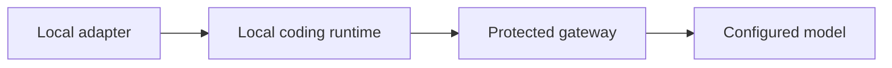

# Try a local coding turn

For the experimental sign-in and project commands, use the
[shared CLI entry point](../../docs/guide/cli-project-commands.md).
Manage your own provider keys with the [key commands](../../docs/guide/cli-provider-key-commands.md).

This experimental adapter connects OpenCode V2 **2.0.27** to an explicitly
configured protected gateway. It exercises the local coding loop while the
CLI sign-in and project-registration flows are being built. It does not select
the runtime for the release. No runtime binary is bundled or downloaded.



Use macOS or Linux, Python 3.9+, an independently installed exact runtime binary and a gateway
with an OpenAI-compatible API and tool-capable model. Obtain a test gateway
credential from the installation operator. This is a Keeplane gateway credential,
not a cloud provider key. Provider keys stay on the server.

From the repository root, run:

```sh
python3 components/cli/opencode_adapter.py \
  --runtime /absolute/path/to/opencode-v2 \
  --gateway https://keeplane.example/v1 \
  --model registered-coder \
  --directory /absolute/path/to/project \
  'Fix the failing addition test.'
```

Enter the gateway credential at the hidden prompt. Automation can supply
`KEEPLANE_GATEWAY_GRANT` through its secret environment; never type the value
into a command or commit it. HTTP is accepted only for a loopback test gateway.
This prototype accepts credentials made of letters, digits, `.`, `_`, `~` and `-`.

The adapter prints the runtime's JSON events when the turn ends. Review its edits and run the
project's tests. A denied request or native error exits unsuccessfully; a timeout
exits with 124; Ctrl+C exits with 130; SIGTERM during a turn exits with 143.
All three terminate the runtime's process
group and bound cleanup without waiting for inherited output pipes to close.
Children that create independent sessions are outside that cleanup boundary;
this prototype does not sandbox or terminate detached workloads.
SIGTERM during process creation is deferred until the adapter owns the child.
The version probe retains its separate ten-second limit. The prior SIGTERM handler
is restored when the CLI's coding invocation ends. SIGKILL cannot run cleanup.
`--timeout 600` gives a slow turn ten minutes. A failed turn can
leave edits, so inspect the diff before retrying. There is no direct-provider fallback.

Each turn uses a temporary profile and excludes existing runtime configuration,
credentials and extensions. On this pinned runtime, its project-configuration
isolation flag also suppresses repository `AGENTS.md` instructions. Existing
repository guidance is therefore not preserved by this prototype yet. The
[paired native control](../../tests/e2e/cli-child-hook-cases.md) records this
limit; enabling arbitrary project configuration is not an acceptable remedy.
The profile is removed when the invocation ends;
sessions cannot yet be resumed. Built-in tool permission prompts remain enabled.
This is not a sandbox or proof of project provenance. Login, authorized-model
discovery, native provider protocols, routing, migration and offline distribution
remain separate work.
