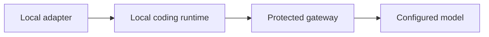

# Try a local coding turn

Install the `keeplane` command with the [wheel installation guide](../../docs/guide/cli-install.md).
For the experimental sign-in and project commands, use the
[shared CLI entry point](../../docs/guide/cli-project-commands.md).
Use [device sign-in](../../docs/guide/cli-device-login.md) when a browser cannot open here.
Manage your own provider keys with the [key commands](../../docs/guide/cli-provider-key-commands.md).
Run a turn and resume private history with the [signed-in coding command](../../docs/guide/cli-coding.md).

This experimental adapter connects OpenCode V2 **2.0.27** to an explicitly
configured protected gateway. The standalone command below exercises the coding
loop with an operator-supplied test credential. It does not select
the runtime for the release. No runtime binary is bundled or downloaded.



Use macOS or Linux, Python 3.9+, an independently installed exact runtime binary and a gateway
with an OpenAI-compatible API and tool-capable model. Obtain a test gateway
credential from the installation operator. This is a Keeplane gateway credential,
not a cloud provider key. Provider keys stay on the server.

From the repository root, run:

```sh
python3 components/cli/opencode_adapter.py \
  --runtime /absolute/path/to/opencode-v2 \
  --gateway https://keeplane.example/v1 \
  --model registered-coder \
  --directory /absolute/path/to/project \
  --instructions AGENTS.md \
  'Fix the failing addition test.'
```

Enter the gateway credential at the hidden prompt. Automation can supply
`KEEPLANE_GATEWAY_GRANT` through its secret environment; never type the value
into a command or commit it. HTTP is accepted only for a loopback test gateway.
This prototype accepts credentials made of letters, digits, `.`, `_`, `~` and `-`.

The adapter prints the runtime's JSON events when the turn ends. Review its edits and run the
project's tests. A denied request or native error exits unsuccessfully; a timeout
exits with 124; Ctrl+C exits with 130; SIGTERM during a turn exits with 143.
All three terminate the runtime's process
group and bound cleanup without waiting for inherited output pipes to close.
Children that create independent sessions are outside that cleanup boundary;
this prototype does not sandbox or terminate detached workloads.
SIGTERM during process creation is deferred until the adapter owns the child.
The version probe retains its separate ten-second limit. The prior SIGTERM handler
is restored when the CLI's coding invocation ends. SIGKILL cannot run cleanup.
`--timeout 600` gives a slow turn ten minutes. A failed turn can
leave edits, so inspect the diff before retrying. There is no direct-provider fallback.

Each turn uses a temporary profile and excludes existing runtime configuration,
credentials and extensions. `--instructions AGENTS.md` explicitly includes a
reviewed UTF-8 file directly in `--directory`; repeat the option for more files.
The adapter snapshots their bytes, labels them with SHA-256 hashes, and adds that
text through its own context hook for parent and child requests. A later turn
reads a fresh snapshot. Files are limited to 32 KiB each, 64 KiB total and eight
sources; symlinks, special files, duplicates and paths in other directories are
refused. The final encoded runtime configuration is capped at 120 KiB, including
JSON escaping. File contents are instructions, never executable configuration.

There is no automatic discovery: without `--instructions`, repository guidance
is still omitted. Ancestor and nested directory rules need a separate scoped
integration; this option does not flatten them into every request. Project
provider settings, plugins, hooks and credential stores remain excluded. The
[paired native control](../../tests/e2e/cli-child-hook-cases.md) explains why
enabling all project configuration would be unsafe.
The profile is removed when the invocation ends. To keep a completed session,
add `--state-dir /absolute/private/keeplane-session` outside the repository.
Its parent directory must already exist. Keeplane creates a private state
directory or accepts an empty private one; existing vendor profiles and databases
are refused. The runtime's JSON events contain the session ID. Repeat the same
command with `--session SESSION_ID` and the same state directory to continue it.
Supply a current gateway credential again; no saved credential authorizes resume.
Repeat `--instructions` to use the current reviewed text.

Only the runtime database is retained; HOME, configuration, caches and temporary
files remain disposable. State is bound to the canonical working directory,
gateway API, model and exact runtime version. Changed bindings, unsafe files or
stored runtime credentials are refused. One owned lock serializes its use.
Resume also requires an existing idle native session in that directory and model;
unknown IDs fail before provider contact. This check uses the pinned runtime's
database metadata because its native `--session` option can create a missing ID.
Server-account binding awaits the browser sign-in integration: this is local
OS-user history, not proof of a Keeplane account or project provenance.

To remove all saved history from that state while keeping its binding and lock:

```sh
python3 components/cli/session_state.py --discard /absolute/private/keeplane-session
```

The next invocation can start a new session. An active state cannot be reset.
Do not unlink its lock to bypass that check. If initial creation was interrupted
and the state is rejected, inspect the owned directory and choose a fresh one.
After an interrupted coding turn, review edits before continuing; this slice
proves completed text/tool turns, not safe replay of unfinished side effects or
attachments from discarded caches. Built-in tool permission prompts remain enabled.
This is not a sandbox or proof of project provenance. Login, authorized-model
discovery integration, native provider protocols, routing, migration apply and offline distribution
remain separate work.
