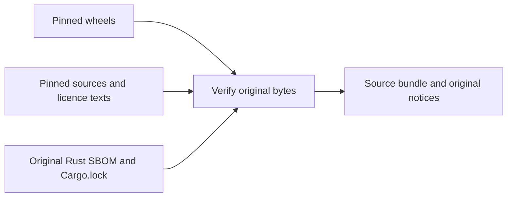

# Collect the optional sign-in trial's source and notices

With Python 3.11+ and the pinned Linux musl CPython 3.13 wheels from
`requirements-cli-auth.txt`, create a fresh directory outside the repository:

```sh
python3 components/control-plane/collect_cli_auth_sources.py \
  --wheel-cache /path/to/verified-wheels \
  --output /tmp/keeplane-cli-auth-sources
```

The command checks all 12 wheel hashes and 17 original notice files, then
downloads the exact published source distributions and supplemental licence
texts pinned in `cli-auth-trial.json`. It also preserves the cryptography wheel's
three original SBOMs and collects the OpenSSL 4.0.1 source URL/checksum declared
there. The OpenSSL and bundled Perl-template licence files are copied byte for
byte. It also collects all 32 registry crate archives named in the original
Rust SBOM, checks their hashes against the source distribution's `Cargo.lock`,
and preserves 62 original crate notice files. Python's built-in TOML reader
checks the lock and source manifests; no extra parser is installed. Archive
trees are never unpacked or executed. Nothing is installed.
`inventory.json` records verification failures; a failed artifact returns a
nonzero exit code. Network
collection shares the base-source collector's four-minute and size limits.
For offline use, add `--source-cache /path/to/files`, containing the pinned
archives and supplemental texts by filename. Output must be new; earlier
results are never replaced. Other wheel platforms and the existing Django/base
image dependencies need their own inventories.



Before redistribution, retain the source bundle and tell recipients how to
obtain the covered source. Preserve the original notices, keep `jwcrypto` independently replaceable,
and record any modifications. Its LGPL-3.0-or-later terms include GPL/LGPL
copies, modification and debugging rights, and the applicable combined-work
requirements. See [LGPL section 4](https://www.gnu.org/licenses/lgpl-3.0.html).
The bundle adds the missing GPL text without changing the wheel. `certifi`'s
MPL notice and source archive are retained, with the full MPL text; see
[MPL sections 3.1–3.4](https://www.mozilla.org/MPL/2.0/).

The OpenSSL source is bound to a checksum in the exact verified wheel's own
SBOM, rather than inferred from binary strings. The pinned publication record
identifies PyCA's wheel subject and publishing workflow commit; it is not an
independently verified reproducible-build attestation. Original SBOMs stay in
`build-records/`, with native source records and licence-copy counts in the report.
The collector does not verify Sigstore signatures or rebuild the wheel.

The Rust inventory preserves the SBOM's 27 `required` and five `excluded`
registry entries. Collecting an excluded entry does not claim it was linked
into the wheel. Seven workspace crates and the root crate remain in the
unmodified cryptography source archive. All 40 lock entries must match that
inventory. Downloads use the publisher's [Cargo registry](https://doc.rust-lang.org/cargo/reference/registry-index.html),
with the archive SHA256 checked against both original records.

Each crate's original Cargo manifest licence string is retained alongside its
SBOM declaration. Four use legacy `MIT/Apache-2.0` strings; the tool preserves
those and their original texts without interpreting a licence choice. This
includes Unicode-3.0 notices, the LLVM exception and both texts in dual-licensed
archives. Original Cargo.lock bytes are copied into `build-records/`.

The bundle also retains libffi 3.4.6 and its original `LICENSE` and
`LICENSE-BUILDTOOLS`, as named by CFFI 2.1.1's pinned Linux release workflow.
The workflow and archive hashes are checked, and the workflow must name the
exact source URL once. These records are marked **release-recipe-only**:
they document declared build inputs, without attesting that the verified CFFI
wheel was built from them. They stay separate from wheel-SBOM declarations.
The report never marks the wheel build attested or native inventory complete.

This is not a completed binary inventory. The cryptography wheel embeds Rust
code and includes `cryptography.libs/libgcc_s-0cd532bd.so.1`. Its original
auditwheel SBOM declares Alpine libgcc 14.2.0-r6, separately from the app base's
source inventory. Rust compiler/standard-library provenance, libgcc sources,
build patches and native build reproduction remain open. CFFI/libffi build
equivalence and charset-normalizer's compiled code also need exact artifact
review. Cryptography documents its
[static wheels](https://cryptography.io/en/48.0.1/installation/#static-wheels);
the [GCC exception](https://raw.githubusercontent.com/gcc-mirror/gcc/releases/gcc-14.2.0/COPYING.RUNTIME)
does not remove that inventory work. The report always marks native closure
incomplete. No default package or release choice changes here.
