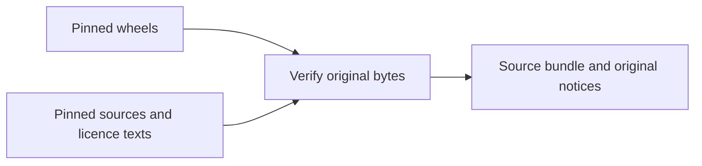

# Collect the optional sign-in trial's source and notices

With Python 3.10+ and the pinned Linux musl CPython 3.13 wheels from
`requirements-cli-auth.txt`, create a fresh directory outside the repository:

```sh
python3 components/control-plane/collect_cli_auth_sources.py \
  --wheel-cache /path/to/verified-wheels \
  --output /tmp/keeplane-cli-auth-sources
```

The command checks all 12 wheel hashes and 17 original notice files, then
downloads the exact published source distributions and supplemental licence
texts pinned in `cli-auth-trial.json`. It copies notice bytes unchanged and keeps
archives intact. Nothing is installed or extracted. `inventory.json` records
verification failures; a failed artifact returns a nonzero exit code. Network
collection shares the base-source collector's four-minute and size limits.
For offline use, add `--source-cache /path/to/files`, containing the pinned
archives and supplemental texts by filename. Output must be new; earlier
results are never replaced. Other wheel platforms and the existing Django/base
image dependencies need their own inventories.



Before redistribution, retain the source bundle and tell recipients how to
obtain the covered source. Preserve the original notices, keep `jwcrypto` independently replaceable,
and record any modifications. Its LGPL-3.0-or-later terms include GPL/LGPL
copies, modification and debugging rights, and the applicable combined-work
requirements. See [LGPL section 4](https://www.gnu.org/licenses/lgpl-3.0.html).
The bundle adds the missing GPL text without changing the wheel. `certifi`'s
MPL notice and source archive are retained, with the full MPL text; see
[MPL sections 3.1–3.4](https://www.mozilla.org/MPL/2.0/).

This is a Python-package source and notice bundle, not a completed binary
inventory. The cryptography wheel embeds OpenSSL and Rust code and includes
`cryptography.libs/libgcc_s-0cd532bd.so.1`. Its GCC 14.2.0 compiler metadata is
separate from the app base's source inventory. Exact native sources, build
patches, and third-party notices remain unverified; an embedded version string
does not prove that provenance. CFFI/libffi and charset-normalizer's compiled
code also need exact artifact review. Cryptography documents its
[static wheels](https://cryptography.io/en/48.0.1/installation/#static-wheels);
the [GCC exception](https://raw.githubusercontent.com/gcc-mirror/gcc/releases/gcc-14.2.0/COPYING.RUNTIME)
does not remove that inventory work. The report always marks native closure
incomplete. No default package or release choice changes here.
