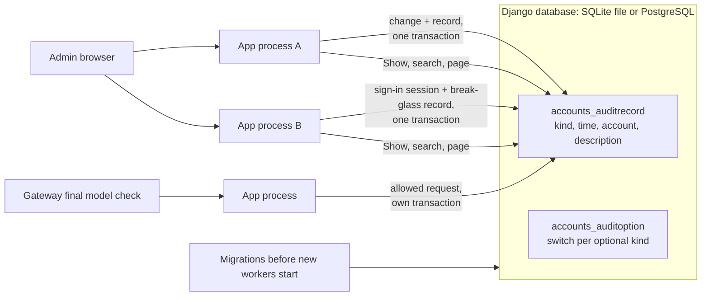

# Audit storage

Audit records live in the same Django database as accounts, sessions, model
approvals and data classes. That is the SQLite file in the local preview, or
PostgreSQL when `KEEPLANE_DATABASE_HOST` is set. Every app process reads and
writes that one database. There is no Audit cache, file or second store, so
every replica shows the same committed records, and they persist across restarts.

## Writing

- **Optional kinds** (settings changes, held-back requests, model answers) are
  written only while their switch in `accounts_auditoption` is on. Each record
  commits in the same transaction as the change it describes.
- **Settings changes** are written by the stores that make the change:
  `DjangoModelCatalog.approve` and `remove` for models,
  `DjangoModelCatalog.change_level` for complexity picks,
  `DjangoModelCatalog.set_persona_rule` for persona rules,
  `DjangoDataClassStore` for the class mode and each class, and
  `DjangoProjectClasses.assign` for a project's class. Each holds the
  settings row lock, then calls `DjangoAuditStore.record_in_transaction`
  before the transaction commits. A refused or unchanged request writes
  nothing. A failed record write raises and rolls the change back. A model
  change that also edits the gateway changes the gateway first. If the
  database write then fails, Keeplane tries to undo a new model or a key
  replacement in the gateway. A model already deleted from the gateway stays
  deleted while the request reports that storage is unavailable.
- **Model answers** are written by the final selected-model check,
  `POST /internal/runtime/installed/selected`, after every check has passed
  (owner decision in governance issue #36: a request sent is enough).
  `model_answer_records.record_sent_request` reads the switch, the developer's
  username and the project name from Keeplane's own tables and writes one
  record per allowed request, in its own transaction. The record's account is
  the developer whose session made the request; its description names the model
  and the project. The entry check and the experimental shared
  `/internal/runtime/authorize` callback write nothing, because the gateway
  may call them more than once for one request. Unlike settings changes, a
  failed write never refuses the request: it is rolled back, logged as a
  warning with only the error kind, and the decision is still returned. Each
  native retry passes the final check again and so writes its own record.
- **Break-glass sign-ins** are always written, in the same transaction as the
  session. If the record cannot be written, the sign-in fails.
- A record holds its kind, UTC time, account ID, username and a short
  description. It never holds passwords, session tokens, provider keys,
  prompts, answers or other request text.

## Finding records

`DjangoAuditStore.records(kind, search, page, page_size)` serves
`GET /api/audit/records`; the screen asks for 25 rows per page.

| Step | Behaviour |
| --- | --- |
| Show | `all` or one of the four kinds, including `break_glass_sign_ins`. Other values are refused. |
| Search | Case-insensitive literal text, up to 80 characters, matched in the username and description. `%` and `_` are plain characters. SQLite ignores case for ASCII letters only. |
| Order | Newest record number first. |
| Paging | Offset pages; the response gives `total` and `has_more`. A page past the end is empty. |

The `audit_kind_recent` index on (kind, newest first) serves Show. Search scans
the rows left after Show, because a substring match cannot use an ordinary
index. If a record arrives between two page requests, the later rows move down
one place, so a row can appear again on the next page.

## Upgrading

Schema changes are Django migrations, run once before new workers start (see
[PostgreSQL](../guide/postgres-accounts.md)). The tables keep their original
`accounts_` names: `audit.0001` takes them over from `accounts.0001` without
recreating or copying them. Records written under the earlier schema stay in
place and can be found by Show, search and paging after the upgrade.
`manage.py import_preview` copies records once from an untouched earlier preview
file and keeps their original times.

## What is not retained or provided

- Nothing deletes records automatically. There is no retention period and no
  delete or export action. Records stay until the database itself is removed.
- Turning a switch off stops new records of that kind; older ones stay visible.
- A database restore returns Audit to the backup's state, like accounts and
  policy. Back up the whole database as described in the PostgreSQL guide.
- Records are not sent to any external system.

## Tests

The [persistence cases](../../tests/integration/audit-persistence-cases.md) run
Show, search and paging across two app processes, after a restart and after an
upgrade, on SQLite and, when configured, PostgreSQL. The
[settings-change cases](../../tests/integration/settings-change-record-cases.md)
cover each model and data-class change, refused changes and failed record
writes on the same databases. The
[model-answer cases](../../tests/integration/model-answer-record-cases.md)
cover the switch, refused requests, failed writes, leaks and other developers'
records, with the producer also run on both databases. The
[browser cases](../../tests/browser/audit-cases.md) cover the screen.
