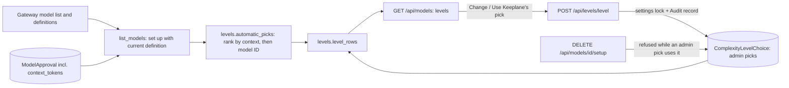

# Complexity levels

Keeplane stores only what an admin decides. Keeplane's own pick for each level
is worked out on every read from the models that are set up now, so it needs no
update when models change.

## Storage

- `ModelApproval.context_tokens` (nullable) holds the context window a local
  runner reported when Keeplane added the model. Edit and Set up keep it.
  Nothing else writes it, and the admin never enters it.
- `ComplexityLevelChoice` has one row per level an admin changed, holding the
  chosen model ID. No row means the level uses Keeplane's pick. Migration
  `model_registry.0007_complexity_levels` adds both.

## Picks

`model_registry.levels.automatic_picks` orders the set-up models by context
window (unknown counts as smallest), then by model ID. Simple takes the first,
Complex the last and Standard the lower middle. Candidates come from the same
listing Models and routing shows: a model must be listed by the gateway,
approved in Keeplane and bound to its current definition. Gateway-only models
are never candidates.

An admin pick is shown while its model is a candidate. Otherwise the level shows
Keeplane's pick and reports that the admin's model isn't set up now; the stored
choice is kept.

Project data classes are not applied to these organization-wide picks shown
in Models and routing. When a task names its level,
[task routing](task-routing.md) works the level's model out again from the
project's allowed models only and passes it through the same filter as
`DjangoModelChoice.next_allowed`, which applies setup, key availability and the
project's class.

## Changes and removal

`DjangoModelCatalog.change_level` validates the level and the model against the
current candidates, then, under the settings row lock, checks that the model's
approval still exists, writes or deletes the choice and adds the settings-change
Audit record in the same transaction. An unchanged request writes nothing.

`remove_model_setup` answers `409` with the admin-changed levels and
[persona rules](task-routing.md) that use the model before it contacts the
gateway. `DjangoModelCatalog.remove` checks again
under the same settings lock, so a level changed to the model during a removal
still stops it before the gateway is asked. Models that are only Keeplane's pick
are removed normally and the picks are worked out again on the next read.
