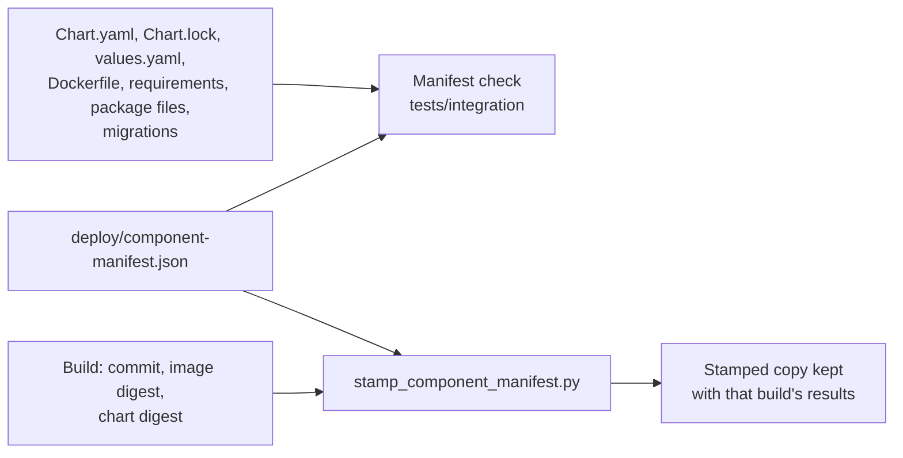

# Component manifest

[`deploy/component-manifest.json`](../../deploy/component-manifest.json) names
the components this repository builds and tests together: the Keeplane chart,
the app image, the gateway chart and image, package versions, database
migrations, default features and the customer-run gateway versions tested.
Release checks, install reviews and other builds can read it instead of
collecting versions from many files.

Keeplane has not been released. The manifest describes the current
pre-release set; it supports nothing yet.



## What it records

| Section | Contents |
| --- | --- |
| `build` | Keeplane commit, app image digest and chart package digest. Empty in Git; see below. |
| `chart` | Keeplane chart name, version and appVersion. |
| `app_image` | The chart's default app image, whether it is pinned, and its Python base image. |
| `gateway` | The gateway chart dependency, its archive hash and the image digest the chart uses. |
| `components` | Control-plane Python packages and optional extras, admin UI runtime dependencies, CLI package and coding runtime. |
| `api` | The declared HTTP API version. The `/api/...` paths have none yet. |
| `database_schema` | The latest migration for each Django app, and the PostgreSQL server versions supported. |
| `features` | Features on and off in a default chart install. |
| `existing_gateway` | Customer-run gateway versions supported and tested, and the version the preflight expects. |
| `upgrade_paths` | Tested upgrades. None until a version ships. |

### Current limits

- The gateway entry is the agentgateway **integration trial**
  (`"release_selected": false`). The release gateway has not been chosen.
- The app image is a local preview tag (`keeplane-preview:local`) and is marked
  `"pinned": false`. No registry image is published.
- Customer-run gateway support is empty. Agentgateway 1.6.0 has run only as a
  separately installed gateway in the local kind trial. The preflight accepts
  that one exact version.
- No PostgreSQL server version is declared supported. Tests use the fixture
  image in `deploy/local/stack.lock.json`.

`deploy/local/stack.lock.json` pins the local test environment (kind node, test
model, fixture images). The manifest describes what Keeplane installs. The
check makes sure the two agree where they overlap.

## Update it

Change the manifest in the same commit as the change it describes: chart or
dependency version, gateway image, Python or UI package, migration, chart
switch or tested gateway version. Then run:

```sh
.venv/bin/python -m pytest tests/integration/test_component_manifest.py
```

A failure names the check that no longer matches. Fix the manifest entry, or
the source file if the manifest was right. To get the gateway archive hash, run
`sha256sum deploy/helm/keeplane/charts/<archive>.tgz`.

Do not add a version to `supported_versions` until the full regression has
passed with it. The check refuses any supported gateway version while the
gateway entry is still a trial.

## Build-time fields

The commit, app image digest and chart package digest exist only after a build.
They stay `null` in Git. A build writes a filled copy and keeps it with its
results:

```sh
python3 deploy/stamp_component_manifest.py \
  --commit "$(git rev-parse HEAD)" \
  --app-image registry.example.test/keeplane@sha256:<digest> \
  --chart-digest sha256:<digest> \
  --output test-results/component-manifest.json
```

The script accepts only a full 40-character commit and `@sha256:` references,
not tags. It will not overwrite the committed manifest. It changes only the
`build` section; `app_image` keeps describing the chart's default reference,
so a stamped copy can still show `"pinned": false` for that default. `--chart-digest` is
optional until the chart is published as a package.

## What the check covers

[`tests/integration/test_component_manifest.py`](../../tests/integration/test_component_manifest.py)
reads the repository files directly; it needs no Docker, Helm or cluster.
The [cases](../../tests/integration/component-manifest-cases.md) list each
check. In short, it fails when:

- the chart name, version or appVersion, gateway dependency, `Chart.lock`
  digest, vendored archive or gateway image digest changes;
- the base image, Python version, pinned Python packages, optional PostgreSQL
  or sign-in packages, admin UI dependencies or CLI versions change;
- a Django app gets a new migration or more than one head;
- a versioned API path appears or a chart switch is added, removed or changes
  default;
- a gateway or PostgreSQL version is listed as supported before release, or
  build fields are committed filled in.

The check proves the manifest matches the source files. It does not prove the
component set works; the [regression suite](../guide/regression-local.md) does
that.
