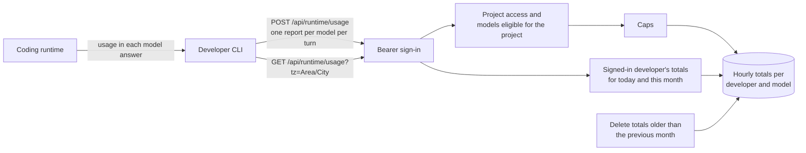

# Developer usage

The Django `usage` app keeps each developer's own token usage per model, so the
CLI can show today's and this month's totals (Spec 009 ST31, ADR 029). Open
Source has the whole feature; Enterprise adds nothing.



## Where the numbers come from

Token counts exist only in the model's answer, which passes through the gateway
to the developer's coding runtime. The control plane approves a request before
it is sent and never sees the answer. So after each turn the CLI sends one
report per model it used. A report that is lost (crash, offline) is not counted:
usage can undercount and is never billing evidence.

## Recording a report

`POST /api/runtime/usage` takes:

```json
{"project_id": "…", "model": "coder", "input_tokens": 1200,
 "output_tokens": 300, "requests": 3, "requests_without_usage": 0}
```

The server:

1. takes the developer from the CLI's bearer sign-in (the same
   `RuntimeSessionAuthentication` as the model catalog: a Django session or a
   CLI OAuth access token). Cookies, account IDs or role headers never
   authenticate, and any other field in the report, such as an account ID, a
   prompt or a path, is ignored and never stored;
2. checks that the developer may use the project and that the model is
   currently eligible for it, using the same project access and model policy as
   `GET /api/runtime/projects/{id}/models`. Otherwise it answers 403; if the
   policy can't be read, 503;
3. caps the numbers: at most 10,000 requests per report, requests without
   tokens at most the request count, and at most 10 million input and 10
   million output tokens per request that reported tokens. No hourly total grows
   past 10^15;
4. adds the report to the developer's total for that model and the current UTC
   hour, in one transaction. Two app copies adding to the same hour at once
   both count: a lost race to create the row adds to the winner's row.

A request whose answer reported no tokens counts as a request and in
`requests_without_usage`; its tokens are never guessed. The CLI can then say a
model's totals may be low.

A total holds only the account, the model ID, the hour and four counts. It keeps
no prompts, answers, project, repository path or time of a single request.
Removing an account removes its totals.

## Reading usage

`GET /api/runtime/usage?tz=Europe/Berlin` returns only the signed-in
developer's totals, per model, for today and this month in that time zone. With
no `tz`, UTC is used. An unknown zone, or any other query parameter, is refused
with 400: there is no parameter for another developer, and no admin route reads
these totals (D191).

```json
{"time_zone": "Europe/Berlin", "today": "2026-11-09", "month": "2026-11",
 "models": [{"model": "coder",
   "today": {"input_tokens": 2000, "output_tokens": 500, "requests": 7, "requests_without_usage": 1},
   "this_month": {"input_tokens": 9000, "output_tokens": 2100, "requests": 31, "requests_without_usage": 1}}]}
```

Models are listed by ID and only if used this month. Task 009-09 adds an
estimated cost to each period from the shipped price list; the counts stay as
they are.

An hourly total counts in the local day and month in which its UTC hour
starts. In a zone with a half-hour or 45-minute offset (India, Nepal, parts of
Australia) the day therefore turns at the first whole UTC hour after local
midnight: up to 45 minutes of usage just after midnight counts in the day
before.

## Retention

Totals older than the previous calendar month are deleted on every report and
every read. The cut-off is the start of the previous month at UTC+14, the zone
furthest ahead, so the previous month stays whole for every developer. Nobody
can change this, and there is no "last month" view.

[Cases DU-01 to DU-15 and DU-S1 to DU-S6](../../tests/integration/developer-usage-cases.md)
and [report rules](../../tests/unit/usage-totals-cases.md) cover this design.
