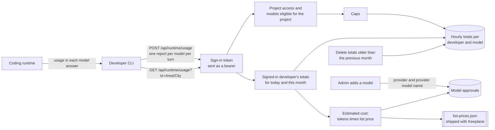

# Developer usage

The Django `usage` app keeps each developer's own token usage per model, so the
CLI can show today's and this month's totals and an estimated cost (Spec 009
ST31, ADR 029). Open Source has the whole feature; Enterprise adds nothing.



## Where the numbers come from

Token counts exist only in the model's answer, which passes through the gateway
to the developer's coding runtime. The control plane approves a request before
it is sent and never sees the answer. So after each turn the CLI sends one
report per model it used. A report that is lost (crash, offline) is not counted:
usage can undercount and is never billing evidence.

## Recording a report

`POST /api/runtime/usage` takes:

```json
{"project_id": "…", "model": "coder", "input_tokens": 1200,
 "output_tokens": 300, "requests": 3, "requests_without_usage": 0}
```

The server:

1. takes the developer from a Keeplane sign-in token sent as a bearer
   (`Authorization: Bearer`), checked the same way as for the model catalog.
   Cookies, account IDs or role headers never authenticate, and any other field in the report, such as an account ID, a
   prompt or a path, is ignored and never stored;
2. checks that the developer may use the project and that the model is
   currently eligible for it, using the same project access and model policy as
   `GET /api/runtime/projects/{id}/models`. Otherwise it answers 403; if the
   policy can't be read, 503;
3. caps the numbers: at most 10,000 requests per report, requests without
   tokens at most the request count, and at most 10 million input and 10
   million output tokens per request that reported tokens. No hourly total grows
   past 10^15;
4. adds the report to the developer's total for that model and the current UTC
   hour, in one transaction. Two app copies adding to the same hour at once
   both count: a lost race to create the row adds to the winner's row.

A request whose answer reported no tokens counts as a request and in
`requests_without_usage`; its tokens are never guessed. The CLI can then say a
model's totals may be low.

A total holds only the account, the model ID, the hour and four counts. It keeps
no prompts, answers, project, repository path or time of a single request.
Removing an account removes its totals.

## Reading usage

`GET /api/runtime/usage?tz=Europe/Berlin` returns only the signed-in
developer's totals, per model, for today and this month in that time zone. With
no `tz`, UTC is used. An unknown zone, or any other query parameter, is refused
with 400: there is no parameter for another developer, and no admin route reads
these totals (D191).

```json
{"time_zone": "Europe/Berlin", "today": "2026-11-09", "month": "2026-11",
 "price_list": {"date": "2026-11-09", "currency": "USD"},
 "models": [{"model": "coder", "cost_status": "estimate",
   "today": {"input_tokens": 2000, "output_tokens": 500, "requests": 7,
             "requests_without_usage": 1, "estimated_cost": "0.003500"},
   "this_month": {"input_tokens": 9000, "output_tokens": 2100, "requests": 31,
                  "requests_without_usage": 1, "estimated_cost": "0.015300"}}]}
```

Models are listed by ID and only if used this month. Each model's cost is
described under [estimated cost](#estimated-cost).

Totals are hourly, so a day or a month starts at the UTC hour nearest local
midnight, at most 30 minutes away. In a zone with a 45-minute offset the
nearest hour is clear: in Nepal (UTC+5:45) the day starts at 18:00 UTC, 15
minutes before midnight. In a zone with a half-hour offset (India, Newfoundland,
parts of Australia) both hours are 30 minutes away and the earlier one is used:
in India (UTC+5:30) the day starts at 18:00 UTC, so the last half hour before
midnight counts in the next day. Usage in that boundary hour shows in whichever
day is "today" when it is read.

## Retention

Totals older than the previous calendar month are deleted on every report and
every read. The zone furthest behind UTC (UTC-12) is the last to leave a month,
so the cut-off takes the current month there, steps back one month, and uses
that month's start at UTC+14, the zone furthest ahead. The previous month stays
whole for every developer: at 1 December 03:00 UTC it is still November in New
York, so all of October is kept. Nobody
can change this, and there is no "last month" view.

## Estimated cost

Cost is worked out when usage is read, never stored: tokens times the list price
of the provider's model, in US dollars. It is an estimate. Discounts, negotiated
prices and batch, cached-input, regional or fast-mode prices are never applied;
cached-input and reasoning tokens count as ordinary input and output tokens.
Requests that reported no tokens add nothing.

**Which models are priced.** When an admin adds a model, Keeplane records where
it runs on its approval:

- a model from a local runner (any local source) is recorded as `local`;
- a cloud model is recorded as `cloud` with its provider (`openai` or
  `anthropic`) and the provider's own model name, the upstream model ID the
  admin entered.

Each model in the answer has a `cost_status`:

| `cost_status` | When | `estimated_cost` |
| --- | --- | --- |
| `estimate` | A cloud model whose provider and model name exactly match a row in the price list. | A decimal string in US dollars, to a millionth of a dollar, rounded half up. |
| `local` | A model Keeplane added from a local runner. It is never priced, whatever its name. | `null` |
| `no_list_price` | A cloud model with no matching row, a model whose provider Keeplane didn't record (set up before Keeplane recorded it, or registered directly in the gateway), or a model whose approval has since been removed. | `null` |

Matching is exact on the recorded provider and model name: no letter-case
folding, prefixes or aliases. Only tokens counted from the UTC hour the
provider was recorded are priced, so if a removed local model's name is later
reused for a cloud model, the local model's earlier tokens are not priced.
Setting a model up again keeps what was recorded.

`price_list` names the list's date and currency, for the label the CLI shows
with every cost. If the shipped list can't be read (a release bug), usage still
answers with `price_list: null` and no model priced.

The price list is only as fresh as the installed Keeplane release. In the local
preview, OpenAI and Anthropic models answer from a local mock provider, but they
are still priced as the real provider's model, so DEV-04 can show a cost.

## Updating the price list

The list is
[`components/control-plane/model_registry/prices/list-prices.json`](../../components/control-plane/model_registry/prices/list-prices.json).
It ships with Keeplane; nothing is fetched at runtime and no third-party price
dataset is copied. Maintainers update it by hand:

1. Open each provider's own public pricing page:
   [OpenAI](https://developers.openai.com/api/docs/pricing) (Standard tier) and
   [Anthropic](https://platform.claude.com/docs/en/about-claude/pricing) (base
   input and output tokens).
2. For each row, copy the standard input and output price per million tokens as
   text (for example `"2.50"`), and set `checked` to today's date. Use the exact
   model name the provider's API takes, such as `gpt-4.1-mini` or
   `claude-sonnet-4-6`. Add a separate row for each name the provider documents
   for the same model (for example a dated ID and its alias).
3. Leave a model out if its price depends on the prompt's length (OpenAI's
   long-context flagship models, Claude Haiku 5.5) or if you can't confirm the
   price on the provider's page. It then shows "no list price", which is better
   than a wrong price.
4. Set the list's `date` to the oldest row's `checked` date. The label shows
   this date, so the list never looks fresher than its oldest price.
5. Run `.venv/bin/python -m pytest tests/unit/test_list_prices.py`; the loader
   refuses a list that breaks a rule (sources must be the provider's own https
   pages, one row per provider and model, prices as text with at most four
   decimals).

Each row holds `provider`, `model`, `input_per_million`, `output_per_million`,
`source` (the pricing page) and `checked`. Adding another provider also needs
Keeplane's cloud add flow to support it.

The [developer usage cases](../../tests/integration/developer-usage-cases.md)
(DU-01 to DU-18, DU-S1 to DU-S6 and DU-C1 to DU-C9), the
[report rules](../../tests/unit/usage-totals-cases.md) and the
[list-price rules](../../tests/unit/list-prices-cases.md) cover this design.
