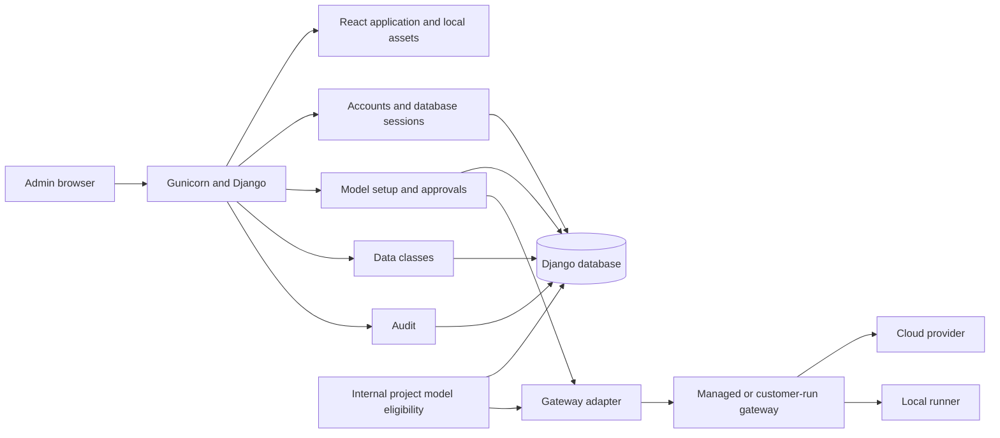

# Application architecture

Keeplane has one React admin application and one Django/DRF API served by
Gunicorn. The gateway registers models and carries model traffic. Django owns
accounts, approvals, data-class settings and Audit.

## Code layout

- `components/admin-ui/src/app/`: shell and API client.
- `components/admin-ui/src/features/`: screens and dialogs grouped by feature.
- `components/control-plane/config/`: Django settings, URLs and WSGI/ASGI entry points.
- `accounts/`, `model_registry/`, `data_classes/`, `audit/`: each area's models,
  migrations, services, views and URLs.
- `common/`: shared request protection, storage errors and application assembly.
- `integrations/`: gateway and runner adapters. HTTP views call use cases;
  adapters handle component-specific requests.

There is no second HTML application, custom HTTP server or custom SQLite store.
The adapter's provider transport stays in the adopted gateway.

## Storage and startup

The local Docker and kind installations use Django ORM with one SQLite database
per installation. PostgreSQL mode uses the same models and services, shared
sessions and transaction boundaries across application copies. SQLite mode
supports one application process; shared deployments require PostgreSQL.

The local launcher builds React, prepares private credentials, runs database
migrations in a separate startup service, imports existing local preview data
once, and starts Gunicorn. Kind uses an init container for the local database.
PostgreSQL deployments use the separate migration Job and restricted runtime role.
Serving workers do not migrate schemas.

The local app and gateway read `/gateway-config/local.yaml` from the same
read-only directory bind. Git can replace that file atomically without leaving
a container attached to an old file mount.

Readiness compares the database's migration history with the app's
known migrations. The graph is cached per worker; each probe makes one read
query. Pending migrations or unavailable storage keep the copy out of service,
while liveness stays independent so it can recover without restarting.

Existing preview account, approval, class and Audit files remain unchanged.
Their data is imported into the Django database; old sessions require a fresh
sign-in. Imported password hashes are upgraded by Django when a user signs in.
New accounts use Django's normal password hasher. The signing secret persists
across restarts and must be shared by PostgreSQL application copies.

## Browser and component boundaries

All administration APIs authenticate the current session and role on the server.
The infrastructure admin is configured outside the UI. Its successful sign-in
and mandatory Audit record commit together. Rotation revokes its old sessions.

Django CSRF checks protect anonymous sign-in and every browser mutation.
Sign-out requires POST. The browser receives a masked token from
`/api/auth-options`; the CSRF cookie is HttpOnly and SameSite Strict. The public
origin and HTTPS scheme come from deployment configuration, not client headers.

Only explicit application and asset routes are served. Gateway management,
provider credentials and databases remain internal. Model registration confirms
component readback; gateway calls and database commits are separate operations,
so partial failures and uncertain outcomes must remain visible.

## Project model eligibility

`model_registry.policy.DjangoModelPolicy` reads the stored project class, class
mode and model approvals on each query. It includes a model only while its
current gateway definition matches the approved definition. Class and approval
reads share the existing settings-writer lock; incomplete policy fails closed.
The caller must first authenticate the developer and authorize project access.
There is no runtime endpoint yet, and this query does not verify provider keys
or enforce the final routed destination. [Isolated cases](../../tests/integration/model-policy-cases.md) cover its behavior.

## Current limits

The admin application is reviewable. The developer CLI, smart routing,
project-class enforcement, final-destination authorization and complete Audit
producers remain unfinished. `/api/ask` is a development transport check.
A working local or Kubernetes trial does not establish production readiness
or select the release gateway.
