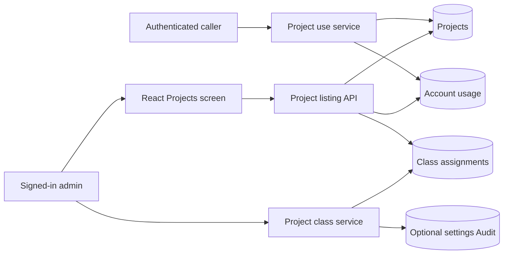

# Project usage records

The Django `projects` app stores a project's opaque ID, display name and use
times. A separate record links each account that has used it. A project can be
used before onboarding and without a data class.

`DjangoProjectStore.register_use(user_id, project_id, name)` is an internal
service. Its caller must supply the account established by authentication.
It rechecks that account, records first use atomically and updates later use
without renaming the project. Repeated requests with the same ID do not create
another project. A storage failure rolls back both project and usage writes.

Existing class assignments stay in `data_classes.ProjectClass`. Recording use
does not assign a class, authorize a model or establish the origin of content.
The project ID is requested context supplied by the caller.

`GET /api/projects` is an internal admin read. It searches project names and
returns stable, bounded pages with the accounts that used each project. It
reads class assignments only while classes are enabled. It never returns
passwords or sessions and never changes project policy. There is no onboarding
completion writer yet, so current first-use records report `initialized: false`.

`PUT /api/projects/{id}/class` accepts an explicit `class_id` or `null` to clear
it. The admin-only write uses the settings lock shared by class edits and policy
reads. It rejects unregistered projects, unknown classes and changes while
classes are off. A required settings Audit failure rolls back the assignment.
The request does not rename a project or alter model approvals.
An admin can read the same path with `GET` to check the current result after an
uncertain write response. Class fields are omitted while classes are off.

The React Projects screen uses the listing API for server-side search and
paging. It hides class columns while classes are off and keeps the table inside
a scrollable frame on narrow screens. CLI registration, project access checks
and the class dialog are separate changes.
