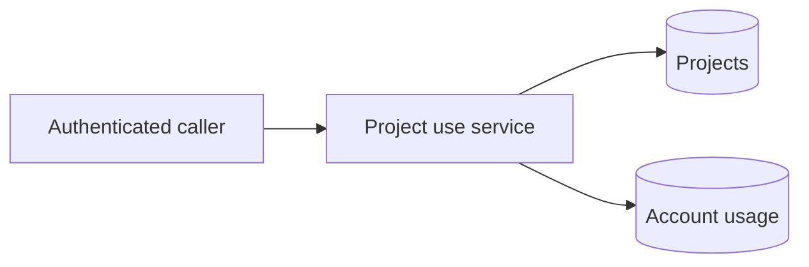
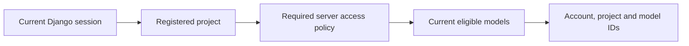

# Project usage records

The Django `projects` app stores a project's opaque ID, display name and use
times. A separate record links each account that has used it. A project can be
used before onboarding and without a data class.

`DjangoProjectStore.register_use(user_id, project_id, name)` is an internal
service. Its caller must supply the account established by authentication.
It rechecks that account, records first use atomically and updates later use
without renaming the project. Repeated requests with the same ID do not create
another project. A storage failure rolls back both project and usage writes.

Existing class assignments stay in `data_classes.ProjectClass`. Recording use
does not assign a class, authorize a model or establish the origin of content.
The project ID is requested context supplied by the caller.

This change adds storage only. CLI registration, project access checks, admin
listing and the Projects screen are separate changes.

## Internal model authorization

`DjangoModelAuthorization(identity, model_policy, project_access=...)` composes a
current Django session, a registered project and current model eligibility.
The required server access function receives canonical account and project IDs;
only an explicit `True` allows the check to continue. Project usage never grants
access, and admin status never bypasses model restrictions. A successful check
returns only the account, project and model IDs.

There is no HTTP authorization endpoint or credential issuer yet. Deployment
must still configure its project-access policy and enforce the decision at the
final gateway destination. [Isolated cases](../../tests/integration/model-authorization-cases.md) cover this composition.
