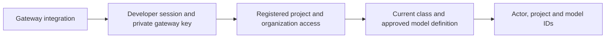
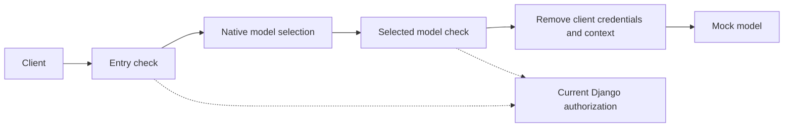
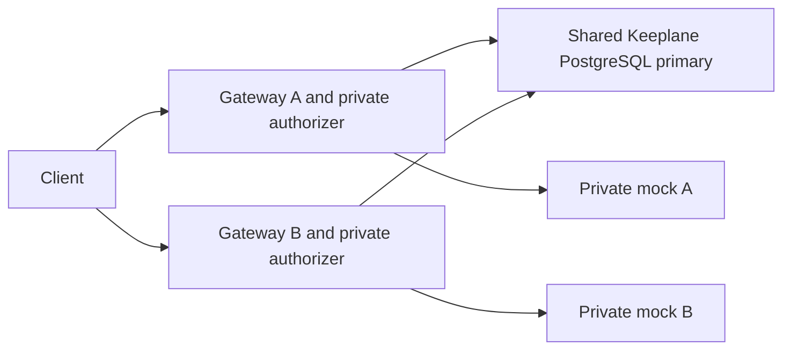
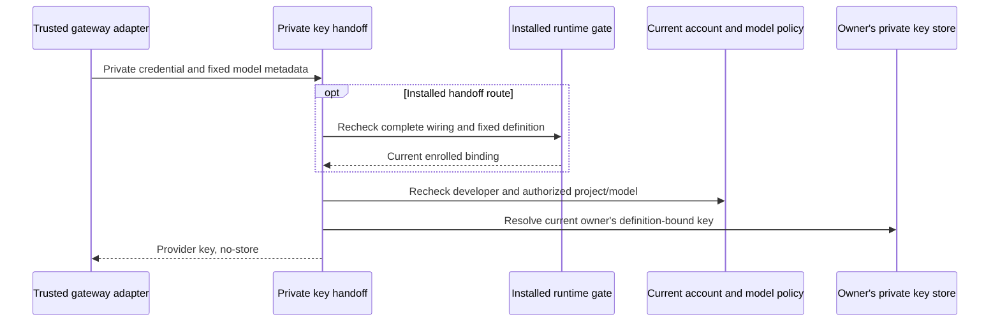

# Check a gateway policy decision

The experimental policy-decision endpoint checks current Keeplane records. It accepts
no prompt, forwards no model traffic and returns no provider key. Deployment and
inference-route wiring are separate work; this does not select a release gateway.

An operator must configure `RUNTIME_AUTHORIZER_KEY_FILE` with an absolute path to
a private file readable by the app account. Its content is a random URL-safe
secret of 32–256 ASCII characters; a trailing newline is allowed. Share it only
with the gateway integration, never with the developer CLI. Protect this route
with private networking and TLS when integrating it; no network isolation is
installed by this slice. Missing or invalid configuration stops authorization.

```text
POST /internal/runtime/authorize
Authorization: Bearer <developer session credential>
X-Keeplane-Gateway-Credential: <operator gateway credential>
Content-Type: application/json

{"project_id":"00000000-0000-0000-0000-000000000001","model_id":"coder"}
```

The body must contain exactly these two fields and fit within 4 KiB. Success
returns 200 with only `actor_id`, canonical `project_id` and `model_id`. The actor,
project access, class and current model setup come from the server. Active
organization accounts may use registered projects; usage is not an access grant,
and admins cannot bypass class or model restrictions. Cookies do not authenticate
this route. A current operator-supplied test session is required until browser
PKCE credential issuance is implemented.

| Status | Meaning |
| --- | --- |
| 200 | Current requested model is eligible for this actor and project |
| 400 / 413 / 415 | Invalid metadata, too much metadata or non-JSON content |
| 401 | Developer session is missing, invalid or withdrawn |
| 403 | Gateway credential, project access or model eligibility is denied |
| 503 | Operator credential, storage or current policy cannot be verified |

Responses are not cached. Replacing the key file withdraws the old gateway
credential on the next request. No credential, request body or key filename is
included in errors. Keep both credentials out of URLs and logs.

Before allowing a shared-key model, the callback also checks that its current
approved definition refers to a readable Keeplane-managed key inside the existing
`PROVIDER_KEY_DIR`. Missing, unreadable, malformed or changed definitions return
503. It reads no arbitrary resource-supplied file or symlink and returns no key.
Keyless models need no key directory. The catalog still describes setup/class
eligibility; it does not promise a usable provider key or healthy provider.
The check keeps storage's 12–512 character limit and accepted padding/UTF-8;
blank contents and control bytes that cannot form an HTTP credential are invalid.

This check prevents native last-known configuration from continuing after a
managed key file disappears. It does not verify that the provider still accepts
the key or implement rotation readback, customer key delivery, developer-owned
keys or encryption. Those remain separate work.



A successful decision checks the requested model only. Provider-key selection,
inspection, routing, fallback and final-destination enforcement still require a
protected gateway integration. A local project ID does not prove content origin.
[Isolated HTTP cases](../../tests/integration/runtime-callback-cases.md) cover
the two credentials, withdrawal, denied contexts, malformed metadata and outages.

## Try the native integration

The [disposable native check](../../tests/integration/native-runtime-authorization-cases.md)
connects this callback to the pinned gateway with real Django records and a mock
provider. Its sibling client carries only a test developer session. The gateway
adds its own file-backed credential and builds metadata from the requested
`X-Keeplane-Project-ID` and model. This header is an experimental requested context,
not proof of repository identity or a released CLI transport contract.

The fixture checks at entry and again for the selected native model backend. A
deliberate later rewrite to a denied model produces no provider call. Only the
guarded chat listener is reachable from the client network; raw model, management
and authorizer listeners bind to the gateway's private loopback namespace.
An existing configuration keeps its unrelated model intact.



The keyless fixture models remove developer authorization and Keeplane context
headers after their final check. Native forwarding keeps those headers by
default. A provider needing a key must instead receive its server-selected
credential without forwarding the developer session; production integration remains
separate work.

The shared-key variant verifies that native backend authentication replaces the
developer session with a synthetic server-held provider key after authorization.
It also confirms that missing or unreadable active keys stop provider contact.
Its bounded rotation diagnostic reports in-place replacement separately from a
new model revision and key-file reference, using match booleans only. A valid
local file alone does not attest the gateway's loaded value. Existing-mode fixture
mounts are explicit test setup, not an implemented customer key-delivery API.

The [actor-key check](../../tests/integration/native-actor-provider-key-cases.md)
tests per-request header injection from a trusted final callback. Its synthetic
server-only key map checks actor isolation and withdrawal; production personal-key
storage and selection remain separate work.

The [definition-generation check](../../tests/integration/native-definition-binding-cases.md)
stops a stale selected resource before key delivery, even when its model ID and
provider address match the current one. It depends on a controlled publisher
using a fresh generation for every complete definition; the native gateway does
not attest arbitrary definitions. Production publication remains separate work.

The [fallback generation check](../../tests/integration/native-fallback-definition-binding-cases.md)
uses a bounded map of current markers for two candidates. Each selected resource
checks its own marker before key delivery; a stale fallback cannot use the first
model's marker. This is a fixed disposable protocol, not production publication.

The [internal definition factory](../../tests/integration/definition-generation-factory-cases.md)
persists a fresh generation before building a guarded model candidate. It keeps
the approved raw fingerprint, generated envelope digest and complete global
wiring digest separate. Failed and retired generations remain recorded. This
factory writes no gateway configuration and enables no dispatch; native final
readback and approval/key validation remain required before integration.

The [internal publisher](../../tests/integration/definition-publication-cases.md)
can submit that candidate to explicitly declared, operator-controlled targets.
It requires trusted complete file and effective baselines before writing.
It retains failed/partial attempts and rereads every target after all writes,
recording each complete protected revision/fingerprint separately. This confirms
management desired state; it changes no approvals or keys and enables no traffic.

Native [external authorization](https://agentgateway.dev/docs/standalone/latest/documentation/configuration/security/external-authz/)
and [file-backed backend credentials](https://agentgateway.dev/docs/standalone/latest/documentation/configuration/security/backend-authn/key/)
provide the transport. These fixture checks do not install production isolation
or policy publication, cover every route/fallback/replica, or select a release
gateway. [The test cases](../../tests/integration/native-runtime-authorization-cases.md)
list prerequisites and the command.

The [fallback check](../../tests/integration/native-runtime-fallback-cases.md)
attaches selected-model checks to each candidate section of a fixed native
failover backend. A retry can reach the next provider only when its current
class, approval and shared key allow it. This is test wiring, not product routing
or production policy publication.

The [protocol check](../../tests/integration/native-runtime-protocol-cases.md)
checks SSE content and tool-call arguments through the same callback. A
tool-result request needs a fresh policy decision; withdrawing model approval
blocks the next valid request before provider contact. This does not execute tools
or cancel a response already in progress.

The [two-copy check](../../tests/integration/native-runtime-replica-cases.md)
uses one PostgreSQL primary for both authorizers. It checks withdrawal on each
serving path and isolates one copy's database link or authorizer without changing
the other copy. This remains a disposable Docker capability trial.



The [installed-runtime gate](../../tests/integration/installed-runtime-cases.md)
adds fresh operator enrollment to separate entry and selected-model callbacks.
It binds exact raw definitions, immutable shared-key files and complete file and
effective baselines without modifying model resources. It remains disabled by
default. [Managed installation](../guide/guarded-runtime.md) must verify applied
native guards before exposing and enabling the protected listener.

The internal managed installer now publishes only file-owned policy overlays;
raw API model values and approval fingerprints stay unchanged. It requires a
fresh gateway with an exact trusted JSON baseline, verifies complete applied
entry/final/provider wiring, and rechecks every enrollment before enabling the
manifest. Re-enrollment requires a new gateway process: native request routing
and backend policy reads do not share one lifetime snapshot. A failed final
filesystem publication reports an unconfirmed state and the launcher must stop
the gateway. The opt-in Compose launcher owns this workflow; its full host execution remains
unverified. Ordinary preview deployment remains unchanged.

The internal [per-model binding reader](../../tests/unit/runtime-binding-cases.md)
is a prerequisite for automatic model activation. It keeps complete shared
entry/private wiring and the selected model's provider, authentication and final
guards, while excluding only provably disjoint stable-ID model targets. This
lets a publisher distinguish an unrelated registry update from a change to the
model being used. Ambiguous or unsupported routing fails closed. The existing
installed gate still uses its complete snapshot; this reader enables no traffic.
The remaining integration must publish and verify each copy automatically when
an admin adds or edits a model, preserve other models' access, and withdraw stale
bindings before acknowledging stricter changes.

## Managed operator contract

An operator can configure `RUNTIME_GUARD_MANIFEST_FILE` as an absolute path to a
regular JSON file owned by root or the application user. The file must not be
writable by other users or groups. Use mode `0600`. The application reads it
again for every decision. A missing, disabled, malformed or changed declaration
stops the protected request.
A model or topology change stops access while declared and serving state differ.
Restoring identical declared and applied state can restore access. A different
definition or configuration needs operator re-enrollment and guard verification;
this first installation does not update enrollment automatically.

The declaration has exactly these fields:

| Field | Meaning |
| --- | --- |
| `version` | Integer `2`. Older declarations remain disabled. |
| `enabled` | Boolean `true` only after the installation has been verified. |
| `file_digest` | SHA-256 of the complete declared native file configuration. |
| `effective_digest` | SHA-256 of the complete declared effective configuration. |
| `applied_digest` | SHA-256 of the complete applied configuration, excluding only three per-request measurements. |
| `models` | At most 32 exact API-owned model IDs, each with the fields below. |

Each model has `fingerprint`, `key_choice`, `key_name` and `key_digest`.
The fingerprint includes the complete raw resource and its native revision.
`key_choice` is `none`, `shared` or `personal`. For `none` and `personal`, both key
fields are empty strings; a Personal enrollment never registers an owner's key.
For `shared`, the name is the existing managed `key-<32 lowercase hex>` basename;
the digest binds its exact file contents. No provider key value belongs in the
declaration. Configuration digests use UTF-8 JSON with sorted keys, no extra
spacing and no non-finite numbers.

Enrollment is trusted operator configuration. Model approval, developer input
and client headers cannot enroll a model. Only exact OpenAI, Anthropic and local
custom-completions definitions are supported here. Personal enrollment supports
only fixed HTTPS OpenAI/Anthropic definitions without provider authentication.
File-owned models, wildcard names and virtual or fallback aliases stay unavailable.
An enrolled raw model must have an explicit `id` equal to its API model ID.
Name-only models remain unavailable: their compiled backend names contain an
index that can change when unrelated models are added or removed.

Both callbacks also read the current applied configuration through an exact
operator-authenticated private route on port 4000. The read is limited to 1 MiB,
does not follow redirects and never uses developer credentials. It does not
expose the native admin listener to developers. The applied digest excludes only
`requestLatency`, `pendingRequests` and `totalRequests` inside the native AI
provider's endpoint measurement object. Health, eviction, capacity, provider
addresses, policies, creation times and unknown fields remain bound. Fields with
those measurement names elsewhere also remain bound.

Applied readback is a current snapshot, not a lock across inference. The pinned
gateway can read routing and selected-backend policy at different stages of a
request. Stable model IDs keep the file-owned final guard attached during normal
model updates; its constant definition fingerprint rejects a changed definition.
The installer must disable enrollment before changing those guard policies.
Arbitrary concurrent operator replacement of the guard file is outside this
fixed installation's supported boundary.

Shared keys use immutable filenames. Replace a key through model management,
which creates a new filename and resource revision, then enroll the new binding.
An in-place content change, missing file or symbolic link denies access. A file
read proves current content availability; it does not attest the credential
already loaded into a native serving process.

The installer disables enrollment throughout publication and verifies exact
compiled entry/final guards, private operator routes, stable model targets and
provider definitions before enabling. Desired management readback alone is
insufficient. If replacing the enabled manifest fails, it attempts to disable it;
if cleanup also fails, the access state is unconfirmed and the launcher stops the
gateway. Re-enrollment always starts a fresh gateway process.
Existing gateways, Kubernetes, replicas and release gateway selection remain
separate work.

Model setup also needs to test a provider before the model is approved. The
private `POST /internal/runtime/installed/operator-validation` callback preserves
that operator workflow. It requires both the current gateway runtime key as its
Bearer credential and the separate private callback key, plus the exact
`X-Keeplane-Installed-Runtime: operator` marker. Its body contains only `model_id`
and `definition_fingerprint`. Success returns `{"allowed": true}`; it does not
attest developer access, approval or enrollment. Developer credentials cannot
use it, and it never contacts a provider itself.
Approved Personal models are denied at this callback before native token exchange;
their administration check uses the separate keyless HTTPS provider probe.

The native installation overwrites the marker on both listeners
before authorization: `operator` on private port 4000 and `1` on protected port
5000. Every selected model still calls authorization. Its native CEL expression
chooses the callback path and constant metadata for that listener; a missing
marker must fail. Client headers cannot select operator validation on port 5000.
The protected route accepts only `POST /v1/chat/completions`. Outbound headers
are replaced after final authorization and native provider authentication:
keyless models retain only Content-Type; shared and Personal models retain their native
provider credential. Unknown Keeplane headers, cookies, developer credentials
and operator credentials never belong upstream. Native administrator tracing
can contain credentials; port 15000 stays on the gateway's loopback interface,
and only the exact authenticated applied-state route is proxied.

## Private Personal key handoff

`POST /internal/runtime/provider-token` is an internal adapter for the gateway's
native token exchange. It requires the current private gateway credential and a
bounded form containing the developer's explicit runtime credential, project,
fixed model and full definition fingerprint. Browser cookies do not authenticate
it. Current account/project/model policy and that owner's private key are checked
on every call; the response is never cached.

The provider key is returned only across this trusted server boundary. Keep the
callback credential and response away from developer clients, proxies that log
bodies and public gateway routes. The native transport must disable token caching.
This route does not attest installed routing or enroll models; it preserves the
separate private transport contract. See [the cases](../../tests/integration/personal-transport-cases.md).

The managed installer uses a separate `POST /internal/runtime/installed-provider-token`
route. It requires a fresh matching enrollment and full raw definition fingerprint
before the same current actor/project/model and owner-key checks. The per-model
native token exchange fixes the model/fingerprint and sends the requested project
and current developer credential. It runs before outbound header stripping and
does not recover an operator credential as a developer key.
The installer derives the protocol from the validated complete raw resource:
OpenAI receives injected Authorization, while Anthropic receives injected
`x-api-key` with an empty prefix. Only that native provider credential and
Content-Type survive the outbound replacement; the subject Bearer is removed.

The installed entry callback first checks that a Personal key is available for
the current owner and definition, returning metadata only. A missing key is denied
before native backend selection. The final private token exchange still resolves
the key afresh. The applied signature omits validated health scores and
consecutive-failure counts only inside active native EndpointInfo records,
alongside the existing request measurements. Normal provider errors can recover
on the next request. Endpoint membership, eviction deadlines/counts, capacity,
destinations, guards, authentication and unknown fields remain bound. Concurrent
withdrawal after entry can still fail at the final boundary; this is not an
in-flight availability guarantee.

This changes the applied signature calculation. Existing installations stay
denied until an operator starts a fresh gateway and reruns enrollment. No previous
signature is accepted automatically. The fixed installation still requires one
provider group, one active endpoint and no rejected endpoints for each model.

Token caching is explicitly disabled in the complete file/effective configuration.
The pinned native applied serializer omits that setting: readback verifies the
visible compiled transport, but cannot attest the cache itself. Fresh-process
enrollment and next-request replacement/withdrawal controls are required; no
in-flight revocation or safe hot policy replacement is claimed.


