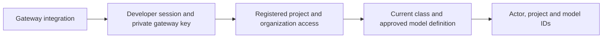
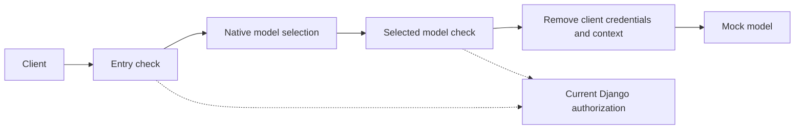
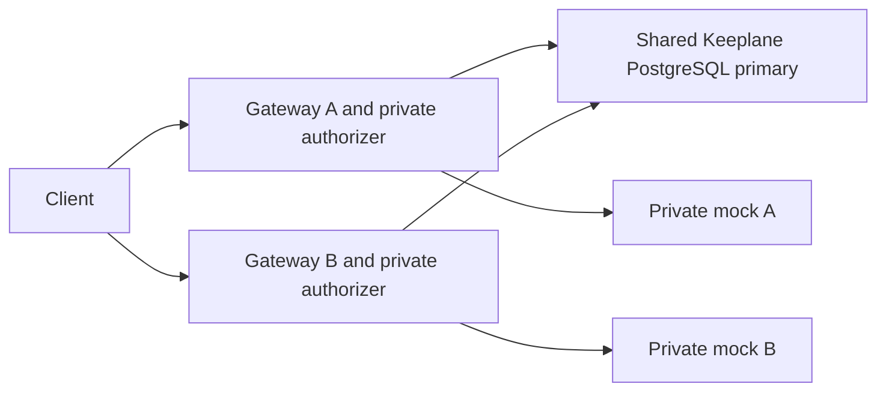

# Check a gateway policy decision

This experimental internal endpoint checks current Keeplane records. It accepts
no prompt, forwards no model traffic and returns no provider key. Deployment and
inference-route wiring are separate work; this does not select a release gateway.

An operator must configure `RUNTIME_AUTHORIZER_KEY_FILE` with an absolute path to
a private file readable by the app account. Its content is a random URL-safe
secret of 32–256 ASCII characters; a trailing newline is allowed. Share it only
with the gateway integration, never with the developer CLI. Protect this route
with private networking and TLS when integrating it; no network isolation is
installed by this slice. Missing or invalid configuration stops authorization.

```text
POST /internal/runtime/authorize
Authorization: Bearer <developer session credential>
X-Keeplane-Gateway-Credential: <operator gateway credential>
Content-Type: application/json

{"project_id":"00000000-0000-0000-0000-000000000001","model_id":"coder"}
```

The body must contain exactly these two fields and fit within 4 KiB. Success
returns 200 with only `actor_id`, canonical `project_id` and `model_id`. The actor,
project access, class and current model setup come from the server. Active
organization accounts may use registered projects; usage is not an access grant,
and admins cannot bypass class or model restrictions. Cookies do not authenticate
this route. A current operator-supplied test session is required until browser
PKCE credential issuance is implemented.

| Status | Meaning |
| --- | --- |
| 200 | Current requested model is eligible for this actor and project |
| 400 / 413 / 415 | Invalid metadata, too much metadata or non-JSON content |
| 401 | Developer session is missing, invalid or withdrawn |
| 403 | Gateway credential, project access or model eligibility is denied |
| 503 | Operator credential, storage or current policy cannot be verified |

Responses are not cached. Replacing the key file withdraws the old gateway
credential on the next request. No credential, request body or key filename is
included in errors. Keep both credentials out of URLs and logs.

Before allowing a shared-key model, the callback also checks that its current
approved definition refers to a readable Keeplane-managed key inside the existing
`PROVIDER_KEY_DIR`. Missing, unreadable, malformed or changed definitions return
503. It reads no arbitrary resource-supplied file or symlink and returns no key.
Keyless models need no key directory. The catalog still describes setup/class
eligibility; it does not promise a usable provider key or healthy provider.
The check keeps storage's 12–512 character limit and accepted padding/UTF-8;
blank contents and control bytes that cannot form an HTTP credential are invalid.

This check prevents native last-known configuration from continuing after a
managed key file disappears. It does not verify that the provider still accepts
the key or implement rotation readback, customer key delivery, developer-owned
keys or encryption. Those remain separate work.



A successful decision checks the requested model only. Provider-key selection,
inspection, routing, fallback and final-destination enforcement still require a
protected gateway integration. A local project ID does not prove content origin.
[Isolated HTTP cases](../../tests/integration/runtime-callback-cases.md) cover
the two credentials, withdrawal, denied contexts, malformed metadata and outages.

## Try the native integration

The [disposable native check](../../tests/integration/native-runtime-authorization-cases.md)
connects this callback to the pinned gateway with real Django records and a mock
provider. Its sibling client carries only a test developer session. The gateway
adds its own file-backed credential and builds metadata from the requested
`X-Keeplane-Project-ID` and model. This header is an experimental requested context,
not proof of repository identity or a released CLI transport contract.

The fixture checks at entry and again for the selected native model backend. A
deliberate later rewrite to a denied model produces no provider call. Only the
guarded chat listener is reachable from the client network; raw model, management
and authorizer listeners bind to the gateway's private loopback namespace.
An existing configuration keeps its unrelated model intact.



The keyless fixture models remove developer authorization and Keeplane context
headers after their final check. Native forwarding keeps those headers by
default. A provider needing a key must instead receive its server-selected
credential without forwarding the developer session; production integration remains
separate work.

The shared-key variant verifies that native backend authentication replaces the
developer session with a synthetic server-held provider key after authorization.
It also confirms that missing or unreadable active keys stop provider contact.
Its bounded rotation diagnostic reports in-place replacement separately from a
new model revision and key-file reference, using match booleans only. A valid
local file alone does not attest the gateway's loaded value. Existing-mode fixture
mounts are explicit test setup, not an implemented customer key-delivery API.

Native [external authorization](https://agentgateway.dev/docs/standalone/latest/documentation/configuration/security/external-authz/)
and [file-backed backend credentials](https://agentgateway.dev/docs/standalone/latest/documentation/configuration/security/backend-authn/key/)
provide the transport. These fixture checks do not install production isolation
or policy publication, cover every route/fallback/replica, or select a release
gateway. [The test cases](../../tests/integration/native-runtime-authorization-cases.md)
list prerequisites and the command.

The [fallback check](../../tests/integration/native-runtime-fallback-cases.md)
attaches selected-model checks to each candidate section of a fixed native
failover backend. A retry can reach the next provider only when its current
class, approval and shared key allow it. This is test wiring, not product routing
or production policy publication.

The [protocol check](../../tests/integration/native-runtime-protocol-cases.md)
checks SSE content and tool-call arguments through the same callback. A
tool-result request needs a fresh policy decision; withdrawing model approval
blocks the next valid request before provider contact. This does not execute tools
or cancel a response already in progress.

The [two-copy check](../../tests/integration/native-runtime-replica-cases.md)
uses one PostgreSQL primary for both authorizers. It checks withdrawal on each
serving path and isolates one copy's database link or authorizer without changing
the other copy. This remains a disposable Docker capability trial.


