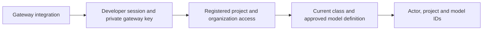
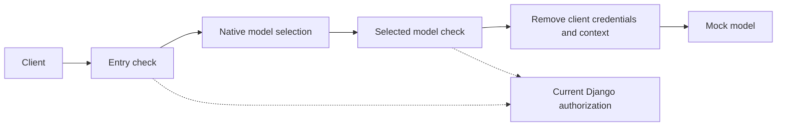
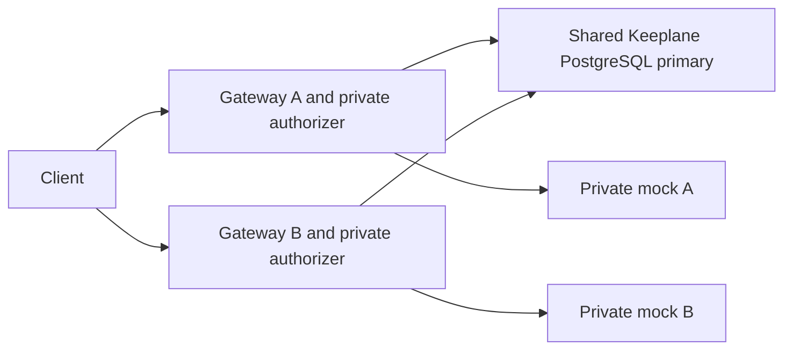
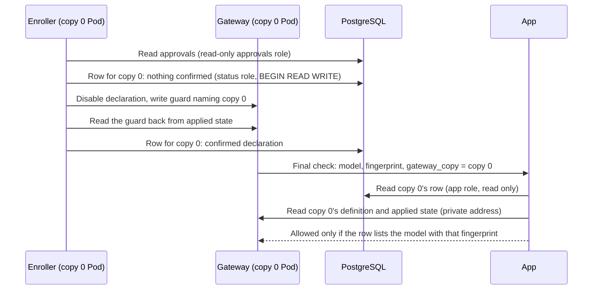
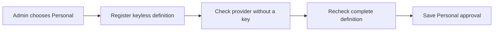
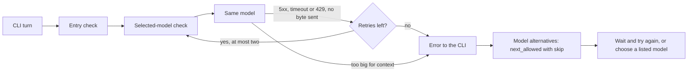
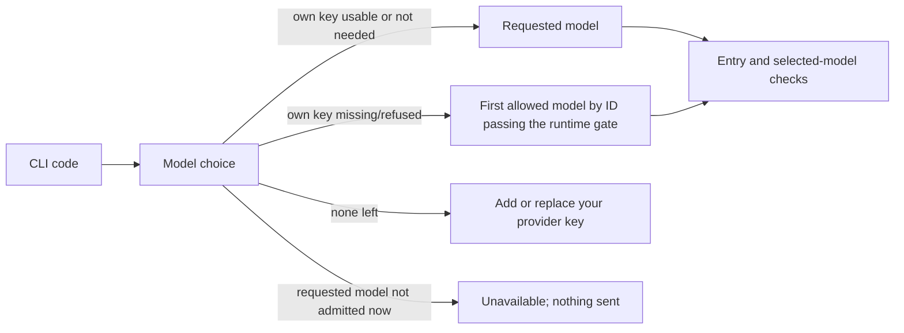
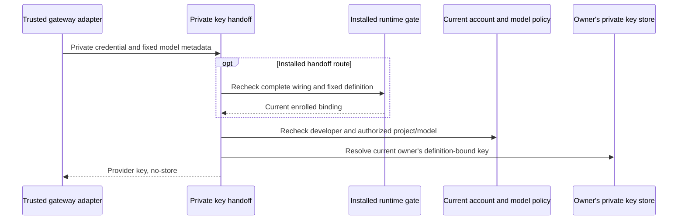
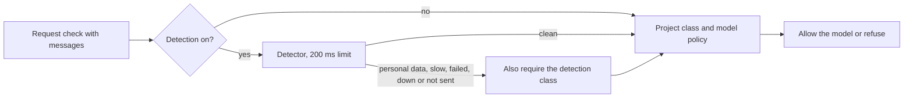

# Check a gateway policy decision

The experimental policy-decision endpoint checks current Keeplane records. It
forwards no model traffic and returns no provider key. It accepts the request's
`messages` only from an install set up for
[personal-data detection](#personal-data-detection), never stores or logs them,
and ignores them while detection is off. Deployment and
inference-route wiring are separate work; this does not select a release gateway.

An operator must configure `RUNTIME_AUTHORIZER_KEY_FILE` with an absolute path to
a private file readable by the app account. Its content is a random URL-safe
secret of 32–256 ASCII characters; a trailing newline is allowed. Share it only
with the gateway integration, never with the developer CLI. Protect this route
with private networking and TLS when integrating it; no network isolation is
installed by this slice. Missing or invalid configuration stops authorization.

```text
POST /internal/runtime/authorize
Authorization: Bearer <developer session credential>
X-Keeplane-Gateway-Credential: <operator gateway credential>
Content-Type: application/json

{"project_id":"00000000-0000-0000-0000-000000000001","model_id":"coder"}
```

The body must contain exactly these two fields, plus optionally the request's
`messages`. Metadata alone must fit within 4 KiB; with `messages` the body may
be up to 8 MiB (every other route keeps the app's 64 KiB request limit). Success
returns 200 with only `actor_id`, canonical `project_id` and `model_id`. The actor,
project access, class and current model setup come from the server. Active
organization accounts may use registered projects; usage is not an access grant,
and admins cannot bypass class or model restrictions. Cookies do not authenticate
this route. A current operator-supplied test session is required until browser
PKCE credential issuance is implemented.

| Status | Meaning |
| --- | --- |
| 200 | Current requested model is eligible for this actor and project |
| 400 / 413 / 415 | Invalid metadata, too much metadata or non-JSON content |
| 401 | Developer session is missing, invalid or withdrawn |
| 403 | Gateway credential, project access or model eligibility is denied |
| 503 | Operator credential, storage or current policy cannot be verified |

A customer-run (`existing`) gateway calls this check at its route and calls
`POST /internal/runtime/authorize/selected` on each model backend, after native
model selection. The final variant takes the same headers and the same two
fields and makes the same decision. When it allows the request and the Audit
**Model answers** switch is on, it writes one record (time, developer, project,
model) in its own transaction; a failed write is logged and the request is
still allowed. In customer-run mode the plain check, called once per request
at the route, writes the **Held-back requests** record: when detection holds
the request and that switch is on, one record (reference, time, developer,
project, class, reason and model, never request text), whether the model was
approved for the class or refused. The final variant runs again for every
backend attempt, so it writes a held-back record only when detection was
down, too slow or failed there, which the route check may not have met; such
a request can have two records, never none. A failed write is logged and the
decision stands. The plain check never writes a Model answers record. In managed mode the final variant returns 503
`Managed gateways use the installed runtime checks` before any decision: the
managed gateway records on its installed final check, so one request is never
recorded twice. The [model-answer cases](../../tests/integration/model-answer-record-cases.md)
cover both modes.

Responses are not cached. Replacing the key file withdraws the old gateway
credential on the next request. No credential, request body or key filename is
included in errors. Keep both credentials out of URLs and logs.

Before allowing a shared-key model, the callback also checks that its current
approved definition refers to a readable Keeplane-managed key inside the existing
`PROVIDER_KEY_DIR`. Missing, unreadable, malformed or changed definitions return
503. It reads no arbitrary resource-supplied file or symlink and returns no key.
Keyless models need no key directory. The catalog still describes setup/class
eligibility; it does not promise a usable provider key or healthy provider.
The check keeps storage's 12–512 character limit and accepted padding/UTF-8;
blank contents and control bytes that cannot form an HTTP credential are invalid.

This check prevents native last-known configuration from continuing after a
managed key file disappears. It does not verify that the provider still accepts
the key or implement rotation readback, customer key delivery, developer-owned
keys or encryption. Those remain separate work.



A successful decision checks the requested model only. Provider-key selection,
inspection, routing, fallback and final-destination enforcement still require a
protected gateway integration. A local project ID does not prove content origin.
[Isolated HTTP cases](../../tests/integration/runtime-callback-cases.md) cover
the two credentials, withdrawal, denied contexts, malformed metadata and outages.

## Try the native integration

The [disposable native check](../../tests/integration/native-runtime-authorization-cases.md)
connects this callback to the pinned gateway with real Django records and a mock
provider. Its sibling client carries only a test developer session. The gateway
adds its own file-backed credential and builds metadata from the requested
`X-Keeplane-Project-ID` and model. This header is an experimental requested context,
not proof of repository identity or a released CLI transport contract.

The fixture checks at entry and again for the selected native model backend. A
deliberate later rewrite to a denied model produces no provider call. Only the
guarded chat listener is reachable from the client network; raw model, management
and authorizer listeners bind to the gateway's private loopback namespace.
An existing configuration keeps its unrelated model intact.



The keyless fixture models remove developer authorization and Keeplane context
headers after their final check. Native forwarding keeps those headers by
default. A provider needing a key must instead receive its server-selected
credential without forwarding the developer session; production integration remains
separate work.

The shared-key variant verifies that native backend authentication replaces the
developer session with a synthetic server-held provider key after authorization.
It also confirms that missing or unreadable active keys stop provider contact.
Its bounded rotation diagnostic reports in-place replacement separately from a
new model revision and key-file reference, using match booleans only. A valid
local file alone does not attest the gateway's loaded value. Existing-mode fixture
mounts are explicit test setup, not an implemented customer key-delivery API.

The [actor-key check](../../tests/integration/native-actor-provider-key-cases.md)
tests per-request header injection from a trusted final callback. Its synthetic
server-only key map checks actor isolation and withdrawal; production personal-key
storage and selection remain separate work.

The [definition-generation check](../../tests/integration/native-definition-binding-cases.md)
stops a stale selected resource before key delivery, even when its model ID and
provider address match the current one. It depends on a controlled publisher
using a fresh generation for every complete definition; the native gateway does
not attest arbitrary definitions. Production publication remains separate work.

The [fallback generation check](../../tests/integration/native-fallback-definition-binding-cases.md)
uses a bounded map of current markers for two candidates. Each selected resource
checks its own marker before key delivery; a stale fallback cannot use the first
model's marker. This is a fixed disposable protocol, not production publication.

The [internal definition factory](../../tests/integration/definition-generation-factory-cases.md)
persists a fresh generation before building a guarded model candidate. It keeps
the approved raw fingerprint, generated envelope digest and complete global
wiring digest separate. Failed and retired generations remain recorded. This
factory writes no gateway configuration and enables no dispatch; native final
readback and approval/key validation remain required before integration.

The [internal publisher](../../tests/integration/definition-publication-cases.md)
can submit that candidate to explicitly declared, operator-controlled targets.
It requires trusted complete file and effective baselines before writing.
It retains failed/partial attempts and rereads every target after all writes,
recording each complete protected revision/fingerprint separately. This confirms
management desired state; it changes no approvals or keys and enables no traffic.

Native [external authorization](https://agentgateway.dev/docs/standalone/latest/documentation/configuration/security/external-authz/)
and [file-backed backend credentials](https://agentgateway.dev/docs/standalone/latest/documentation/configuration/security/backend-authn/key/)
provide the transport. These fixture checks do not install production isolation
or policy publication, cover every route/fallback/replica, or select a release
gateway. [The test cases](../../tests/integration/native-runtime-authorization-cases.md)
list prerequisites and the command.

The [fallback check](../../tests/integration/native-runtime-fallback-cases.md)
attaches selected-model checks to each candidate section of a fixed native
failover backend. A retry can reach the next provider only when its current
class, approval and shared key allow it. This is test wiring, not product routing
or production policy publication.

The [protocol check](../../tests/integration/native-runtime-protocol-cases.md)
checks SSE content and tool-call arguments through the same callback. A
tool-result request needs a fresh policy decision; withdrawing model approval
blocks the next valid request before provider contact. This does not execute tools
or cancel a response already in progress.

The [two-copy check](../../tests/integration/native-runtime-replica-cases.md)
uses one PostgreSQL primary for both authorizers. It checks withdrawal on each
serving path and isolates one copy's database link or authorizer without changing
the other copy. This remains a disposable Docker capability trial.



The [installed-runtime gate](../../tests/integration/installed-runtime-cases.md)
adds fresh operator enrollment to separate entry and selected-model callbacks.
It binds exact raw definitions, immutable shared-key files and complete file and
effective baselines without modifying model resources. It remains disabled by
default. [Managed installation](../guide/guarded-runtime.md) must verify applied
native guards before exposing and enabling the protected listener.

The internal managed installer now publishes only file-owned policy overlays;
raw API model values and approval fingerprints stay unchanged. It requires a
fresh gateway with an exact trusted JSON baseline, verifies complete applied
entry/final/provider wiring, and rechecks every enrollment before enabling the
manifest. Operator re-enrollment starts a new gateway process: native request routing
and backend policy reads do not share one lifetime snapshot. A failed final
filesystem publication reports an unconfirmed state and the launcher must stop
the gateway. The opt-in Compose launcher owns this workflow; its full host execution remains
unverified. Ordinary preview deployment remains unchanged.

The internal [per-model binding reader](../../tests/unit/runtime-binding-cases.md)
is a prerequisite for automatic model activation. It keeps complete shared
entry/private wiring and the selected model's provider, authentication and final
guards, while excluding only provably disjoint stable-ID model targets. This
lets a publisher distinguish an unrelated registry update from a change to the
model being used. Ambiguous or unsupported routing fails closed. The existing
installed gate still uses its complete snapshot; this reader enables no traffic.
Admin model changes now read the changed model back from every serving copy
listed in `GATEWAY_COPY_URLS` before they are acknowledged; see
[every gateway copy](model-registration.md#every-gateway-copy). A copy that
can't confirm leaves the change unapproved (or, for a removal, withdrawn and
reported), and other models are untouched. In the Docker preview, the private model enroller now re-enrolls from that
confirmed state without restarting the gateway (see
[the model enroller](#model-enroller)). For Kubernetes, each copy's enroller
records its confirmed guard in a database row that the app checks for the copy
that sends each protected check (see [per-copy guard status](#per-copy-guard-status)).
The Helm chart holds that enroller as a container beside every Kubernetes
gateway copy (`gateway.enroller`, see
[the chart's model enroller](../guide/kubernetes-installation-reference.md#model-enroller)),
but it doesn't yet install the protected runtime on the managed gateway, so
Helm refuses the enroller for now: it would have no guard to keep. The
remaining integration must install that runtime in Kubernetes, then lift the
refusal, and cover customer-run gateways that don't share one model store.

## Model enroller

`manage.py run_model_enroller` runs as its own service in the gateway's network
namespace. It has no listener and takes nothing from the app. Its database
connection is read-only (`KEEPLANE_DATABASE_READ_ONLY=1` opens SQLite with
`mode=ro` and makes every PostgreSQL transaction read-only; in PostgreSQL its
role must also be read-only). Every 2 seconds it:

1. works out the models to enroll: every saved approval whose fingerprint
   matches the gateway's current definition and passes the installer's checks.
   A model that fails them is left out (refused) without blocking the others;
2. does nothing when the enabled declaration already lists exactly those models
   and still verifies against the gateway;
3. holds the change for `HOLD_SECONDS` (196 seconds: three 60-second attempts,
   two 0.5-second backoffs and 15 seconds' margin) when it would change or
   remove the guard of a model that is being served, leaving the old guard and
   declaration in place. A request keeps its backend snapshot through its
   retries while it reads backend policy afresh, so replacing or removing a
   guard earlier could pair an old destination with the new guard, or leave it
   without a final check. The app refuses the changed model throughout, because
   its old guard's fingerprint no longer matches the saved approval. Adding a
   model changes no existing guard and is not held. If the record of served
   models (`served.json`) is unreadable, every change is held once;
4. otherwise disables the declaration, writes the new guard, reads it back from
   the applied state, and enables the declaration for exactly those models, as
   the installer does. With nothing to enroll it restores the trusted base and
   confirms the protected port has closed.

It shares the installer's private lock, so the two never write at once. A
failure leaves the declaration disabled and is retried on the next pass.

### Per-copy guard status

In Kubernetes each gateway copy is a StatefulSet Pod with its own private guard
volume, which the app never mounts. So each copy's enroller also records the
declaration it confirmed in the guard-status table
(`model_registry_gatewayguardstatus`), one row per copy, keyed by the Pod name.
A row holds whether the copy has a confirmed guard, the declaration itself
(the enrolled models with their definition fingerprints, key choices and the
file, effective and applied digests) and when it was confirmed. The Docker
preview keeps no row and the app reads the declaration file as before.

The enroller, configured with `KEEPLANE_GATEWAY_COPY` and a status connection
(`KEEPLANE_GUARD_STATUS_DATABASE_USER` and `..._PASSWORD_FILE`):

1. writes the copy name into every protected check of its guard (entry, final
   and Personal key exchange; not operator validation), as `gateway_copy`. A
   guard that names another copy, or none, is replaced;
2. before it disables the declaration to move the guard, records that nothing
   is confirmed. If that write fails, the guard isn't touched;
3. only after the new guard reads back and the declaration is enabled, records
   the new declaration as confirmed. An unchanged guard is recorded once, for
   example on the first pass after the operator's enrollment;
4. while a change is held, leaves the old confirmation in place: the app still
   refuses the changed model, because its fingerprint no longer matches;
5. once no model is left, or when a pass fails after it disabled or changed
   the guard (for example a readback that never completes), leaves nothing
   confirmed. A pass that fails before touching the guard, such as an
   unreadable gateway, keeps the last confirmation (ADR 027 "Failure"); the
   app still checks the copy's live state on every call.

Approvals are read on the read-only connection. The status write uses a
second connection, as a role whose only grant is on the status table and
whose row-level security admits only its own copy's row; its transactions are
read-only by default, and the write opens an explicit `BEGIN READ WRITE`. A
mistaken write on the approvals connection still fails. Installers create
these roles as in [the enroller's database roles](../guide/guard-status-roles.md).

In the Helm chart (`gateway.enroller`, refused until the chart installs the
protected runtime), the enroller is a second container in
each gateway copy Pod, with no port and no API token. Every copy shares one
Pod template, so an init container receives the installer's Secrets through
`secretKeyRef` and writes only this copy's credentials, picked by Pod name,
into an in-memory folder that only the enroller mounts: the approvals password,
this copy's status role and password, the two gateway keys, the database CA
and a random signing secret of its own. The guard is a Pod-local folder the
enroller writes and the gateway container reads; the app never mounts it. The
chart then sets `KEEPLANE_GUARD_STATUS_CHECK=1` on the app, and the migration
Job runs `configure_guard_status_access` for every copy.

With `KEEPLANE_GUARD_STATUS_CHECK=1`, the app's installed entry, final and
Personal key exchange checks require `gateway_copy` and then:

- find that copy's private address among `GATEWAY_COPY_URLS` (the first label
  of the host is the Pod name; exactly one must match);
- read the copy's row as the app role, which can only read the table. A
  missing, unconfirmed or malformed row refuses the call (503);
- apply every existing check to that declaration on that copy: the model must
  be listed (else 403), its fingerprint must match the saved approval, the
  copy's current definition and the fingerprint the final check carries, and
  the copy's file, effective and applied state must still match the recorded
  digests. A row that no longer matches its copy is refused.

Another copy's row never vouches for the sender. A model choice for the CLI,
made before any copy is known, picks a model only when every listed copy's
confirmed row lists it with the saved fingerprint; the serving copy still
checks it in full.



## Managed operator contract

An operator can configure `RUNTIME_GUARD_MANIFEST_FILE` as an absolute path to a
regular JSON file owned by root or the application user. The file must not be
writable by other users or groups. Use mode `0600`. The application reads it
again for every decision. A missing, disabled, malformed or changed declaration
stops the protected request.
A model or topology change stops access while declared and serving state differ.
Restoring identical declared and applied state can restore access. A different
definition needs re-enrollment and guard verification, which
the [model enroller](#model-enroller) does automatically in the Docker preview.
A gateway configuration change still needs operator re-enrollment.

The declaration has exactly these fields:

| Field | Meaning |
| --- | --- |
| `version` | Integer `2`. Older declarations remain disabled. |
| `enabled` | Boolean `true` only after the installation has been verified. |
| `file_digest` | SHA-256 of the complete declared native file configuration. |
| `effective_digest` | SHA-256 of the complete declared effective configuration. |
| `applied_digest` | SHA-256 of the complete applied configuration, excluding only three per-request measurements. |
| `models` | At most 32 exact API-owned model IDs, each with the fields below. |

Each model has `fingerprint`, `key_choice`, `key_name` and `key_digest`.
The fingerprint includes the complete raw resource and its native revision.
`key_choice` is `none`, `shared` or `personal`. For `none` and `personal`, both key
fields are empty strings; a Personal enrollment never registers an owner's key.
For `shared`, the name is the existing managed `key-<32 lowercase hex>` basename;
the digest binds its exact file contents. No provider key value belongs in the
declaration. Configuration digests use UTF-8 JSON with sorted keys, no extra
spacing and no non-finite numbers.

Enrollment is trusted operator configuration. Model approval, developer input
and client headers cannot enroll a model. Only exact OpenAI, Anthropic and local
custom-completions definitions are supported here. Personal enrollment supports
only fixed HTTPS OpenAI/Anthropic definitions without provider authentication.
File-owned models, wildcard names and virtual or fallback aliases stay unavailable.
An enrolled raw model must have an explicit `id` equal to its API model ID.
Name-only models remain unavailable: their compiled backend names contain an
index that can change when unrelated models are added or removed.

Both callbacks also read the current applied configuration through an exact
operator-authenticated private route on port 4000. The read is limited to 1 MiB,
does not follow redirects and never uses developer credentials. It does not
expose the native admin listener to developers. The applied digest excludes only
`requestLatency`, `pendingRequests` and `totalRequests` inside the native AI
provider's endpoint measurement object. Health, eviction, capacity, provider
addresses, policies, creation times and unknown fields remain bound. Fields with
those measurement names elsewhere also remain bound.

Applied readback is a current snapshot, not a lock across inference. The pinned
gateway can read routing and selected-backend policy at different stages of a
request. Stable model IDs keep the file-owned final guard attached during normal
model updates; its constant definition fingerprint rejects a changed definition.
The installer must disable enrollment before changing those guard policies.
Arbitrary concurrent operator replacement of the guard file is outside this
fixed installation's supported boundary.

Shared keys use immutable filenames. Replace a key through model management,
which creates a new filename and resource revision, then enroll the new binding.
An in-place content change, missing file or symbolic link denies access. A file
read proves current content availability; it does not attest the credential
already loaded into a native serving process.

The installer disables enrollment throughout publication and verifies exact
compiled entry/final guards, private operator routes, stable model targets and
provider definitions before enabling. Desired management readback alone is
insufficient. If replacing the enabled manifest fails, it attempts to disable it;
if cleanup also fails, the access state is unconfirmed and the launcher stops the
gateway. Operator re-enrollment always starts a fresh gateway process; the
model enroller replaces guards on a running one, holding changes as described above.
Existing gateways, Kubernetes, replicas and release gateway selection remain
separate work.

Model setup also needs to test a provider before the model is approved. The
private `POST /internal/runtime/installed/operator-validation` callback preserves
that operator workflow. It requires both the current gateway runtime key as its
Bearer credential and the separate private callback key, plus the exact
`X-Keeplane-Installed-Runtime: operator` marker. Its body contains only `model_id`
and `definition_fingerprint`. Success returns `{"allowed": true}`; it does not
attest developer access, approval or enrollment. Developer credentials cannot
use it, and it never contacts a provider itself.
Approved Personal models are denied at this callback before native token exchange;
their administration check uses the separate keyless HTTPS provider probe.

The native installation overwrites the marker on both listeners
before authorization: `operator` on private port 4000 and `1` on protected port
5000. Every selected model still calls authorization. Its native CEL expression
chooses the callback path and constant metadata for that listener; a missing
marker must fail. Client headers cannot select operator validation on port 5000.
The protected route accepts only `POST /v1/chat/completions`. Outbound headers
are replaced after final authorization and native provider authentication:
keyless models retain only Content-Type; shared and Personal models retain their native
provider credential. Unknown Keeplane headers, cookies, developer credentials
and operator credentials never belong upstream. Native administrator tracing
can contain credentials; port 15000 stays on the gateway's loopback interface,
and only the exact authenticated applied-state route is proxied.

## Private Personal key handoff

The admin [Personal setup API](../guide/personal-model-setup.md) registers a fixed
keyless cloud definition and checks provider reachability without borrowing a
developer key. Its approval binds the complete raw definition and revision;
developer-key validation remains a separate operation.



`POST /internal/runtime/provider-token` is an internal adapter for the gateway's
native token exchange. It requires the current private gateway credential and a
bounded form containing the developer's explicit runtime credential, project,
fixed model and full definition fingerprint. Browser cookies do not authenticate
it. Current account/project/model policy and that owner's private key are checked
on every call; the response is never cached.

The provider key is returned only across this trusted server boundary. Keep the
callback credential and response away from developer clients, proxies that log
bodies and public gateway routes. The native transport must disable token caching.
This route does not attest installed routing or enroll models; it preserves the
separate private transport contract. See [the cases](../../tests/integration/personal-transport-cases.md).

The managed installer uses a separate `POST /internal/runtime/installed-provider-token`
route. It requires a fresh matching enrollment and full raw definition fingerprint
before the same current actor/project/model and owner-key checks. The per-model
native token exchange fixes the model/fingerprint and sends the requested project
and current developer credential. It runs before outbound header stripping and
does not recover an operator credential as a developer key.
The installer derives the protocol from the validated complete raw resource:
OpenAI receives injected Authorization, while Anthropic receives injected
`x-api-key` with an empty prefix. Only that native provider credential and
Content-Type survive the outbound replacement; the subject Bearer is removed.

Before starting a coding turn, the CLI asks
`GET /api/runtime/projects/{project_id}/model-choice?model_id=ID` which model to
use. The server keeps the requested model unless it is Personal and the caller's
registration is missing, refused or bound to an earlier definition (the same rule
the key resolver applies). It then returns the first other eligible model, by ID,
that the current mode's gate admits: in managed mode the installed enrollment with
its shared key or the caller's usable registration; otherwise the shared-key
availability check, which never admits Personal models. Gateway-only models,
other classes and withdrawn setup are never returned. The response is
`{"project_id", "requested_model_id", "model_id", "reason"}` with `reason`
`null`, `missing`, `refused` or `outdated`, and `model_id: null` when nothing else
is allowed. A requested model that needs no own key (or whose own key is usable)
but that the mode's gate refuses now, such as one not installed or with its
shared key gone, returns `reason: "unavailable"` and `model_id: null`; nothing
moves to another model, and the CLI stops before sending (Spec 005 ST19). Older
CLIs treat that reason as an invalid choice and also stop. It reads registration metadata and the shared key file's digest only; it never
reads a developer's own key or sends any key, and is advice
rather than a permit: both gateway checks still run for the chosen model.

`GET /api/runtime/projects/{project_id}/task-model` takes an optional
`model_id` (the developer's switch), `persona` and `level`, and applies the
routing order of Spec 004 ST17 (D150): the developer's switch through
`DjangoModelChoice.choose`, then the persona rule's model, then the level's
model, then `next_allowed`. Each rule or level candidate passes the same filter
as `next_allowed` before it is returned; the CLI does not call it yet. Details
are in [task routing](task-routing.md).

`DjangoModelChoice.next_allowed(session, owner, project, skip=...)` is the one
candidate filter for every fallback: registered and set up with its current
definition, allowed for the project's class, admitted by the mode's runtime gate
including shared or own key availability, then rechecked for the developer and
project. A later fallback passes every model it has already tried as `skip`. The
missing-key choice is the only caller that moves a task. An
empty eligible set gives the CLI an empty catalog, and it stops before sending.

### A model that is down or too small

Owner decision of 31 October 2026 (Spec 004 ST16): Keeplane never switches the
model for an outage or a context-length refusal. The managed installer adds a
native route policy to the protected `keeplane-chat` route:

```json
{"retry": {"attempts": 2, "codes": [429, 500, 501, 502, "…", 599], "backoff": "500ms"},
 "timeout": {"backendRequestTimeout": "60s"}}
```

The native policy takes exact codes, so the installer lists 429 and every code
from 500 to 599 (101 codes). A provider that cannot be reached (connection
refused) never started the request, and the native gateway retries that too.

`attempts` counts retries after the first try, so a model is contacted at most
three times. Each retry goes to the same route backend and its native model
selection, and passes the selected-model check again before the provider is
contacted (ADR 018 final destination). The per-attempt timeout covers the time
up to the provider's response headers; it never cuts a stream that has started.
A status decides the retry before any byte reaches the client, so a stream that
has started is never retried. A context-length refusal is a 4xx other than 429
and is returned at once. The native gateway buffers a request body to retry it
and disables retries above its own size limit; such a request fails on its first
error. The installer's readback requires exactly one entry check, one retry and
one timeout on that route, and compares them with what it generated: the same
attempts, the same set of codes, the same backoff and the same per-attempt
timeout, with no other timeout set. It normalises only the native spelling:
codes as numbers, text or text with a reason phrase, and durations such as
`500ms`, `0.5s`, `1m0s` or seconds and nanoseconds. Anything else is refused.

After the retries, the CLI reads the runtime's error event. A remaining 429 or
5xx, or a context-length refusal, makes it ask
`GET /api/runtime/projects/{project_id}/model-alternatives?model_id=ID`. The
server authorizes the developer, project and requested model, then calls
`next_allowed` repeatedly, each time skipping every model already listed, so
the list uses the same filter as every fallback: at most 32 model IDs, never the
requested model, never a gateway-only model. The response is
`{"project_id", "model_id", "alternatives"}`; nothing is chosen or moved. The CLI
prints which model is unavailable or too small and the listed models for
`--model`. When the list is empty, a down model gets "… is unavailable right now
and no other model is allowed for this project. Wait and try again, or ask your
admin to set up another model." (governance issue #52), and a task too big for
its model gets "This task is too big for … context and no other model is allowed
for this project. Make the task smaller, or ask your admin to set up a model with
a larger context." (governance issue #57; [CLI coding guide](../guide/cli-coding.md)). Errors are 400, 401, 403 and 503
as for the model choice.



A stream that fails after its first byte returns the error and contacts no other
model ([protocol cases](../../tests/integration/native-runtime-protocol-cases.md),
[outage cases](../../tests/integration/native-runtime-outage-cases.md)). This
retry is installed only by the managed Docker runtime installer; the Kubernetes
chart does not yet install the protected listener. A customer-run gateway must
set the same route policy itself; see [gateway modes](../guide/gateway-configuration.md#retry-a-model-that-is-down).



The installed entry callback first checks that a Personal key is available for
the current owner and definition, returning metadata only. A missing key is denied
before native backend selection. The final private token exchange still resolves
the key afresh. The applied signature omits validated health scores and
consecutive-failure counts only inside active native EndpointInfo records,
alongside the existing request measurements. Normal provider errors can recover
on the next request. Endpoint membership, eviction deadlines/counts, capacity,
destinations, guards, authentication and unknown fields remain bound. Concurrent
withdrawal after entry can still fail at the final boundary; this is not an
in-flight availability guarantee.

This changes the applied signature calculation. Existing installations stay
denied until an operator starts a fresh gateway and reruns enrollment. No previous
signature is accepted automatically. The fixed installation still requires one
provider group, one active endpoint and no rejected endpoints for each model.

Token caching is explicitly disabled in the complete file/effective configuration.
The pinned native applied serializer omits that setting: readback verifies the
visible compiled transport, but cannot attest the cache itself. Fresh-process
enrollment and next-request replacement/withdrawal controls are required; no
in-flight revocation or safe hot policy replacement is claimed.



## Personal-data detection

Detection is off by default and applies only while data classes are on. When
an admin turns it on, both request checks (entry and selected model, in managed
and customer-run modes) inspect the request's `messages` before deciding.

The managed installer adds `messages` to its CEL check bodies only when the app
has `KEEPLANE_PERSONAL_DATA_DETECTION=1`. Without it, the installed gateway
configuration and every check body are exactly as before detection existed,
and the admin switch can't be turned on. The switch also needs the detector
and model to be installed. The expression is
`size(request.body) <= 1048576 ? json(request.body).messages : null`, so a body
over 1 MiB sends `null` and is held, never refused for its size. Whether the
pinned gateway can read `request.body` in the backend-targeted selected check
has not yet been verified against the native gateway; if it can't, the check
fails and, with `failureMode: deny`, every request on an install with this
setting is refused. Run the native runtime cases with the setting on before
using it.



A held request may use only models approved for the detection class **and**
for the project's own class, so detection never relaxes a project
restriction. The final model still passes every other check. A refusal says
`This request is handled as <class> and <model> isn't approved for it, so
nothing was sent. Run it with a model approved for <class>, or ask your admin
to approve one.`
The response body is unchanged: actor, project and model IDs only. The CLI's
model choice, alternatives and task routing never see a request, so they do
not apply detection; the gateway checks do.

The detector is Presidio Analyzer with the spaCy `en_core_web_lg` model,
followed by Keeplane's code-aware filter and card and phone rules
(`components/control-plane/personal_data/`). It runs in the app process on two
worker threads, loads in the background the first time a check needs it and
never downloads anything; `KEEPLANE_PERSONAL_DATA_MODEL` names an installed
model package or a model directory. Until it has loaded, if it cannot load,
raises an error, or cannot finish within 200 ms, the request is held. Long
requests are checked in overlapping pieces of about 2 000 characters, stopping
at the first piece with personal data; the code-aware filter and the card and
phone rules see the whole request. Requests longer than about 4 000 characters
often cannot finish in time and are held; over 100 000 characters they are held
without a check. Message fields Keeplane doesn't read (anything but role,
content text and refusal parts, name, refusal, tool calls, tool call IDs and
legacy function calls), image parts and malformed fields make the request
unreadable, so it is held. Detection runs before the policy transaction, so a slow check
does not hold the policy lock. A request that was not inspected because
detection read as off is held if detection is on by the time the policy is read.

Request text is never stored, logged, returned or sent anywhere else. A held
request reaches a no-op hook (`held_request` in `runtime_callback.py`) where
held-request Audit records will be written; nothing is recorded yet. Cases:
[detection rules](../../tests/unit/personal-data-detection-cases.md),
[routing](../../tests/integration/personal-data-routing-cases.md) and
[the model bar](../../tests/integration/personal-data-model-cases.md).
