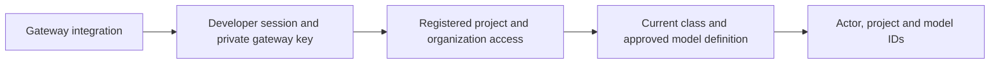

# Check a gateway policy decision

This experimental internal endpoint checks current Keeplane records. It accepts
no prompt, forwards no model traffic and returns no provider key. Deployment and
inference-route wiring are separate work; this does not select a release gateway.

An operator must configure `RUNTIME_AUTHORIZER_KEY_FILE` with an absolute path to
a private file readable by the app account. Its content is a random URL-safe
secret of 32–256 ASCII characters; a trailing newline is allowed. Share it only
with the gateway integration, never with the developer CLI. Protect this route
with private networking and TLS when integrating it; no network isolation is
installed by this slice. Missing or invalid configuration stops authorization.

```text
POST /internal/runtime/authorize
Authorization: Bearer <developer session credential>
X-Keeplane-Gateway-Credential: <operator gateway credential>
Content-Type: application/json

{"project_id":"00000000-0000-0000-0000-000000000001","model_id":"coder"}
```

The body must contain exactly these two fields and fit within 4 KiB. Success
returns 200 with only `actor_id`, canonical `project_id` and `model_id`. The actor,
project access, class and current model setup come from the server. Active
organization accounts may use registered projects; usage is not an access grant,
and admins cannot bypass class or model restrictions. Cookies do not authenticate
this route. A current operator-supplied test session is required until browser
PKCE credential issuance is implemented.

| Status | Meaning |
| --- | --- |
| 200 | Current requested model is eligible for this actor and project |
| 400 / 413 / 415 | Invalid metadata, too much metadata or non-JSON content |
| 401 | Developer session is missing, invalid or withdrawn |
| 403 | Gateway credential, project access or model eligibility is denied |
| 503 | Operator credential, storage or current policy cannot be verified |

Responses are not cached. Replacing the key file withdraws the old gateway
credential on the next request. No credential, request body or key filename is
included in errors. Keep both credentials out of URLs and logs.



A successful decision checks the requested model only. Provider-key selection,
inspection, routing, fallback and final-destination enforcement still require a
protected gateway integration. A local project ID does not prove content origin.
[Isolated HTTP cases](../../tests/integration/runtime-callback-cases.md) cover
the two credentials, withdrawal, denied contexts, malformed metadata and outages.
