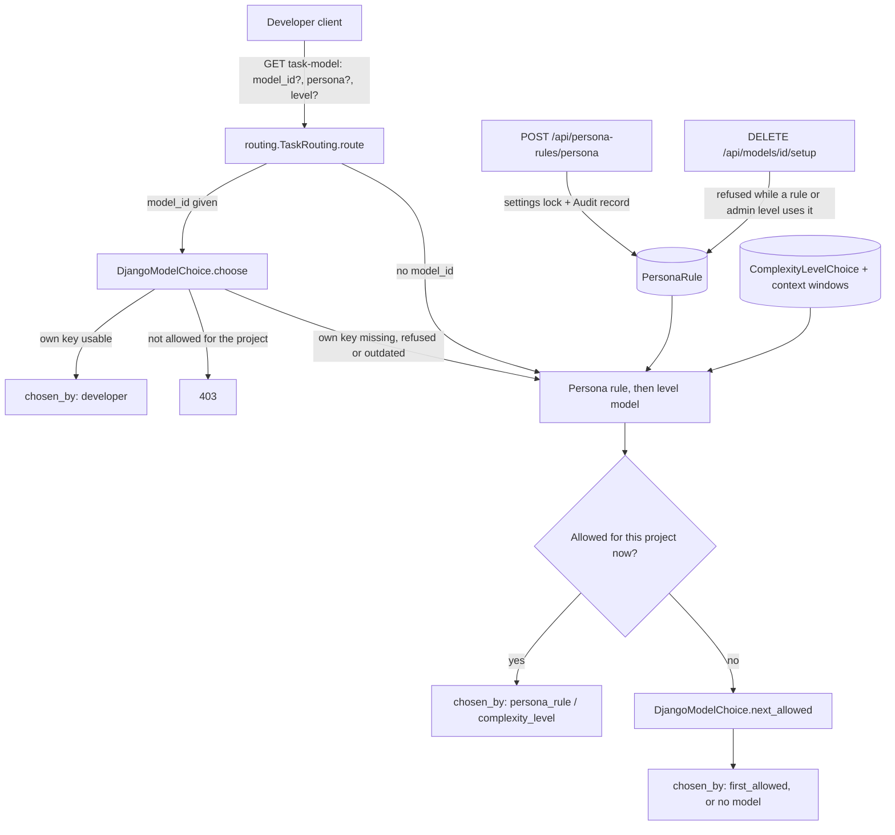

# Task routing: persona rules and precedence

Spec 004 ST15 and ST17 (D28, D106, D150). Keeplane stores only what an admin
decides: one `PersonaRule` row per persona that has a rule. Which model a task
goes to is worked out on every request from current policy; nothing is cached.

## Storage and admin API

- `PersonaRule(persona, model_id)`; `persona` is one of the predefined
  personas (`architect`, `developer`, `frontend`, D24). Migration
  `model_registry.0008_persona_rules` adds it.
- `GET /api/models` adds `persona_rules` (persona, name, model ID and whether
  that model is set up now) and `personas` (the choices for Add rule).
- `POST /api/persona-rules/<persona>` with `{"model_id": "<model>"}` adds or
  replaces the persona's rule; `{"model_id": null}` removes it (no screen uses
  this yet). It needs an admin and the admin-UI action header, accepts only
  models set up with their current gateway definition, and answers with the
  updated `persona_rules`.
- `DjangoModelCatalog.set_persona_rule` checks again under the settings row
  lock that the model's approval still exists, writes the rule and adds the
  settings-change Audit record in the same transaction. An unchanged request
  writes nothing.

## Removal guard

`DjangoModelCatalog.routing_uses` returns the admin-changed levels and the
persona rules that use a model. `remove_model_setup` answers `409` with both
lists (`in_use.levels`, `in_use.persona_rules`) before it contacts the gateway,
and `DjangoModelCatalog.remove` checks again under the settings lock, so a rule
added during a removal still stops it before the gateway is asked.

## Applying the precedence

`GET /api/runtime/projects/<project>/task-model` (developer runtime session,
not cached) calls `routing.TaskRouting.route`:

1. With `model_id`, the developer's switch goes through
   `DjangoModelChoice.choose` unchanged. A model the project may not use is
   refused with `403`; a model the runtime gate refuses for a reason other than
   the developer's own key gets no model, as before. When only the developer's
   own key is unusable, routing continues below without that model and keeps
   the reason.
2. The persona rule's model, then the level's model, are tried in that order.
   The level's model comes from `levels.level_rows` over the project's allowed
   models only: the admin's choice while the project may use it, otherwise
   Keeplane's pick among those models.
3. A candidate counts only if it is in `DjangoModelPolicy.eligible_model_ids`
   for the project (set up, current definition, project class), passes the
   mode's runtime gate (`DjangoModelChoice._usable`: installation, shared key
   or the developer's own key) and passes `DjangoModelAuthorization.authorize`.
   That is the same filter `next_allowed` uses for every fallback.
4. Otherwise `DjangoModelChoice.next_allowed` gives the first allowed model by
   model ID, or none.

The answer names the model, `chosen_by` and `reason`. It never names a rule's
model that the project may not use. It is advice for the client: the gateway's
entry and selected-model checks still decide every request. Locking a rule so
developers can't switch away from it is an Enterprise organization rule and is
not part of this edition.
