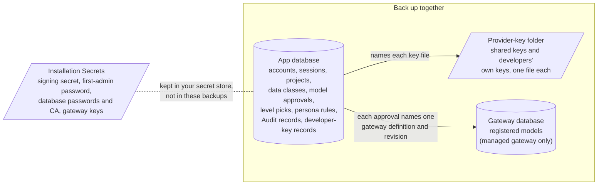

# Back up and restore Keeplane

This guide is for whoever installed Keeplane. It shows what to back up, how to
take a consistent backup, how to restore it into a fresh database, and how to
check the result before people sign in again. Keeplane doesn't schedule or
keep backups for you: run these steps from your own backup tooling and keep the
copies as you keep other secrets.

## What Keeplane keeps, and where

A complete backup has three parts, taken at the same time. The database alone
is not enough.



| Part | Docker preview | Kubernetes, SQLite trial | Kubernetes, PostgreSQL |
| --- | --- | --- | --- |
| App database | `/state/keeplane.sqlite3` in the `account-data` volume | `/state/keeplane.sqlite3` on the app's state volume | The database named in `app.postgres.database` |
| Provider-key folder | `/provider-keys` in the `provider-keys` volume | `/provider-keys` on the provider-key claim | `/provider-keys` on `app.postgres.providerKeysClaim` |
| Gateway database | `/data/agentgateway.db` in the `gateway-data` volume | The managed gateway's PostgreSQL | The managed gateway's PostgreSQL. A customer-run gateway is backed up by its owner |
| Signing secret | `/state/django-secret-key` (in the app database's volume) | `/state/django-secret-key` | `signing-secret` in `app.postgres.identitySecret` |
| Other credentials | The private credential folder printed at start (`.keeplane/local/`) | `gateway.keysSecret` and the trial's Secrets | `gateway.keysSecret`, `app.postgres.*Secret` |

In the Docker preview, the `account-data` volume is the Docker volume
`keeplane-accounts-trial_model-approvals`, and the others are
`keeplane-local_provider-keys` and `keeplane-local_gateway-data`. The app
container runs as UID 65532 and the gateway container as UID 65532 too: the
preview's `volume-init` step gives the gateway volume to that user before the
gateway starts. In the Kubernetes trial, the app's `/state` and
`/provider-keys` are the claims `<release>-state` and
`<release>-provider-keys`. The trial's signing secret is a file on the state
claim, not a Kubernetes Secret, so your secret store doesn't hold it unless you
copy it there ([step 5](#5-keep-the-secrets)).

What each part means for a restore:

- **Provider keys aren't encrypted.** Each key is a plain file readable only by
  the app's user (UID 65532, folder mode 0700, file mode 0600). There is no
  encryption key to keep, but the folder's backup holds every provider key in
  plain text: store it encrypted and as restricted as your Secrets. The app
  database holds only which file belongs to which developer and model, so a
  database restored without its key folder can't use those keys (Keeplane
  refuses them; it never uses a different one).
- **The signing secret protects sign-ins.** Restored with the same signing
  secret, browser sessions and CLI sign-ins from the backup keep working.
  With a different one, everyone is signed out; nothing else changes
  ([BR-06](../../tests/integration/backup-restore-cases.md)).
- **The first-admin password always comes from your installation's Secret**,
  not from the backup. When the app starts with a restored database, it sets the
  first admin's password to the configured one and ends that account's old
  sessions if they differ.
- **Model approvals belong to one gateway definition.** If the gateway database
  comes from a different time than the app database, a model whose definition
  changed shows as not set up and developers can't use it until an admin sets
  it up again ([BR-08](../../tests/integration/backup-restore-cases.md)). It
  fails closed, but back up both together to avoid it.

## Prerequisites

- Shell access to an app copy: `docker compose exec` into the preview's `app`
  service, or `kubectl exec` into the `app` container of
  `deploy/<release>-app`. Each check below is shown both ways: in the preview
  it's `python manage.py <command>` (the app's working folder is `/app`), in
  Kubernetes `python /app/manage.py <command>`.
- In Kubernetes, the permissions for each step: `kubectl exec` and `kubectl cp`
  (every check, the SQLite copies and the provider-key folder) need
  `pods/exec`, granted by the optional
  [operations Role](kubernetes-namespace-permissions.md#operations-role).
  Keeping and replacing Secrets, `kubectl scale`, `kubectl rollout restart` and
  `helm upgrade` need the
  [installer Role](kubernetes-namespace-permissions.md#installer-role). A
  restore uses both
  ([which Role each command needs](kubernetes-namespace-permissions.md#which-role-each-command-needs)).
- For PostgreSQL: `pg_dump` and `pg_restore` at least as new as the server, and
  the migration role's credentials (it owns the tables). The restricted app role
  can't make a complete dump.
- A private place for the backups: `umask 077`, outside Git, encrypted at rest.
- The same Keeplane version for the restore as for the backup, or a newer one.
  Keeplane refuses a backup from a newer version
  ([BR-10](../../tests/integration/backup-restore-cases.md)).

Set up once in the shell you'll use. For the Docker preview, stay at the
repository root: the Docker commands below run there and write into
`keeplane-backup/`.

```sh
# Docker preview: from the repository root
umask 077
mkdir -p keeplane-backup
```

Run Docker preview commands with the configuration file the launcher printed,
as in [Run locally](local-preview.md); the examples write `docker compose` for
short.

For Kubernetes, work inside the backup folder: the Kubernetes commands read and
write their files in the current folder.

```sh
# Kubernetes
umask 077
mkdir -p keeplane-backup && cd keeplane-backup
NS=<namespace>; RELEASE=<release>
```

## Take a backup

### 1. Save a report

Save what the database holds now, to compare after a restore:

```sh
# Docker preview
docker compose exec -T app python manage.py verify_restore > keeplane-backup/report.json
# Kubernetes
kubectl -n "$NS" exec deploy/"$RELEASE"-app -c app -- \
  python /app/manage.py verify_restore > report.json
```

`verify_restore` prints one JSON report and exits 1 if something needs fixing.
It counts accounts, sessions, CLI sign-ins, data classes, projects, approvals,
level picks, persona rules and Audit records, gives the newest Audit time, and
checks that every registered developer key file is readable. It never prints a
password, session key, provider key or key filename. Save `check_credentials`
too when a gateway is reachable: it lists the gateway's models and Keeplane's
approvals ([how to read it](postgres-accounts.md#before-and-after-every-rotation)).

```sh
# Docker preview
docker compose exec -T app python manage.py check_credentials > keeplane-backup/credentials.json
# Kubernetes
kubectl -n "$NS" exec deploy/"$RELEASE"-app -c app -- \
  python /app/manage.py check_credentials > credentials.json
```

Take the next steps back to back while no one is changing models, data
classes or accounts.

### 2. Back up the app database

**SQLite (Docker preview and Kubernetes SQLite trial).** Use SQLite's online
backup while Keeplane keeps running. Never copy `keeplane.sqlite3` with `cp`
or a volume snapshot while the app runs: a copy taken mid-write can be
corrupt.

```sh
# Docker preview
docker compose exec -T app python -c "import sqlite3,sys; s=sqlite3.connect('file:'+sys.argv[1]+'?mode=ro',uri=True); d=sqlite3.connect(sys.argv[2]); s.backup(d); d.close(); s.close()" /state/keeplane.sqlite3 /state/backup.sqlite3
docker compose cp app:/state/backup.sqlite3 keeplane-backup/keeplane-app.sqlite3
docker compose exec -T app rm /state/backup.sqlite3
```

```sh
# Kubernetes SQLite trial
POD=$(kubectl -n "$NS" get pod -l app="$RELEASE"-app -o name | head -n 1)
kubectl -n "$NS" exec "$POD" -c app -- python -c "import sqlite3,sys; s=sqlite3.connect('file:'+sys.argv[1]+'?mode=ro',uri=True); d=sqlite3.connect(sys.argv[2]); s.backup(d); d.close(); s.close()" /state/keeplane.sqlite3 /state/backup.sqlite3
kubectl -n "$NS" cp -c app "${POD#pod/}":/state/backup.sqlite3 keeplane-app.sqlite3
kubectl -n "$NS" exec "$POD" -c app -- rm /state/backup.sqlite3
```

**PostgreSQL.** `pg_dump` takes a consistent snapshot while the app keeps
serving. Run it as the migration role, with its password in a private
[password file](https://www.postgresql.org/docs/current/libpq-pgpass.html)
rather than on the command line:

```sh
PGSSLMODE=verify-full PGSSLROOTCERT=database-ca.crt \
pg_dump --format=custom --host <database host> --username keeplane_migrate \
  --dbname keeplane --file keeplane-app.dump
```

Expected result: the command exits 0 and `keeplane-app.dump` is not empty.

### 3. Back up the provider-key folder

```sh
# Docker preview
docker compose exec -T app tar -C /provider-keys -cf - . > keeplane-backup/provider-keys.tar
# Kubernetes (either mode)
kubectl -n "$NS" exec deploy/"$RELEASE"-app -c app -- \
  tar -C /provider-keys -cf - . > provider-keys.tar
```

### 4. Back up the gateway database

**Docker preview.** Copy the gateway's SQLite file with the same online backup,
using the preview's helper container that already mounts the gateway volume:

```sh
docker compose run --rm --no-deps -v "$PWD/keeplane-backup:/backup" volume-init \
  python -c "import sqlite3,sys; s=sqlite3.connect('file:'+sys.argv[1]+'?mode=ro',uri=True); d=sqlite3.connect(sys.argv[2]); s.backup(d); d.close(); s.close()" /data/agentgateway.db /backup/gateway.sqlite3
```

**Kubernetes managed gateway.** Dump the gateway's PostgreSQL database with
`pg_dump --format=custom` as above, using the gateway database's own role. The
[gateway database guide](gateway-database-secret.md) describes a dump and
restore of the kind trial's gateway database. A customer-run gateway isn't part of Keeplane's backup.

### 5. Keep the Secrets

Make sure your secret store holds the current signing secret, first-admin
password, database passwords, database CA and gateway keys. In PostgreSQL mode
the signing secret is already there, in `app.postgres.identitySecret`.

In the Docker preview and the Kubernetes trial, the signing secret is a file
next to the app database, so copy it out with the backup:

```sh
# Docker preview: also keep the credential folder (.keeplane/local/)
docker compose cp app:/state/django-secret-key keeplane-backup/django-secret-key
# Kubernetes SQLite trial
kubectl -n "$NS" exec deploy/"$RELEASE"-app -c app -- \
  cat /state/django-secret-key > django-secret-key
```

Expected result: the file is one line of at least 48 characters. It signs
every browser session and CLI sign-in, so keep it as privately as the
database backup.

If the signing secret is lost (it wasn't copied, or the volume holding it is
gone), the backup still restores: when none is there, a new signing secret is
made at start (by the launcher's volume step in the preview, by the app's init
container in the Kubernetes trial), and everyone signs in again. Browser sessions and CLI
sign-ins end; accounts, passwords, approvals and provider keys stay. This is
the same result as the sign-out after
[restoring an older backup](#after-restoring-an-older-backup).

## Restore

Restore into a fresh database. The old one stays untouched until you have
checked the restore, so you can go back to it.

### SQLite: Docker preview and Kubernetes trial

1. Start a fresh installation, or use the existing one. Its app database can
   be empty or in use: SQLite's online backup replaces all of it in one
   transaction.
2. Copy the backup in as the app's own user, then copy it over the app
   database:

   ```sh
   # Docker preview
   docker compose exec -T app python -c "import shutil,sys; shutil.copyfileobj(sys.stdin.buffer, open(sys.argv[1], 'xb'))" /state/incoming.sqlite3 < keeplane-backup/keeplane-app.sqlite3
   docker compose exec -T app python -c "import sqlite3,sys; s=sqlite3.connect('file:'+sys.argv[1]+'?mode=ro',uri=True); d=sqlite3.connect(sys.argv[2]); s.backup(d); d.close(); s.close()" /state/incoming.sqlite3 /state/keeplane.sqlite3
   docker compose exec -T app rm /state/incoming.sqlite3
   ```

   ```sh
   # Kubernetes SQLite trial, from the backup folder: reads keeplane-app.sqlite3 there
   POD=$(kubectl -n "$NS" get pod -l app="$RELEASE"-app -o name | head -n 1)
   kubectl -n "$NS" exec -i "$POD" -c app -- python -c "import shutil,sys; shutil.copyfileobj(sys.stdin.buffer, open(sys.argv[1], 'xb'))" /state/incoming.sqlite3 < keeplane-app.sqlite3
   kubectl -n "$NS" exec "$POD" -c app -- python -c "import sqlite3,sys; s=sqlite3.connect('file:'+sys.argv[1]+'?mode=ro',uri=True); d=sqlite3.connect(sys.argv[2]); s.backup(d); d.close(); s.close()" /state/incoming.sqlite3 /state/keeplane.sqlite3
   kubectl -n "$NS" exec "$POD" -c app -- rm /state/incoming.sqlite3
   ```
3. Restore the key folder over the existing one:

   ```sh
   docker compose exec -T app tar -C /provider-keys -xf - < keeplane-backup/provider-keys.tar
   # Kubernetes: kubectl -n "$NS" exec -i "$POD" -c app -- tar -C /provider-keys -xf - < provider-keys.tar
   ```

   Files added after the backup stay in the folder, but nothing refers to
   them. They still hold provider keys: delete them once the restore is
   checked, if your policy requires it.
4. To keep people signed in, restore the signing secret too. Skip this to
   sign everyone out instead; see
   [after restoring an older backup](#after-restoring-an-older-backup).

   ```sh
   # Docker preview
   docker compose exec -T app python -c "import pathlib,sys; pathlib.Path(sys.argv[1]).write_bytes(sys.stdin.buffer.read())" /state/django-secret-key < keeplane-backup/django-secret-key
   # Kubernetes SQLite trial, from the backup folder
   kubectl -n "$NS" exec -i "$POD" -c app -- python -c "import pathlib,sys; pathlib.Path(sys.argv[1]).write_bytes(sys.stdin.buffer.read())" /state/django-secret-key < django-secret-key
   ```

   Restoring into the same installation without this step keeps its current
   signing secret. If you didn't keep the backup's signing secret, skip this
   step: everyone signs in again, as described in
   [step 5 of the backup](#5-keep-the-secrets).

5. Bring the schema up to date and restart the app so it reloads everything.
   For the preview:

   ```sh
   docker compose exec -T app python manage.py migrate --noinput
   docker compose restart app
   ```

   For the Kubernetes trial, `kubectl -n "$NS" rollout restart deployment/"$RELEASE"-app`;
   its init container runs the migrations before the app starts.
6. Restore the gateway database if you backed it up. In the Docker preview,
   stop the gateway, copy the backup in with the same online backup as when
   you took it (the two paths swapped), and give the files back to the
   gateway's user. The helper
   container runs as root, so a file it writes belongs to root, and the
   gateway (UID 65532) can't open it; a new installation's empty volume is the
   usual case.

   ```sh
   # Docker preview
   docker compose stop gateway
   docker compose run --rm --no-deps -v "$PWD/keeplane-backup:/backup" volume-init \
     python -c "import sqlite3,sys; s=sqlite3.connect('file:'+sys.argv[1]+'?mode=ro',uri=True); d=sqlite3.connect(sys.argv[2]); s.backup(d); d.close(); s.close()" /backup/gateway.sqlite3 /data/agentgateway.db
   docker compose run --rm --no-deps volume-init chown -R 65532:65532 /data
   docker compose run --rm --no-deps volume-init ls -ln /data
   docker compose start gateway
   ```

   Expected result: `ls -ln` shows `65532 65532` as the owner of
   `agentgateway.db` and of any other file there, and
   `docker compose logs gateway` shows no database error after the start.

   In the Kubernetes trial the managed gateway keeps its models in
   PostgreSQL: restore it as in step 6 of the
   [PostgreSQL restore](#postgresql).

### PostgreSQL

1. Restore the provider-key folder while the app copies still run. This only
   adds the backup's key files back; it doesn't change or remove any file the
   current database uses. The app's init container repairs owners and modes
   when the copies next start.

   ```sh
   kubectl -n "$NS" exec -i deploy/"$RELEASE"-app -c app -- \
     tar -C /provider-keys -xf - < provider-keys.tar
   ```

2. Stop the app copies so nobody writes to the old database during the
   restore. This interrupts sign-in and model calls until step 5.

   ```sh
   kubectl -n "$NS" scale deployment/"$RELEASE"-app --replicas=0
   ```

3. Ask your database administrator to create a new, empty database owned by
   the migration role, with the same privileges as the original
   ([PostgreSQL privileges](postgres-accounts.md#install-the-chart-against-an-operated-database)):

   ```sql
   CREATE DATABASE keeplane_restored OWNER keeplane_migrate;
   REVOKE ALL ON DATABASE keeplane_restored FROM PUBLIC;
   GRANT CONNECT ON DATABASE keeplane_restored TO keeplane_app;
   ```

   These three lines are all the restore needs on PostgreSQL 15 and newer,
   where the new database's `public` schema belongs to its owner; the dump
   brings back the schema's grants and default privileges. On PostgreSQL 14
   and older, also run this while connected to `keeplane_restored`, or the
   restore stops when it reaches the schema's grants:

   ```sql
   ALTER SCHEMA public OWNER TO keeplane_migrate;
   ```

4. Restore as the migration role. The dump brings back the tables, their
   grants to the app role and the default privileges for new tables:

   ```sh
   pg_restore --exit-on-error --single-transaction --no-owner \
     --host <database host> --username keeplane_migrate \
     --dbname keeplane_restored keeplane-app.dump
   ```

   Use the same `PGSSLMODE` and `PGSSLROOTCERT` as for `pg_dump`. Expected
   result: the command exits 0. With `--single-transaction`, a
   failure leaves the new database empty; fix the cause, drop it and start
   again. Never restore into the database the app copies are using.

5. Point the release at the restored database and start the copies. Upgrade
   with your saved values, as in
   [Kubernetes](kubernetes-local.md#preserve-settings-when-upgrading-helm),
   adding `--set app.postgres.database=keeplane_restored`. The migration Job
   runs before the new copies start and brings an older backup up to date.
   If you run migrations yourself, run
   `python /app/manage.py migrate --noinput` with the migration role first.
6. Restore the gateway database the same way if you backed it up, using the
   gateway database's own role, then restart the managed gateway copies so
   they load it:

   ```sh
   kubectl -n "$NS" rollout restart statefulset/"$RELEASE"-gateway
   ```

## Check the restore

Before you let people back in:

```sh
# Docker preview
docker compose exec -T app python manage.py verify_restore > keeplane-backup/restored.json
docker compose exec -T app python manage.py check_credentials > keeplane-backup/restored-credentials.json
# Kubernetes
kubectl -n "$NS" exec deploy/"$RELEASE"-app -c app -- \
  python /app/manage.py verify_restore > restored.json
kubectl -n "$NS" exec deploy/"$RELEASE"-app -c app -- \
  python /app/manage.py check_credentials > restored-credentials.json
```

Expected result: both exit 0 and show `"passed": true`, and the `records`
counts in `restored.json` equal those in the `report.json` you saved with the
backup, apart from sessions that have expired since. `records.sessions.usable`
is the number of saved sessions that still work with the current signing
secret: 0 after a new or lost signing secret. Then compare the models and approvals:

```sh
# Docker preview
diff <(jq '{gateway_models, approvals}' keeplane-backup/credentials.json) \
     <(jq '{gateway_models, approvals}' keeplane-backup/restored-credentials.json) && echo unchanged
# Kubernetes
diff <(jq '{gateway_models, approvals}' credentials.json) \
     <(jq '{gateway_models, approvals}' restored-credentials.json) && echo unchanged
```

Finally sign in as an admin, open Models and check that the models you expect
are set up, and send one model call.

| `verify_restore` problem | What to do |
| --- | --- |
| Missing migrations this Keeplane version needs | The backup came from an older version. Run `migrate` (or the migration Job), then check again ([BR-09](../../tests/integration/backup-restore-cases.md)). |
| Migrations this Keeplane version doesn't know | The backup came from a newer version. Restore it with that version or newer. Don't serve from it. |
| Developer key files are missing | Restore the key folder from the same backup. Otherwise those developers add their key again; until then Keeplane refuses those keys. |
| Developer key files can't be read | Restore owner 65532, folder mode 0700 and file mode 0600. In Kubernetes, restarting the app runs the repair. In the Docker preview, restore the folder with the `docker compose exec` command above, which writes as the app's user. |
| Developer keys are registered but `PROVIDER_KEY_DIR` isn't set | Run the check in an app copy, where the folder is mounted. |
| Keeplane can't read the database | The app copy points at the wrong database or its password is refused; run `check_credentials`. |
| Every migration pending and nothing applied | The app copy points at an empty database, not the restored one ([BR-11](../../tests/integration/backup-restore-cases.md)). |

## After restoring an older backup

A restore returns everything to the moment of the backup. Every change made
since then is undone, including ones that took access away
([BR-05](../../tests/integration/backup-restore-cases.md)):

- a model that was removed, or narrowed to fewer data classes, is approved
  again, and developers can use it again wherever the gateway still has the
  same definition;
- an account that was removed or demoted is back with its old role;
- a browser session or CLI sign-in that ended (sign-out, removal, demotion)
  works again. A CLI sign-in can keep itself going by refreshing, so waiting
  doesn't end it: only a new signing secret (step 1 below) does;
- a developer key that was replaced or removed is back, if its file is;
- Audit records written after the backup are not in the restored database.
  Keep the old database (or a backup of it taken just before the restore) for
  as long as you must keep those records.

Unless the restore only moved the same data with nothing changed since the
backup, do all of these before reopening access:

1. **Sign everyone out** by giving the app a new signing secret. Accounts,
   passwords, approvals and keys stay. In PostgreSQL mode follow
   [rotate the signing secret](postgres-accounts.md#rotate-the-signing-secret).
   In the Docker preview or Kubernetes trial, write a new one and restart:

   ```sh
   # Docker preview
   docker compose exec -T app python -c "import pathlib,secrets; pathlib.Path('/state/django-secret-key').write_text(secrets.token_urlsafe(64) + '\n')"
   docker compose restart app
   # Kubernetes SQLite trial
   kubectl -n "$NS" exec deploy/"$RELEASE"-app -c app -- python -c "import pathlib,secrets; pathlib.Path('/state/django-secret-key').write_text(secrets.token_urlsafe(64) + '\n')"
   kubectl -n "$NS" rollout restart deployment/"$RELEASE"-app
   ```

2. **Recheck Users**: remove or demote again anyone whose access was taken
   away after the backup.
3. **Recheck Models and the gateway**: compare `check_credentials` with your
   most recent saved report, not only the one from the backup. Remove again or
   narrow again any model that was withdrawn after the backup, and check
   level picks and persona rules.
4. **Ask developers to check their keys**: a key replaced after the backup is
   back at its earlier value.

## What not to do

- Don't copy a live SQLite file or the PostgreSQL data folder; use the
  commands above.
- Don't restore the app database without the provider-key folder from the same
  backup, or the other way round.
- Don't restore into the database the app copies are using, or into an older
  Keeplane version.
- Don't let people back in before `verify_restore` passes and you have done the
  steps after an older backup.
- Don't keep backups in Git, in a shared folder or unencrypted: they hold
  password hashes, sessions, Audit records and provider keys in plain text.

## What is tested

The [backup and restore cases](../../tests/integration/backup-restore-cases.md)
fill a database through Keeplane itself, back it up and restore it with the
commands above on SQLite and on PostgreSQL with separate migration and app
roles, and check what survives, what a different signing secret or a missing
key folder does, and older and newer backups. The Docker preview and
Kubernetes wrappers (`docker compose`, `kubectl`, the migration Job) are not
run by those cases. The [guide command cases](../../tests/unit/backup-guide-cases.md)
check that every command here names a real preview service, chart resource,
mounted path and `manage.py` command, and that the gateway's user can write its
database after the restore step's `chown`. Backup scheduling, retention, point-in-time recovery and
database availability belong to your database operator; Keeplane doesn't
provide them.
