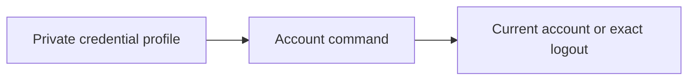

# Check or sign out a CLI account

This is the private credential storage part of the browser sign-in trial. The
login command is being added separately; the current checks use synthetic
credentials. Do not construct a profile by putting secrets in shell commands.

On macOS or Linux with Python 3.9+, an existing Keeplane credential profile can
check its current account or sign out:

```sh
python3 components/cli/account_session.py whoami --profile /private/keeplane-account
python3 components/cli/account_session.py logout --profile /private/keeplane-account
```

`whoami` reads the current account from Keeplane and requires the same account ID
saved at sign-in. Roles are read fresh. `logout` revokes that credential and its
paired refresh token, then removes the local credential. A confirmed 401 also
removes an already withdrawn credential. An outage or ambiguous response retains
it so you can retry. To remove only the local copy during recovery:

```sh
python3 components/cli/account_session.py forget --profile /private/keeplane-account
```

This last command does not revoke server access. Keep the profile outside Git
and runtime history. The parent directory must exist and be controlled by you.
The profile directory is owned by your OS user with mode 0700; its credential
and stable lock files use 0600. Writes are atomic and serialized. Symlinks,
hardlinks, special files, foreign files and unsafe permissions are refused.
An interrupted write may leave a pending file; inspect the private directory
and recover it before retrying. Do not remove the lock to bypass active use.



Credentials are stored as private plaintext, not encrypted or in an OS keychain.
The OS user and trusted processes running as that user can read them. Server
HTTPS is required except for loopback testing; redirects, ambient proxies and
cookies cannot carry the credential elsewhere. Transport uses a ten-second
socket timeout, not a total request deadline. No credentials are imported from
vendor profiles. The coding adapter still takes its separate gateway grant;
account-aware runtime integration and automatic refresh remain separate steps.
