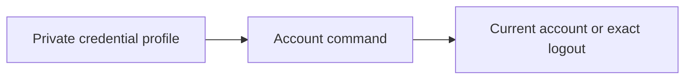

# Manage your CLI sign-in

This is the private credential storage part of the browser sign-in trial. Use
[browser sign-in](cli-browser-login.md) to create the profile; do not construct
one by putting secrets in shell commands.

On macOS or Linux with Python 3.9+, an existing Keeplane credential profile can
check its current account or sign out:

```sh
python3 components/cli/account_session.py whoami --profile /private/keeplane-account
python3 components/cli/account_session.py logout --profile /private/keeplane-account
```

To explicitly rotate a signed-in credential pair:

```sh
python3 components/cli/keeplane.py refresh --profile /private/keeplane-account
```

Refresh makes one exchange with the saved issuer and sign-in client, checks that
the new credential belongs to the same current account, then atomically replaces
the pair. It can refresh an expired access token while its refresh token remains
valid. There is no automatic retry or refresh during a coding turn. An uncertain
exchange retains the old local profile, but the server may already have rotated
it; recover with logout or operator withdrawal and sign in again. Do not blindly
retry a lost rotation response: the trial server withdraws the rotated family
when a previously used refresh token is replayed.

New profiles use format v2 and store only the fixed browser or device client ID.
Strict v1 profiles are read as browser-issued and upgrade on save. Device profiles
created before v2 need logout and a new device sign-in before refresh. Client IDs
and account IDs are metadata, not authority; the server rechecks the grant.

If account verification or saving fails after rotation, the CLI attempts to
revoke the new pair. A failed write before replacement preserves old local state;
a failed directory sync after replacement can leave the revoked new pair locally.
Unconfirmed cleanup requires server-side withdrawal. Cancellation or a crash can
also lose an exchange response; local storage cannot undo server issuance.

`whoami` reads the current account from Keeplane and requires the same account ID
saved at sign-in. Roles are read fresh. `logout` revokes that credential and its
paired refresh token, then removes the local credential. A confirmed 401 also
removes an already withdrawn credential. An outage or ambiguous response retains
it so you can retry. To remove only the local copy during recovery:

```sh
python3 components/cli/account_session.py forget --profile /private/keeplane-account
```

This last command does not revoke server access. Keep the profile outside Git
and runtime history. The parent directory must exist and be controlled by you.
The profile directory is owned by your OS user with mode 0700; its credential
and stable lock files use 0600. Writes are atomic and serialized. Symlinks,
hardlinks, special files, foreign files and unsafe permissions are refused.
An interrupted write may leave a pending file; inspect the private directory
and recover it before retrying. Do not remove the lock to bypass active use.



Credentials are stored as private plaintext, not encrypted or in an OS keychain.
The OS user and trusted processes running as that user can read them. Server
HTTPS is required except for loopback testing; redirects, ambient proxies and
cookies cannot carry the credential elsewhere. Transport uses a ten-second
socket timeout, not a total request deadline. No credentials are imported from
vendor profiles. The [signed-in coding command](cli-coding.md) uses this account
profile and checks current authorization. The standalone adapter's test grant
remains separate. Automatic refresh is not implemented.
