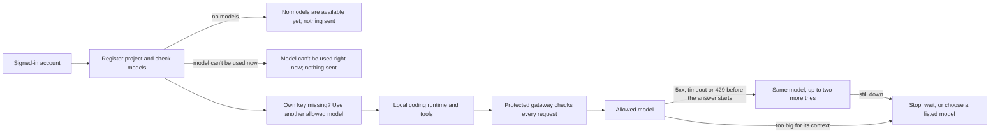

# Code with a signed-in account

Install the [CLI wheel](cli-install.md), then use your signed-in account for a
local coding turn. This trial requires macOS or Linux, Python 3.9+, the external
OpenCode V2 2.0.27 binary, and an operator-installed protected trial gateway.
The ordinary gateway listener is insufficient: the protected listener rechecks
Keeplane identity, project and model policy on every model request. The
[installed journey](../../tests/e2e/installed-cli-cases.md) covers this flow with
a shared-key model; personal-key coding is not enabled here.

First [sign in](cli-browser-login.md). Then choose a model from
`keeplane models --profile PROFILE --project PROJECT_ID` for a registered
project, or ask the installation operator which model to use on first use.

```sh
keeplane code \
  --profile "$HOME/.config/keeplane/account" \
  --project 00000000-0000-0000-0000-000000000001 --name "Example" \
  --model coder --runtime /path/to/opencode-v2 \
  --gateway https://gateway.example.com/v1 \
  --directory /path/to/repository \
  'Fix the addition function and check the result.'
```

Use your installation's project ID, model and gateway URL. `code` checks the
current account, records project use and checks the allowed model list before
starting the runtime. If the model needs your own provider key and yours is
missing or refused, the CLI uses another allowed model and says why; see
[provider key commands](cli-provider-key-commands.md). A supplied project ID identifies requested context; it
does not prove where repository contents came from. The gateway makes the final
decision, including changes made after the CLI's initial checks.

If your organization has not added any model yet, or none is approved for the
project's data class, `code` stops before the runtime starts and sends nothing:

```text
No models are available for this project yet, so nothing was sent. Ask an admin to add a model, or approve one for this project's class, in Models and routing.
```

If the requested model is approved for the project but can't be used right now,
for example because it is not installed or its shared provider key is gone,
`code` also stops before the runtime starts and sends nothing to any other model:

```text
coder is approved for this project but can't be used right now, so nothing was sent. Choose another model allowed for this project, or ask an admin to check it in Models and routing.
```

The project's data class always applies. Model or provider settings in the
repository's own runtime configuration, and runtime environment variables, are
not loaded, so they cannot send a task to a model outside the class.

Settings your runtime sends with each request, such as temperature, reach the
model unchanged: Keeplane adds none of its own.

### When the model is down or the task is too big

If the model answers with a server error (5xx), cannot be reached, times out, or says it is busy
(429) before any of its answer has reached you, the gateway sends the same
request to the same model twice more. Keeplane never moves the task to another
model on its own. If the model is still down, the turn stops and `code` prints
the runtime's error followed by:

```text
coder is unavailable right now, so this task stopped. Wait and try again, or run it with another model allowed for this project using --model: general, local.
```

Run the same `code` command again later, or with one of the listed models in
`--model`. The list is checked for you: only models set up in Keeplane, allowed
for the project's class and with a usable key. If no other model is allowed
for the project, `code` prints instead:

```text
coder is unavailable right now and no other model is allowed for this project. Wait and try again, or ask your admin to set up another model.
```

When the model refuses a task as too big for its context, nothing is retried
and `code` prints:

```text
This task is too big for coder's context, so it stopped. Run it with another model allowed for this project using --model: large.
```

If no other model is allowed for the project, it prints instead:

```text
This task is too big for coder's context and no other model is allowed for this project. Make the task smaller, or ask your admin to set up a model with a larger context.
```

Once part of an answer has started to arrive, a failure is shown as it is and
nothing is sent again. An older Keeplane server cannot list the alternatives;
the message then points to `keeplane models` instead. The missing-key case
above is different: there `code` does switch to another allowed model and says
so before it starts.



Only the access token reaches the local runtime. The refresh token stays in the
private account profile. Provider keys remain on the server. Reviewed instruction
files can be selected with repeatable `--instructions AGENTS.md` arguments;
repository plugins and provider overrides stay disabled.

Add `--state-dir "$HOME/.local/state/keeplane/example"` to keep private conversation
history outside the repository. Resume with that same option and `--session ID`,
using the session ID in the runtime's output. History is tied to the server,
account, project, directory, gateway, model and runtime version. Signing in again
as the same account can reuse it; a different account or project cannot. Earlier
experimental history without an account binding is refused. Start a fresh state
directory instead. History contains conversation and tool results; protect it
like repository contents.

Ctrl-C cancels the owned turn and returns 130. A timeout returns 124; termination
returns 143. Cleanup covers the owned runtime process group; detached tools and
safe resume of an unfinished turn are not guaranteed. Review file edits before
retrying: cancellation does not undo them. Finish or cancel the active command
before using its account profile elsewhere.
Sign out with `keeplane logout --profile PROFILE`; the gateway must reject
that credential on subsequent requests. Already authorized work is not recalled.

Use explicit [refresh](cli-account-profile.md) before a turn when needed;
[device sign-in](cli-device-login.md) is available when this machine has no browser.
Use [init preview](cli-migration-preview.md) to inspect existing project settings
without changing files. Migration apply and automatic routing remain separate
work. Release runtime selection and distribution checks remain open.
