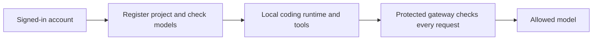

# Code with a signed-in account

This integration trial joins browser sign-in to the pinned local coding runtime.
It requires macOS or Linux, Python 3.9+, OpenCode V2 2.0.27, and an operator-provided
protected gateway endpoint. The ordinary gateway listener is not sufficient:
the protected listener must recheck Keeplane identity, project and model policy
on every model request. Production installation of that listener remains work.

First [sign in](cli-browser-login.md). Then choose a model from
`keeplane.py models --profile PROFILE --project PROJECT_ID` for a registered
project, or ask the installation operator which model to use on first use.

```sh
python3 components/cli/keeplane.py code \
  --profile "$HOME/.config/keeplane/account" \
  --project 00000000-0000-0000-0000-000000000001 --name "Example" \
  --model coder --runtime /path/to/opencode-v2 \
  --gateway https://gateway.example.com/v1 \
  --directory /path/to/repository \
  'Fix the addition function and check the result.'
```

Use your installation's project ID, model and gateway URL. `code` checks the
current account, records project use and checks the allowed model list before
starting the runtime. A supplied project ID identifies requested context; it
does not prove where repository contents came from. The gateway makes the final
decision, including changes made after the CLI's initial checks.



Only the access token reaches the local runtime. The refresh token stays in the
private account profile. Provider keys remain on the server. Reviewed instruction
files can be selected with repeatable `--instructions AGENTS.md` arguments;
repository plugins and provider overrides stay disabled.

Add `--state-dir "$HOME/.local/state/keeplane/example"` to keep private conversation
history outside the repository. Resume with that same option and `--session ID`,
using the session ID in the runtime's output. History is tied to the server,
account, project, directory, gateway, model and runtime version. Signing in again
as the same account can reuse it; a different account or project cannot. Earlier
experimental history without an account binding is refused. Start a fresh state
directory instead. History contains conversation and tool results; protect it
like repository contents.

Ctrl-C cancels the owned turn and returns 130. A timeout returns 124; termination
returns 143. Review file edits before retrying: cancellation does not undo them.
Finish or cancel the active command before using its account profile elsewhere.
Sign out with `keeplane.py logout --profile PROFILE`; the gateway must reject
that credential on subsequent requests. Already authorized work is not recalled.

Initialization, migration apply, automatic routing, refresh and device sign-in
remain separate integration work. This trial does not select a release runtime.
