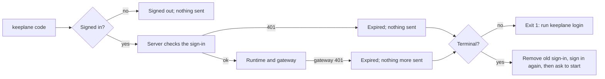
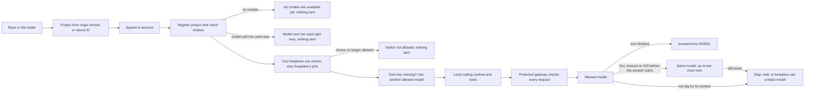

# Code with a signed-in account

Install the [CLI wheel](cli-install.md), then use your signed-in account for a
local coding turn. This trial requires macOS or Linux, Python 3.9+, the external
OpenCode V2 2.0.27 binary, and an operator-installed protected trial gateway.
The ordinary gateway listener is insufficient: the protected listener rechecks
Keeplane identity, project and model policy on every model request. The
[installed journey](../../tests/e2e/installed-cli-cases.md) covers this flow with
a shared-key model; personal-key coding is not enabled here.

First [sign in](cli-browser-login.md). Then go to any Git repo and run:

```sh
cd /path/to/repository
keeplane code --gateway https://gateway.example.com/v1 \
  'Fix the addition function and check the result.'
```

The repo needs no setup in Keeplane. `code` works out everything else:

| What | Where it comes from | Override |
| --- | --- | --- |
| Account | The profile in `~/.config/keeplane/account` (or `$XDG_CONFIG_HOME/keeplane/account`) | `--profile PATH` |
| Project | The repo's `origin` remote, or an ID saved in the repo's Git folder; see [how a repo becomes a project](cli-project-commands.md#how-a-repo-becomes-a-project) | `--project ID --name NAME` |
| Model | Your [`keeplane use`](#choose-the-model) choice for this repo, otherwise the model Keeplane picks; `code` names it before it starts | `--model MODEL` (this turn only) |
| Coding runtime | `"runtime"` in your [settings file](#the-settings-file), then `opencode` on your `PATH` | `--runtime PATH` |
| Gateway | The address saved in your profile when you signed in | `--gateway URL` |
| Folder | The folder you run it in | `--directory PATH` |

The server gives a signed-in CLI the gateway address its installer set, but
this CLI version doesn't save it yet, so pass `--gateway` with the address
your admin gave you. Without it, `code` sends
nothing and says:

```text
Keeplane doesn't know your gateway address yet, so nothing was sent. Pass --gateway with the address your admin gave you, ending in /v1.
```

Once your Keeplane server gives the address at sign-in, sign in again and
`keeplane code 'task'` needs no options at all.

On a Kubernetes installation with the chart's Ingress, the gateway URL is
Keeplane's own address followed by `/v1`, such as
`https://keeplane.example.com/v1` (see
[how developers reach protected models](kubernetes-installation-reference.md#how-developers-reach-protected-models)).
On the Docker preview it is `http://127.0.0.1:5000/v1`.

Without `--model`, `code` asks the server which allowed model the task goes to
and prints, for example:

```text
Using coder for this task, chosen by Keeplane. Run `keeplane use MODEL` to choose another.
```

If none of the project's models can be used right now, it sends nothing and
says so. After a turn that finished, it prints which model answered, for
example `Answered by coder.`, even when your provider key moved the task to
another model. `code` checks the current account, records
that you use the project, and checks the allowed model list before starting the
runtime. Until an admin sets the repo's data class on the Projects page, the
repo can use every model your organization has approved. If the model needs
your own provider key and yours is missing or refused, the CLI uses another
allowed model and says why; see
[provider key commands](cli-provider-key-commands.md). The project ID is the
context the CLI asks for; it does not prove where repository contents came
from. The gateway makes the final decision, including changes made after the
CLI's initial checks.

### Choose the model

To use another allowed model for this repo's next tasks, list the models and
switch:

```sh
keeplane models
keeplane use general
```

```text
This repo's next tasks use general. Run `keeplane use --auto` to let Keeplane choose again.
```

`keeplane models` lists only the models allowed for this repo's project and
marks the current one with `"current": true`; `"chosen_by"` says whether you
chose it (`you`) or Keeplane did (`keeplane`). `use` accepts only a listed
model. Any other is refused and nothing is saved:

```text
outside isn't allowed for this project, so nothing was saved. Choose one that `keeplane models` lists.
```

The choice is saved in your [settings file](#the-settings-file) under the
repo's project ID, so it applies in every clone of the same remote on this
computer and nowhere else. Each task then says:

```text
Using general for this task, as you chose with `keeplane use`. Run `keeplane use --auto` to let Keeplane choose.
```

Your choice comes before Keeplane's own picks, such as an admin's persona rule
or a complexity level. `keeplane use --auto` clears it, with no sign-in needed:

```text
This repo's next tasks use the model Keeplane chooses.
```

`--model MODEL` still works for a single turn and leaves your choice as it is.

If an admin later stops allowing the model you chose, `code` sends nothing,
and Keeplane doesn't pick another one for you:

```text
You switched this repo to general, but it isn't allowed for this project now, so nothing was sent. Run `keeplane use MODEL` with a model `keeplane models` lists, or `keeplane use --auto` to let Keeplane choose.
```

If the model you chose needs your own provider key and yours is missing or
refused, the task goes to the model Keeplane would pick next and says why, as
with `--model`. Your choice stays saved, so the next task tries it again.

### When your sign-in has expired

A sign-in lasts 8 hours. When the Keeplane server or the gateway says it has
expired, `code` sends nothing more. The server is checked before the runtime
starts, so usually nothing has been sent at all. In a terminal it offers to sign
you in again:

```text
Your Keeplane sign-in has expired, so nothing was sent. Sign in again now? [Y/n]
```

Press Enter (or type `y` or `yes`) to sign in again with the same server, the
same way as last time: through the browser, or with a code if you used
`login --device`. The old sign-in is removed first, so if you cancel or the new
sign-in fails, you are signed out. If only the gateway refused it and the server
still accepted it, the server is asked to end it before you sign in again.
Then `code` asks before it starts the task:

```text
Signed in. Start the task now? [Y/n]
```

If the gateway refused the sign-in part-way through a task, the steps that had
already run stay on screen and the message says "so nothing more was sent". Saying
yes then starts the task again from the beginning, so review any edits first.
Any other answer is no, and so is no answer at all. Answering no to the first
question stops with:

```text
Run `keeplane login` to sign in again.
```

Answering no to the second leaves you signed in and exits with status 1:

```text
You're signed in. The task wasn't started, so nothing was sent. Run it again when you're ready.
```

or, if earlier steps had already gone out:

```text
You're signed in. The task wasn't continued, so nothing more was sent. Run it again when you're ready.
```

In a script, or whenever the CLI isn't talking to a terminal, there is no
question. `code` exits with status 1 and prints:

```text
Your Keeplane sign-in has expired, so nothing was sent. Run `keeplane login` to sign in again.
```

It says "so nothing more was sent" when earlier steps had already gone out.

Only `code` offers to sign in again. The other commands exit 1. `whoami`,
`models` and the key commands that only read (`keys list`, `status`, `check`)
print:

```text
Your Keeplane sign-in has expired. Run `keeplane login` to sign in again.
```

`keys set`, `keys remove` and `use MODEL` print:

```text
Your Keeplane sign-in has expired. Nothing was saved. Run `keeplane login` to sign in again.
```

`register-project` prints the same message as `code` in a script.
`keeplane login` replaces the expired sign-in.

### When you're signed out

After `keeplane logout`, or before you have ever signed in, commands send
nothing. `code`, `models`, `keys` and `register-project` exit 1 with:

```text
You're signed out of Keeplane, so nothing was sent. Run `keeplane login` to sign in.
```

`use MODEL` exits 1 with "You're signed out of Keeplane, so nothing was saved.
Run `keeplane login` to sign in." (`use --auto` works signed out.)

`whoami` and `refresh` exit 1 with:

```text
You're signed out of Keeplane. Run `keeplane login` to sign in.
```

`logout` prints `You're already signed out of Keeplane.` and succeeds. There is
no offer to sign in here; run `keeplane login` when you want to.



### The coding runtime

`code` runs OpenCode V2 **2.0.27** and refuses any other version. It looks for
it in `--runtime`, then in the settings file, then as `opencode` on your
`PATH`. If it finds none, or finds another version, it starts nothing and says
how to fix it:

```text
Keeplane needs OpenCode V2 2.0.27, and /usr/local/bin/opencode is another version or doesn't run. Install 2.0.27, then put it on your PATH, pass --runtime PATH, or set "runtime" in your Keeplane settings file.
```

### The settings file

Your CLI settings live outside every repo, in
`~/.config/keeplane/settings.json` (or `$XDG_CONFIG_HOME/keeplane/settings.json`).
To keep the runtime somewhere other than your `PATH`, save its full path there:

```json
{"runtime": "/opt/opencode-2.0.27/bin/opencode"}
```

`keeplane use` saves your model choice in the same file, under `"projects"` and
the repo's project ID; use the command rather than editing it by hand.

Only you may be able to change the file (for example `chmod 600`), because
`code` runs the program it names. Keys Keeplane doesn't know are ignored.
Server and gateway addresses are not kept here; they stay in your profile.

If your organization has not added any model yet, or none is approved for the
project's data class, `code` stops before the runtime starts and sends nothing:

```text
No models are available for this project yet, so nothing was sent. Ask an admin to add a model, or approve one for this project's class, in Models and routing.
```

If the requested model is approved for the project but can't be used right now,
for example because it is not installed or its shared provider key is gone,
`code` also stops before the runtime starts and sends nothing to any other model:

```text
coder is approved for this project but can't be used right now, so nothing was sent. Choose another model allowed for this project, or ask an admin to check it in Models and routing.
```

The project's data class always applies. Model or provider settings in the
repository's own runtime configuration, and runtime environment variables, are
not loaded, so they cannot send a task to a model outside the class.

Settings your runtime sends with each request, such as temperature, reach the
model unchanged: Keeplane adds none of its own.

`keeplane code` has no web search and no web fetch: the model cannot search
the web or open a web page during a turn, even if your shell holds a search
provider key: the runtime's built-in web
tools and hosted search providers are turned off, so a turn never sends its
content to a service your admin did not set up. The only places a turn reaches
are your Keeplane server and the gateway; see
[Developers' computers](outbound-connections.md#developers-computers).

### Cloud models use API keys

Every cloud model is reached through the gateway with an API key: the
organization's shared key, or your own key where the project asks for one
(`keeplane keys set`). There is no sign-in with a personal subscription such
as ChatGPT or Claude, and the CLI has no command for one.

The runtime `code` starts can't sign in to a provider either:

- its only provider is your Keeplane gateway, and every other provider it
  knows (OpenAI, Anthropic and the rest) is removed before the turn starts;
- its built-in provider plugins are off, so it offers no ChatGPT, OpenAI,
  GitHub Copilot or other sign-in and doesn't look for local model runners;
- it starts with a fresh, empty home folder, so a provider sign-in or key you
  saved for OpenCode yourself (for example in
  `~/.local/share/opencode/auth.json`) is never read.

### Token usage

The runtime asks the gateway to include token counts in its streamed answers,
so each model call of a turn ends with its counts. Keeplane doesn't show or
report them yet. Once `keeplane usage` is available, the CLI will send one
report per model after each turn: input tokens (cached input included), output
tokens (reasoning included), the number of calls and how many came back
without counts. A report won't hold a prompt, an answer, a file or a path, and
calls made by a subagent won't be counted.

### When the model is down or the task is too big

If the model answers with a server error (5xx), cannot be reached, times out, or says it is busy
(429) before any of its answer has reached you, the gateway sends the same
request to the same model twice more. Keeplane never moves the task to another
model on its own. If the model is still down, the turn stops and `code` prints
the runtime's error followed by:

```text
coder is unavailable right now, so this task stopped. Wait and try again, or run `keeplane use MODEL` with another model allowed for this project: general, local.
```

Run the same `code` command again later, or switch to one of the listed models
with `keeplane use MODEL` (or pass it in `--model` for one turn). The list is checked for you: only models set up in Keeplane, allowed
for the project's class and with a usable key. If no other model is allowed
for the project, `code` prints instead:

```text
coder is unavailable right now and no other model is allowed for this project. Wait and try again, or ask your admin to set up another model.
```

When the model refuses a task as too big for its context, nothing is retried
and `code` prints:

```text
This task is too big for coder's context, so it stopped. Run `keeplane use MODEL` with another model allowed for this project: large.
```

If no other model is allowed for the project, it prints instead:

```text
This task is too big for coder's context and no other model is allowed for this project. Make the task smaller, or ask your admin to set up a model with a larger context.
```

Once part of an answer has started to arrive, a failure is shown as it is and
nothing is sent again. An older Keeplane server cannot list the alternatives;
the message then points to `keeplane models` instead. The missing-key case
above is different: there `code` does switch to another allowed model and says
so before it starts.



Only the access token reaches the local runtime. The refresh token stays in the
private account profile. Provider keys remain on the server. Reviewed instruction
files can be selected with repeatable `--instructions AGENTS.md` arguments;
repository plugins and provider overrides stay disabled.

Add `--state-dir "$HOME/.local/state/keeplane/example"` to keep private conversation
history outside the repository. Resume with that same option and `--session ID`,
using the session ID in the runtime's output. History is tied to the server,
account, project, directory, gateway, model and runtime version. Signing in again
as the same account can reuse it; a different account or project cannot. Earlier
experimental history without an account binding is refused. Start a fresh state
directory instead. History contains conversation and tool results; protect it
like repository contents.

Ctrl-C cancels the owned turn and returns 130. A timeout returns 124; termination
returns 143. Cleanup covers the owned runtime process group; detached tools and
safe resume of an unfinished turn are not guaranteed. Review file edits before
retrying: cancellation does not undo them. Finish or cancel the active command
before using its account profile elsewhere.
Sign out with `keeplane logout`; the gateway must reject
that credential on subsequent requests, and the CLI then [sends
nothing](#when-youre-signed-out) until you sign in again. Already authorized work is not recalled.

Use explicit [refresh](cli-account-profile.md) before a turn when needed;
[device sign-in](cli-device-login.md) is available when this machine has no browser.
Use [init preview](cli-migration-preview.md) to inspect existing project settings
without changing files. Release runtime selection and distribution checks remain open.
