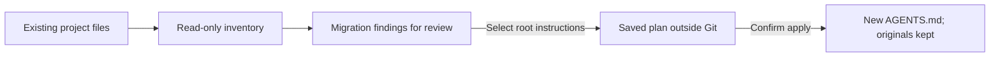

# Preview a setup or copy root instructions

The preview inventories a Git repository without changing it. You can then
explicitly copy one root instruction file through a saved plan. This is a partial
migration, not complete onboarding or a coding runtime selection.
Use Python 3.11+ on macOS or Linux; no model, account or network is needed.



With the [CLI installed](cli-install.md), run from your project:

```sh
keeplane init --preview
```

Or choose the root explicitly with `--directory /absolute/path/to/project`.
Choose `--preview` for discovery; `init` alone does not start onboarding. No account or
server connection is needed. From the Keeplane source tree, the same command is:

```sh
python3 components/cli/keeplane.py init --preview --directory /absolute/path/to/project
```

The original standalone entry point remains available:

```sh
python3 components/cli/migration_preview.py /absolute/path/to/project
```

The JSON output lists source paths and hashes, instruction targets to review,
conflicting guidance, recognized setting names and unknown fields. Different
instruction files in the same directory are flagged before suggesting that a
later migration preserve their content in `AGENTS.md`; nested guidance keeps
its directory scope. No content or setting values are printed.

Recognized sources are `AGENTS.md`, `CLAUDE.md`, `QWEN.md`, Claude project
`settings.json` and `settings.local.json`, Codex project `config.toml`, Qwen
project `settings.json`, and `.mcp.json`. The setting categories are an initial
review list, not a complete vendor schema or a compatibility guarantee.

Hooks, credential helpers and MCP configuration are flagged for review; nothing
is executed or imported. Credential files, session histories and user-home
profiles are not opened. Symlinks, nested repositories, Git internals, dependency
trees and build output are skipped. Each source is limited to 1 MiB.

Exit 0 means discovery completed, even if conflicts need review. Exit 1 means a
source is unreadable or malformed; valid inventory is still shown. Exit 2 means
the selected root cannot be scanned. Fix blocked sources and rerun. Plain preview
leaves all existing files untouched. Other CLI commands still
support Python 3.9+; this preview reports its Python 3.11 prerequisite when needed.

## Copy reviewed root instructions

Run from the repository root. Select `CLAUDE.md` or `QWEN.md` explicitly and save
the plan outside the repository, in an existing directory you own:

```sh
mkdir -p "$HOME/.config/keeplane"
keeplane init --preview --source CLAUDE.md \
  --plan "$HOME/.config/keeplane/project-migration.json"
```

Review the inventory and the selected file locally. The private plan contains
paths and hashes, never instruction contents. Applying it confirms that copy:

```sh
keeplane init --apply "$HOME/.config/keeplane/project-migration.json"
```

Use `--directory /absolute/path/to/project` on both commands when working
elsewhere. Plans cannot be applied to a different repository or overwritten.
The command creates a new root `AGENTS.md` with exactly the selected bytes and
mode 0600. Originals, settings, Git state and nested guidance remain untouched.
Review the result and commit it yourself. Coding still requires explicit
`--instructions AGENTS.md`; migration does not enable project config or hooks.

An existing `AGENTS.md`, conflicting root instructions, changed sources, unsafe
files or blocked preview sources prevent applying. All root instruction files
must be owned regular files without links, valid nonempty UTF-8 and at most
32 KiB. Repository and plan directories must be owned by you without group or
public write access. The filesystem must support hardlinks and directory sync.
Plan/apply errors exit 2; plain preview keeps its exit codes.

Do not edit files during apply. Creation is exclusive and atomic. Before
publication, a caught failure tries to remove its random temporary file. Once
published, `AGENTS.md` is kept even if a later check or disk sync fails: automatic
deletion could erase your replacement or edits. Inspect it and any
`.keeplane-init-*.pending` leftovers, preserve changes, and resolve the outcome
before creating a fresh plan. A failed plan save can also leave its named file;
inspect it and choose a new plan path. Keeplane never overwrites plans or removes
published `AGENTS.md`, and never rewrites or deletes the original instructions.
If the copy is correct, keep and review it as an ordinary change. Otherwise,
preserve your edits before removing a confirmed generated file yourself.

This copies text; it does not translate vendor directives, import configuration
or history, merge conflicts, create defaults, or mark the project initialized.
