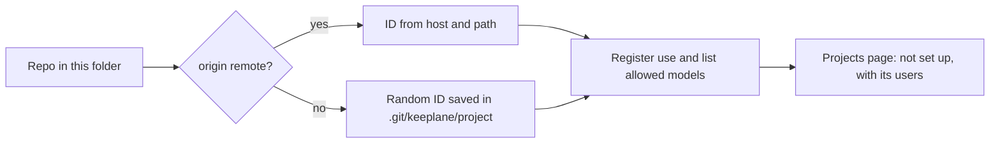

# Sign in and list a project's models

The CLI entry point joins browser sign-in, private account storage, project
registration, model discovery and logout. It needs the sign-in server described
in [browser login](cli-browser-login.md). Use macOS or Linux and Python 3.9+.
[Install the wheel](cli-install.md) to replace the source-tree invocation below
with `keeplane` from any directory.

Run the project commands inside the Git repo you work in. No project ID, name or
setup in Keeplane is needed:

```sh
cd /path/to/repository
keeplane login --server https://keeplane.example
keeplane whoami
keeplane models
keeplane use <model>
keeplane register-project
keeplane logout
```

Every command uses the private profile `~/.config/keeplane/account` (or
`$XDG_CONFIG_HOME/keeplane/account`) unless you pass `--profile PATH`. Add
`--device` to `login` to approve a short code in another browser. See
[device sign-in](cli-device-login.md) for prerequisites and cancellation behavior.

`models` lists the models this repo's project may use now; an empty list is
valid. It marks the model your next task uses with `"current": true` (none when
Keeplane can't pick one right now), and
`"chosen_by"` says whether you chose it with `keeplane use` (`you`) or Keeplane
picked it (`keeplane`):

```json
{
  "project_id": "…",
  "models": [{"id": "coder", "current": true}, {"id": "general", "current": false}],
  "chosen_by": "keeplane"
}
```

`use <model>` switches this repo's next tasks to one of those models, and
`use --auto` goes back to Keeplane's pick; see
[choose the model](cli-coding.md#choose-the-model). `register-project` records that your account uses the project and
returns the name the server keeps for it. `keeplane code` does both for you on
every turn, so you rarely need them. Pass `--project ID` (and, for
`register-project`, `--name NAME`) to use another project.

## How a repo becomes a project

Keeplane works out the project from the repo's Git folder. It reads the files
directly and never runs Git.

- **With an `origin` remote**, the project ID comes from the remote's host and
  path, in lower case, without user names, passwords, port or a `.git` ending.
  So `git@github.com:platform/payments-api.git` and
  `https://you@github.com/Platform/payments-api` are the same project, and every
  developer's clone of that remote shares it. The project name is the remote's
  path, here `platform/payments-api`.
- **With no remote**, or a remote that is a folder on this machine, the CLI
  makes a random ID once and saves it in `.git/keeplane/project`. Git never
  commits that file. The project name is the repo's top folder name, never its
  full path.
- **Worktrees** share the main checkout's project. A **submodule** is its own
  project, from its own remote.
- Run it outside a Git repo and the command sends nothing and asks you to run
  it inside a repo or pass `--project` and `--name`.

The first name the server sees for a project is the one admins see. A fork, or
the same code under another remote, is a different project. Adding an `origin`
remote later moves the repo to the remote's project.

The new project shows on the admins' Projects page as not set up, with each
developer who used it. Until an admin sets its data class, it can use every
model your organization has approved. The ID is the context the CLI asks for,
not proof of where the code came from; the server and gateway check every
request.



Each project command checks the current server account against the saved ID
before making its project request. A changed, withdrawn or unavailable account
stops the command. The server address comes only from the private profile, so
there is no second server argument that can forward its credential elsewhere.

Explicit refresh, logout and local `forget` follow the [profile recovery behavior](cli-account-profile.md).
Use the [key commands](cli-provider-key-commands.md) to manage your own stored
provider keys. The [coding command](cli-coding.md) joins this profile to local
tool turns and account-bound resume history through the protected gateway. Use
[init preview](cli-migration-preview.md) to inventory an existing Git project
without changing it.
