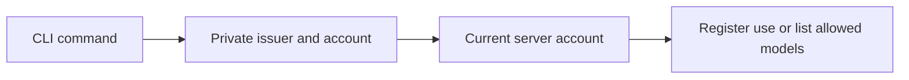

# Sign in and list a project's models

The experimental CLI entry point joins browser sign-in, private account storage,
project registration, model discovery and logout. It needs the trial sign-in
server described in [browser login](cli-browser-login.md). Use macOS or Linux and
Python 3.9+. [Install the wheel](cli-install.md) to replace the source-tree
invocation below with `keeplane` from any directory.

```sh
python3 components/cli/keeplane.py login --server https://keeplane.example --profile /absolute/private/keeplane-account
python3 components/cli/keeplane.py whoami --profile /absolute/private/keeplane-account
python3 components/cli/keeplane.py refresh --profile /absolute/private/keeplane-account
python3 components/cli/keeplane.py register-project --profile /absolute/private/keeplane-account --project PROJECT_UUID --name 'My project'
python3 components/cli/keeplane.py models --profile /absolute/private/keeplane-account --project PROJECT_UUID
python3 components/cli/keeplane.py logout --profile /absolute/private/keeplane-account
```

Add `--device` to `login` to approve a short code in another browser. See
[device sign-in](cli-device-login.md) for prerequisites and cancellation behavior.

Replace `PROJECT_UUID` with an explicit project UUID. Registration records that
your account uses the project and returns its server-preserved name. It does not
initialize files, derive Git identity or grant access. `models` returns the
server's current allowed model IDs; an empty list is valid.

Each project command checks the current server account against the saved ID
before making its project request. A changed, withdrawn or unavailable account
stops the command. The issuer comes only from the private profile, so there is no
second server argument that can forward its credential elsewhere. The server
still checks every request and remains authoritative for project/model access.



Explicit refresh, logout and local `forget` follow the [profile recovery behavior](cli-account-profile.md).
Use the [key commands](cli-provider-key-commands.md) to manage your own stored
provider keys. The [coding command](cli-coding.md) joins this profile to local
tool turns and account-bound resume history through an operator's protected
gateway. Use [init preview](cli-migration-preview.md) to inventory an existing Git project
without changing it; applying a migration remains separate work.
