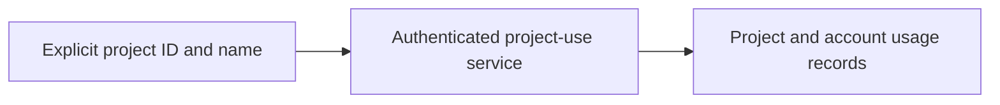

# Record project use

This experimental command records use of an explicitly identified project.
It needs the matching runtime project-registration route and a Keeplane test
session. It does not infer Git identity, onboard the repository or write files.

```sh
python3 components/cli/project_registration.py \
  --server https://keeplane.example \
  --project 01234567-89ab-cdef-0123-456789abcdef \
  --name 'Example project'
```

Use the agreed project UUID, not a username or a provider key. Enter the test
session at the hidden prompt, or use the `KEEPLANE_SESSION_CREDENTIAL` secret
environment. The server establishes the account from that session.



Success prints the canonical project ID and server-preserved name. Reusing an
ID records another use without replacing its name or class. If a network error
leaves the outcome unclear, retry with the same ID; this does not create a
duplicate project. Project use grants no membership or model access and does
not assign a class. Use the [catalog command](cli-server-connection.md) to read
current eligible models. Login, local session storage and automatic repository
identification remain separate work.
