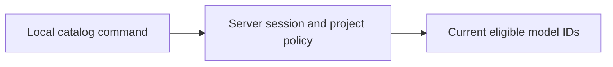

# Discover a project's allowed models

This experimental command reads the current server-authorized model catalog.
It needs the matching experimental runtime catalog route, Python 3.9+ and an
operator-supplied test Keeplane session. Browser sign-in with PKCE and device
fallback remain separate work; this command does not obtain or save credentials.



From the repository root, run:

```sh
python3 components/cli/server_connection.py \
  --server https://keeplane.example \
  --project 01234567-89ab-cdef-0123-456789abcdef
```

Enter the test session at the hidden prompt. Automation can supply
`KEEPLANE_SESSION_CREDENTIAL` through its secret environment. Use a Keeplane
session, never a provider key. The command prints the project ID and allowed
model IDs; it does not authorize future calls or bypass the gateway.

Connections use HTTPS with certificate verification; HTTP is accepted only for
loopback testing. The server must be an origin without a URL path. Redirects,
ambient proxies and browser cookies are excluded. Each network wait has a
ten-second timeout and responses are limited to 1 MiB. Invalid or unavailable
sessions, denied project access, policy outages and malformed catalogs fail
without printing server error bodies. Check the server, session and project
before retrying. A successful empty list means no model is currently eligible.
