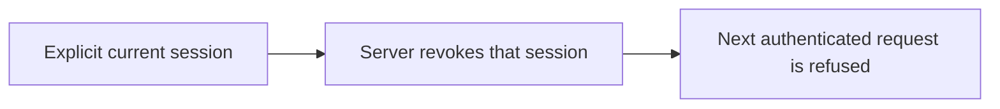

# Revoke a test CLI session

Use this experimental command with the matching runtime session-revocation
route. It revokes the supplied Keeplane session at the server. Browser/PKCE
sign-in and local credential storage are separate changes.

```sh
python3 components/cli/session_logout.py --server https://keeplane.example
```

Enter the current Keeplane test session at the hidden prompt, or supply it
through the `KEEPLANE_SESSION_CREDENTIAL` secret environment. Never enter a
provider key or a secret command-line argument.



Success prints `Keeplane session revoked.` only after a 204 response. If the
session is already unavailable, the server refuses the request. A connection
failure does not confirm revocation; retry against the same server. Other
sessions and provider keys are untouched. HTTPS, redirect refusal, sanitized
errors and response limits follow the [catalog connection](cli-server-connection.md).
