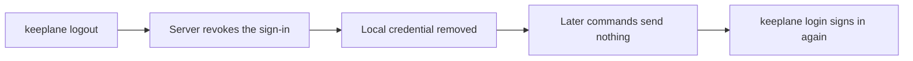
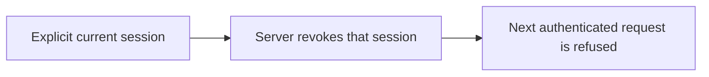

# Sign out of the CLI

Spec 009 ST29 "Sign out". Run:

```sh
keeplane logout
```

Keeplane revokes this CLI's sign-in and its refresh token at the server, then
removes the local credential. From then on the CLI sends nothing with that
profile until you sign in again with `keeplane login`. `code`, `models`, `usage`,
`keys` and `register-project` each say "You're signed out of Keeplane, so nothing
was sent. Run `keeplane login` to sign in." and exit 1; `whoami` and `refresh` say
"You're signed out of Keeplane. Run `keeplane login` to sign in." Running `logout`
again says "You're already signed out of Keeplane." Admins sign out the same way.

If the server can't be reached, `logout` keeps the credential and says so; run it
again when the server is back. `keeplane forget` removes only the local copy and
doesn't revoke anything at the server
([profile storage and recovery](cli-account-profile.md)).



## Revoke a test CLI session

Use this experimental command with the matching runtime session-revocation
route. It revokes the supplied Keeplane session at the server. Browser/PKCE
sign-in and local credential storage are separate changes.

```sh
python3 components/cli/session_logout.py --server https://keeplane.example
```

Enter the current Keeplane test session at the hidden prompt, or supply it
through the `KEEPLANE_SESSION_CREDENTIAL` secret environment. Never enter a
provider key or a secret command-line argument.



Success prints `Keeplane session revoked.` only after a 204 response. If the
session is already unavailable, the server refuses the request. A connection
failure does not confirm revocation; retry against the same server. Other
sessions and provider keys are untouched. HTTPS, redirect refusal, sanitized
errors and response limits follow the [catalog connection](cli-server-connection.md).
