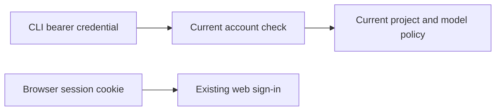

# CLI sign-in integration trial

This is the account and revocation part of the browser sign-in trial. Browser
authorization, device sign-in and the CLI login command are the next steps.

CLI credentials use the same Keeplane account and current project/model policy.
A password change, disabled account or account removal withdraws access. CLI
logout revokes its own access token and paired refresh token; other CLI sessions
and the browser session keep working.

`GET /api/runtime/session` returns the current account ID, username and role for
an explicit bearer credential. The CLI can bind its local history to that account.
`DELETE` on the same resource signs that credential out.



For development, use Python 3.12 with the control-plane dependencies installed
in a virtual environment. Install the separate pinned trial dependencies:

```sh
python -m pip install --require-hashes --no-deps \
  -r components/control-plane/requirements-cli-auth.txt
KEEPLANE_CLI_OAUTH_ENABLED=1 python -m pytest -q -m optional \
  tests/integration/test_cli_oauth_identity.py
```

The lock covers macOS Python 3.12 and Linux musl Python 3.13 wheels.
It is separate from the packaged application while installation, source and
licence checks are completed.

Acceptance is off by default. A trial server with the dependencies installed
must run its normal Django migrations before setting
`KEEPLANE_CLI_OAUTH_ENABLED=1`. Turning acceptance off keeps the installed token
models registered, so account deletion still removes their records. Keep the
dependency installed after migrating; package removal requires a planned schema
rollback.

The tests create synthetic credentials through the actual authorization-server
models and the account-binding helper. They cover hashed access/refresh storage,
current policy, revocation, rollback and storage failures. The browser-to-CLI
journey and gateway dispatch still need their integration checks.
