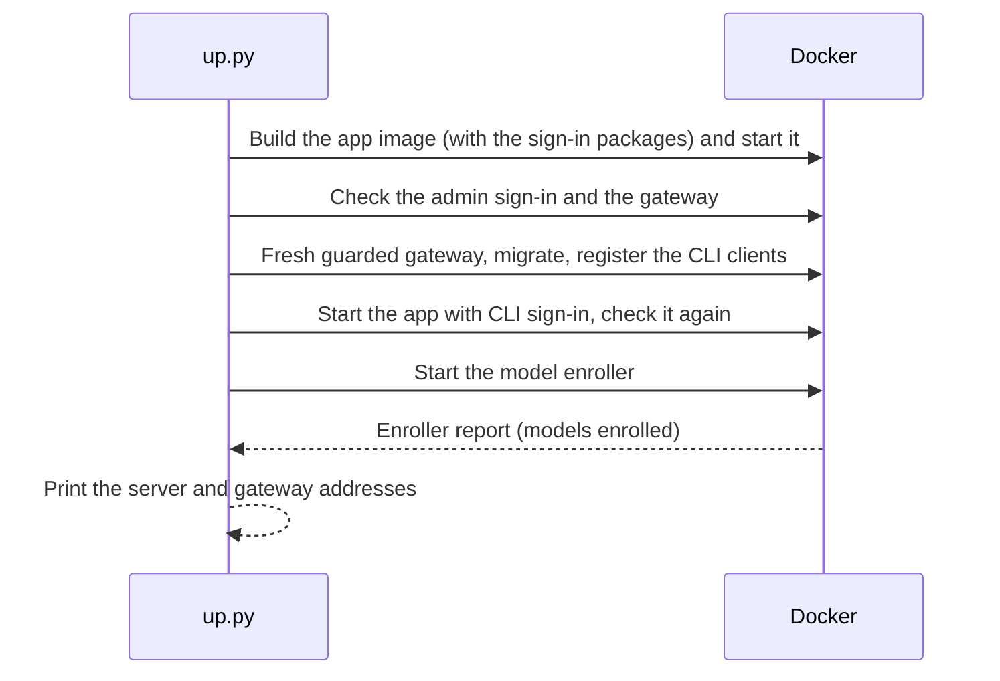

# Run Keeplane locally

This starts the development application, its model gateway and a small Qwen demo
model on your computer, with CLI sign-in and the guarded model gateway that the
Keeplane CLI uses. It keeps existing accounts and registered models.

## Before you start

- Python 3.9 or newer.
- Node.js 22.12 or newer, including npm.
- Docker running, with Docker Compose supporting `up --wait`.
- Two free local ports: 3000 for the browser and 5000 for the guarded model
  gateway.
- Internet access for the first dependency, image and model downloads. The model
  download is about 0.4 GB; allow more space for Docker images and npm packages.

The launcher checks the tools before downloading or building. Use macOS or Linux.
On Windows, use a Linux environment such as WSL with Docker.

## Start

From the repository root:

```sh
python3 deploy/local/up.py
```

The command installs the locked frontend dependencies, builds the application,
runs Django database migrations, starts Docker and checks sign-in and the gateway.
It then turns on CLI sign-in, registers the Keeplane CLI's browser and device
clients, and starts a fresh guarded model gateway and the model enroller, which
enrols every model approved in **Models and routing**. No extra options are
needed. The first run takes longer because it downloads dependencies and the
demo model. Success looks like:

```text
No model is enrolled for protected access.
Keeplane is ready: http://127.0.0.1:3000
Guarded model gateway for the CLI: http://127.0.0.1:5000/v1
Sign in from the CLI: keeplane login --server http://127.0.0.1:3000 --profile PROFILE
First admin username: first-admin
First admin password file: <path on your computer>
Configuration file: <path on your computer>
```

The first line is the model enroller's report. Once you have approved models it
says how many are enrolled, for example `Protected access is ready: 1 model is
enrolled.`

The app also gives that gateway address to every signed-in CLI: the account on
`GET /api/runtime/session` carries `"gateway_url": "http://127.0.0.1:5000/v1"`,
or the `--runtime-port` you chose, set as `KEEPLANE_GATEWAY_PUBLIC_URL` in
`deploy/local/runtime.yaml`. This CLI version still needs it as
`keeplane code --gateway`.



Open the printed address. `127.0.0.1` means your own computer; this development
installation is accessible only from there. Read the password from the printed
file and sign in as `first-admin`.

New installations keep private credentials under `.keeplane/local/`, which Git
ignores. Earlier installations reuse `/private/tmp/keeplane-accounts-trial/`
when it exists. Accounts and registered models live in Docker volumes and are
kept between restarts. Preserve both the credential files and the volumes when
keeping an installation.

### Earlier preview data

Before the first release Keeplane doesn't carry an earlier preview's data
forward. The app database now has its own folder, `/state/database`, in the
account volume. If you ran an earlier preview, this one starts a fresh database
there with only the first admin: earlier accounts, models, classes and Audit
records aren't imported. The earlier files (`/state/keeplane.sqlite3`, or
before that `accounts.sqlite3` and `model-approvals.sqlite3`) are left unused
and unchanged, and each start prints a notice naming the ones it found. The
launcher also removes the containers of the earlier port 3001 preview (the
`keeplane-accounts-trial` Compose project); its data stays in the volume.

To reset the preview fully, stop everything, including the
[guarded runtime's](guarded-runtime.md) model enroller, remove every container
still using the account volume (an earlier preview's stopped containers hold it
too, and Docker won't remove a volume in use), remove the volume, then start the
preview again:

```sh
docker compose -f compose.yaml -f deploy/local/runtime.yaml --profile runtime down --remove-orphans
docker ps -aq --filter volume=keeplane-accounts-trial_model-approvals | xargs -r docker rm -f
docker volume rm keeplane-accounts-trial_model-approvals
python3 deploy/local/up.py
```

This deletes every account, model setting and Audit record in the preview,
along with the earlier files.

## Configuration

```sh
python3 deploy/local/up.py --port 3080
```

The port option changes Docker's published port, the application's browser origin
and the startup checks together. Open the printed address. Private addresses
between containers stay the same.

| Option | Purpose | Default |
| --- | --- | --- |
| `--port` / `KEEPLANE_PORT` | Browser port | `3000` |
| `--runtime-dir` / `KEEPLANE_RUNTIME_DIR` | Local credential directory | Existing legacy directory, otherwise `.keeplane/local/` |
| `--runtime-port` | Loopback port of the guarded model gateway | `5000` |
| `--context-size` / `QWEN_CONTEXT_TOKENS` | Bundled runner context, in tokens | `4096` |
| `--verbose` | Show dependency and container build output | Off |

Command-line options override environment variables. Keep using the same
credential directory when restarting. Choosing another directory does not create
another installation: this launcher manages one Compose project and its volumes.

## Try the application

1. Open **Users**. The first admin is managed by infrastructure and cannot have
   its role changed in the UI. Create user starts with Developer selected.
2. Open **Models and routing**, then **Add model** → **Local runner**.
3. Enter `http://qwen:8080`, choose **Find models**, select
   `qwen2.5-coder:0.5b`, then add it. That address is the runner inside Docker.
   If the model already exists, use **Set up** on its row instead.
4. Data classes start off on a fresh installation. To choose which data the
   model may receive, open **Data classes** and turn on **Use data classes**.
   Public, Internal and Confidential are listed. Then return to the model and approve Public and
   Internal. If the automated demo has already run, data classes are on and
   `demo-qwen` already has these approvals.
5. Open **Audit** to see the infrastructure admin's sign-ins, then sign out.

There is no chat panel. Developers use the Keeplane CLI instead; see
[Sign in from the CLI](#sign-in-from-the-cli).

The local
[`ask.py`](../../deploy/local/ask.py) helper exercises a model request; it is a
development tool. See [model setup](model-add-local.md) for the supported flows.

## Sign in from the CLI

The preview accepts CLI sign-in as soon as it is ready. Create a developer in
**Users**, [install the CLI](cli-install.md), then sign in with the printed
server address and a private profile outside Git:

```sh
keeplane login --server http://127.0.0.1:3000 --profile "$HOME/.config/keeplane/account"
keeplane whoami --profile "$HOME/.config/keeplane/account"
```

The browser opens Keeplane's sign-in page; sign in and choose **Continue** to
allow CLI access. With no browser on this computer, add `--device` and enter the
printed code in a browser elsewhere. See [browser sign-in](cli-browser-login.md)
and [device sign-in](cli-device-login.md).

The CLI's model requests go to the printed guarded gateway,
`http://127.0.0.1:5000/v1`. It answers only signed-in developers, for models
approved for their project; until you approve a model it serves nothing. See
[guarded model access](guarded-runtime.md) and [coding](cli-coding.md).

## Isolated networks

Internet access is needed only for the first downloads. Once Keeplane is
running, the web UI asks nothing from the internet: every page, script, style
and font, including the IBM Plex typefaces, comes from Keeplane itself. Admins
on a network with no outside access see the same pages in IBM Plex. The font
licence is at `/fonts/LICENSE.txt` on your Keeplane address; other bundled
notices are at `/app/assets/THIRD_PARTY_LICENSES.txt`.

## Model limits

The displayed active context is the running model's configured limit. Training
context is model metadata; it does not increase the running limit. The demo
starts with 4,096 context tokens. To change its allocation:

```sh
python3 deploy/local/up.py --context-size 8192
```

This restarts the bundled runner and may use more memory. Configure customer
runners where they run. Request parameters, such as temperature and output
limits, are separate from runner capacity and belong to the client request.

## Stop and troubleshoot

Stop everything, including the guarded gateway's model enroller, with:

```sh
docker compose --env-file "<printed configuration file>" \
  -f compose.yaml -f deploy/local/runtime.yaml --profile qwen --profile runtime down
```

Volumes are kept. Add `-v` only if you intend to delete their data.

- **Missing tool:** install the prerequisites above and retry.
- **Port in use:** choose another port with `--port`, or `--runtime-port` for
  the guarded gateway.
- **Guarded gateway refuses every request:** run
  `docker compose -f compose.yaml -f deploy/local/runtime.yaml logs model-enroller`.
  Right after a model is removed or edited it waits about 3 minutes before
  enrolling again; see [guarded model access](guarded-runtime.md).
- **Build failure:** repeat the command with `--verbose` for the underlying error.
- **Sign-in check refused:** check the address and credential directory; retain
  the original password file when restarting.
- **Models load, but adding models fails after a Git update:** if the gateway
  reports a missing config file, rerun the launcher. It recreates containers with
  the current directory mount while retaining existing credentials and volumes.
- **Gateway not ready:** run `docker compose logs app gateway qwen`. The model
  may still be loading, or Docker may need more available memory.

[PostgreSQL operations](postgres-accounts.md) and
[Kubernetes installation](kubernetes-local.md) have separate requirements.
