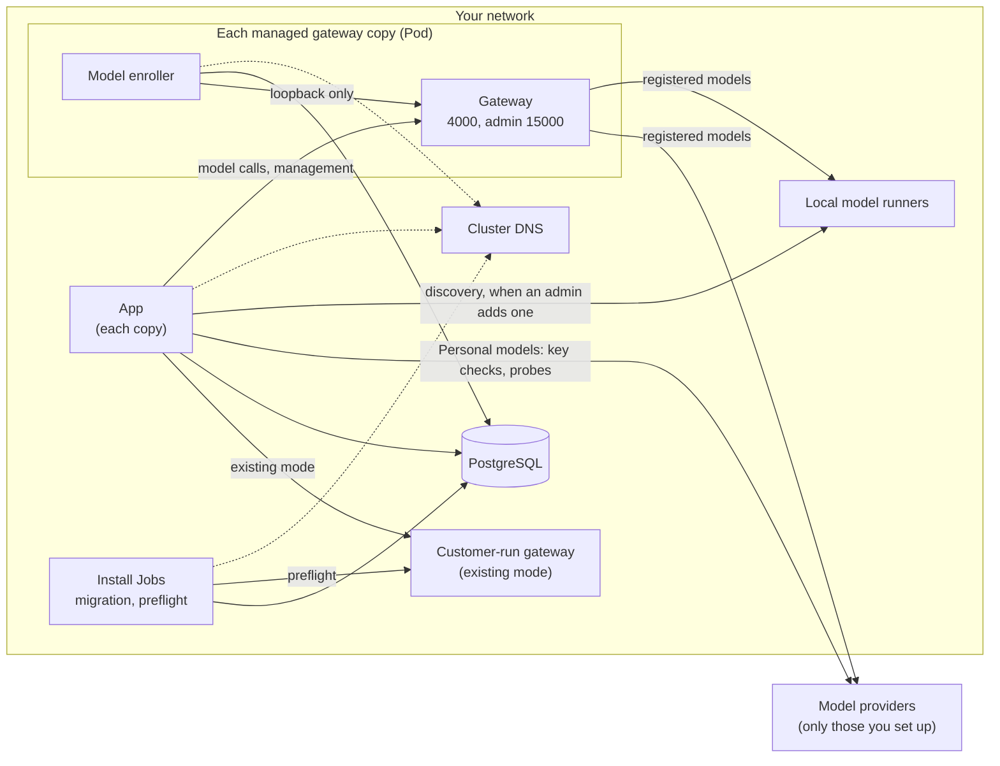
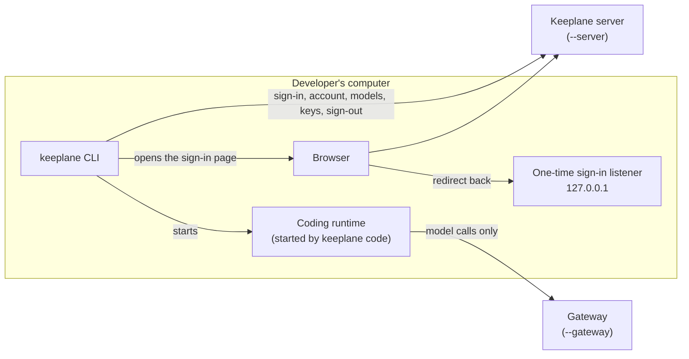

# Outbound connections

Keeplane needs nothing from the internet to run. This page lists every
connection the Keeplane server opens, and when, so that an installation on an
isolated network can open exactly those destinations and nothing else. It
covers the app, its install Jobs and the model enroller, and, in
[Developers' computers](#developers-computers), the Keeplane CLI and the coding
runtime it starts. The web UI in the browser loads everything from Keeplane
itself.

There is no telemetry, no update check, no licence check, no hosted font or
CDN, and no outside control plane. The optional personal-data detector loads
its language model from the image and never downloads a model or a list.

## What each part connects to

| From | To | When | Chart setting with `networkPolicy.egressEnabled` |
| --- | --- | --- | --- |
| App | Cluster DNS | To find any name below | `networkPolicy.dns` |
| App | PostgreSQL | Every request that reads or writes accounts, settings, approvals or Audit (PostgreSQL mode) | `egress.postgres` |
| App | The managed gateway Service and each copy on TCP 4000 | Every model call, model change and copy read-back; `/health` and the admin status page | Allowed by the app egress policy in managed mode |
| App | A customer-run gateway (`gateway.url` and every `gateway.copyUrls`) | The same calls, in existing mode | `egress.suppliedGateway` |
| App | The provider address of a Personal model an admin set up | When an admin sets the model up (a probe without any key) and when a developer saves or rechecks their own key for it | `egress.modelEndpoints` |
| App | A runner listed in `app.runnerUrls` | Only when an admin lists a runner's models or adds a runner model | `egress.runners` |
| Migration Job | PostgreSQL | Before install and upgrade | `egress.postgres` |
| Preflight Job (existing mode) | The customer-run gateway | Before install and upgrade | `egress.suppliedGateway` |
| Model enroller | Its own gateway copy at `127.0.0.1:4000` and the copy's admin port `127.0.0.1:15000` | Every few seconds; both stay inside the copy's Pod | None needed: loopback |
| Model enroller | PostgreSQL (read-only approvals and its own guard-status row) | Every few seconds | `egress.postgres`, added to the gateway egress policy |
| `check_credentials` (run in an app Pod) | The database server and an `https` gateway address | When you run it: it reads the certificate each one presents | Same as the app |

The managed gateway copies themselves connect to the registered model
providers and runners (`egress.modelEndpoints`), the gateway database in
database mode (`egress.gatewayDatabase`) and, with the model enroller, the app
on TCP 3000. See [network policies](kubernetes-installation-reference.md#network-policies)
for the policies that enforce all of this.

A provider address comes only from a model an admin set up. A definition
without its own address uses the provider's public address,
`https://api.openai.com/v1` or `https://api.anthropic.com/v1`; give a
`baseUrl` to keep that call inside your network.

## Proxies

Keeplane uses an HTTP proxy only where noted:

- The provider-key check, the Personal provider probe and the read of a gateway
  copy's applied configuration never use a proxy, and never follow a redirect.
  On an isolated network the app must reach those providers directly, so list
  them in `egress.modelEndpoints` even when the gateway copies reach them
  through a proxy.
- Calls to the gateway and runner discovery use `HTTP_PROXY`, `HTTPS_PROXY`
  and `NO_PROXY` if they are set in the app's environment when it starts. The
  chart sets none of them. If you add one, put your gateway and runner hosts
  in `NO_PROXY`.

## The Docker preview

The Docker preview on a developer's computer also checks its fixed demo
runner (`qwen:8080`) and guarded test provider (`guarded-provider:18081`)
inside its own Docker network. Its first start downloads images, packages and
the demo model; see [Run locally](local-preview.md).

## Install and build

Images are built, and source archives for the licence notices are collected,
before installation. Those steps download pinned packages and sources and are
never run by a running installation. Pulling images is the only install-time
need: make the pinned images available inside your network before you close
any temporary registry access (see [Images](kubernetes-installation-reference.md#images)).

## Developers' computers

On an isolated network a developer's computer needs to reach only two
addresses: the Keeplane server they sign in to and the gateway URL they code
through. The CLI has no address of its own and installs nothing at runtime.

| From | To | When |
| --- | --- | --- |
| CLI | The Keeplane server given to `keeplane login --server` | Sign-in, refresh, `whoami`, project registration, `models`, `keys`, the checks before a coding turn, and sign-out |
| CLI | Its own one-time listener on `127.0.0.1` | Browser sign-in only: the server's sign-in page sends the browser back to it. Nothing outside the computer connects to it |
| Browser | The Keeplane server's sign-in page | Browser sign-in; `keeplane login --device` shows a code to use in any browser instead |
| Coding runtime | The gateway URL given to `keeplane code --gateway` | Each model call in a coding turn |

The CLI never uses a proxy from the developer's shell and never follows a
redirect, so its requests and credentials go only to the server it was given.

When `keeplane code` starts the coding runtime (OpenCode V2 2.0.27), it turns
off everything the runtime would otherwise reach on its own:

- `OPENCODE_DISABLE_MODELS_FETCH=1`: no download of the hosted model catalogue
  from `models.opencode.ai`. The only model is the one Keeplane approved.
- `OPENCODE_DISABLE_AUTOUPDATE=1`, and an update policy of `disable` in the
  runtime's settings: no update check and no self-upgrade.
- `OPENCODE_CONFIG_PROJECT_DISABLE=1`: settings in the repository are not read,
  so a repository cannot add a model provider, an MCP server or a plugin to
  install.
- The runtime gets a fresh, empty settings folder and only `PATH`, the language
  and the TLS certificate settings from the developer's shell. A proxy,
  provider keys and other runtime settings in the shell are not passed on.
- Its only provider is the Keeplane gateway, through a provider built into the
  runtime, so no package is downloaded. Sharing is off. Keeplane's instruction
  plugin is a local folder with no dependencies.

The runtime's own web search and web fetch tools are not changed by Keeplane.
They run only when the model asks for them during a turn, and they reach the
page or the hosted search service that the tool names. On an isolated network
those calls fail and the turn carries on without them.

## How this is checked

The [outbound connection cases](../../tests/unit/outbound-connection-cases.md)
fail the backend checks when server or CLI code gains a connection, an address
or a dependency that is not declared here, when `keeplane code` stops turning
off one of the runtime's own connections, and run an admin journey, each call
site and a developer's signed-in CLI journey against local test endpoints with
every other connection refused.
