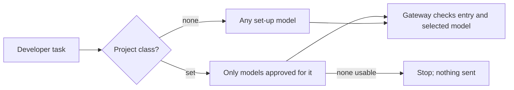

# Project records

Projects keep their name and the accounts that have used them, even before
onboarding. Recording use does not grant access or assign a data class.

Sign in as an admin and open **Projects**. Search by project name, then use
Previous and Next to move through the list. Each row shows whether the project
is initialised and who used it. The data-class column is hidden while classes
are off. On a narrow screen, scroll the table sideways inside its frame.

To change a project's class, choose **Set class**, pick a class or **None**, and
choose **Save**. The table shows the saved value. **Cancel** keeps the current
assignment. If Keeplane cannot confirm the result, choose **Check** to read it
back; the dialog does not send the change again automatically.

## What a project's class does

Once a project has a class, each of its tasks goes only to models approved for
that class in **Models and routing**. Keeplane checks this when a task starts
and again for the model the gateway selects, so a fallback, a model the
developer names, or a model set in the repository's own runtime settings cannot
reach a model approved only for another class. Admin accounts get the same
restriction.

If the model the developer asked for is approved but can't be used right now
(for example it is not installed or its shared provider key is gone), the task
stops before anything is sent, even if other approved models are up, and says so:

```text
coder is approved for this project but can't be used right now, so nothing was sent. Choose another model allowed for this project, or ask an admin to check it in Models and routing.
```

If no model is approved for the class at all, the task stops with "No models are
available for this project yet". A project with no class, or any project while
classes are off, may use any model that is set up.



For integration checks, a signed-in admin can read `/api/projects` on the
Keeplane application. Use `search`, `page` and `page_size` to narrow the result;
pages contain 25 projects by default and at most 50. Developers cannot read
this organization-wide list. Class fields appear only while classes are on.

An admin integration can set a registered project's class with
`PUT /api/projects/{id}/class`, using `{"class_id":"confidential"}` or
`{"class_id":null}` for none. It requires the same CSRF token and action header
as other admin changes. Turn on data classes first. A class in use cannot be
removed; clear or change the project's assignment first. Settings Audit records
real assignment changes when that record kind is enabled.

The current records come from the server's project-use service. CLI first-use
registration is a separate delivery step. No onboarding completion is recorded yet.
