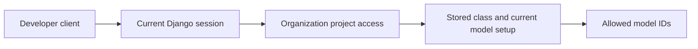

# Read the allowed model catalog

This experimental endpoint lets a developer client discover the models allowed
for a registered project. An operator supplies a test session credential; browser
PKCE sign-in and credential issuance remain separate work. Use HTTPS, or a
loopback HTTP development installation. Keep the credential out of URLs and logs.

```text
GET /api/runtime/projects/{project_id}/models
Authorization: Bearer <opaque session credential>
```

A successful response contains a canonical project UUID and sorted model IDs:

```json
{"project_id":"00000000-0000-0000-0000-000000000001","models":[{"id":"coder"}]}
```

An empty list means no currently set-up model is eligible. The server resolves
the stored project class and current gateway definitions on every read. Classes
off or a project without a class permits every currently set-up model.

Open Source runs as one organization: active accounts can use its registered
projects. Previous usage does not grant access; admin status does not bypass
model restrictions. Cookies and client user, role or class claims are ignored.

| Status | Meaning |
| --- | --- |
| 200 | Current catalog, including an empty list |
| 401 | Missing, invalid, expired or revoked session; sign in again |
| 403 | Project context is unknown or unavailable |
| 503 | Current identity, gateway or policy cannot be verified |

Responses are not cached. The credential currently resolves through Django's
database session support. No provider key is returned, and this endpoint sends
no model traffic. Final gateway enforcement remains separate work.



Header authentication follows [DRF's custom authentication contract](https://www.django-rest-framework.org/api-guide/authentication/#custom-authentication).
[Isolated HTTP cases](../../tests/integration/runtime-catalog-cases.md) cover
revocation, class restrictions, unknown contexts and outages.
