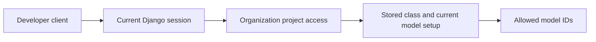

# Read the allowed model catalog

This experimental endpoint lets a developer client discover the models allowed
for a registered project. An operator supplies a test session credential; browser
PKCE sign-in and credential issuance remain separate work. Use HTTPS, or a
loopback HTTP development installation. Keep the credential out of URLs and logs.

```text
GET /api/runtime/projects/{project_id}/models
Authorization: Bearer <opaque session credential>
```

A successful response contains a canonical project UUID and sorted model IDs:

```json
{"project_id":"00000000-0000-0000-0000-000000000001","models":[{"id":"coder"}]}
```

An empty list means no currently set-up model is eligible. The server resolves
the stored project class and current gateway definitions on every read. Classes
off or a project without a class permits every currently set-up model.

Open Source runs as one organization: active accounts can use its registered
projects. Previous usage does not grant access; admin status does not bypass
model restrictions. Cookies and client user, role or class claims are ignored.

| Status | Meaning |
| --- | --- |
| 200 | Current catalog, including an empty list |
| 401 | Missing, invalid, expired or revoked session; sign in again |
| 403 | Project context is unknown or unavailable |
| 503 | Current identity, gateway or policy cannot be verified |

Responses are not cached. The credential currently resolves through Django's
database session support. No provider key is returned, and this endpoint sends
no model traffic. Final gateway enforcement remains separate work.



Header authentication follows [DRF's custom authentication contract](https://www.django-rest-framework.org/api-guide/authentication/#custom-authentication).
[Isolated HTTP cases](../../tests/integration/runtime-catalog-cases.md) cover
revocation, class restrictions, unknown contexts and outages.

## Revoke a test session

Send `DELETE /api/runtime/session` with the same Bearer credential and an empty
body. Success returns 204. Reusing that credential returns 401; other sessions
remain valid. The route accepts no account ID and never authenticates cookies.
It needs no CSRF cookie because authorization comes only from the explicit
header. Browser sign-in, account changes and browser sign-out keep their normal
[Django CSRF protection](https://docs.djangoproject.com/en/5.2/ref/csrf/).

## Register first use

Send `POST /api/runtime/projects` with the Bearer credential and JSON containing
exactly `project_id` (an explicit UUID) and `name` (1–120 printable characters).
Success returns 200 with the canonical `project_id` and server-preserved name.
Repeated use records the current account without renaming the project or changing
its class. Invalid bodies or extra fields return 400; unavailable storage returns
503. The account always comes from the session, never the body.

This records use before onboarding. It does not infer Git identity, write repo
files, assign a class or grant access. The developer client supplies the project
context explicitly; repository/content provenance remains outside this check.

## Report and read your own usage

After each turn a developer client sends one usage report per model it used:

```text
POST /api/runtime/usage
Authorization: Bearer <credential>

{"project_id":"…","model":"coder","input_tokens":1200,"output_tokens":300,"requests":3,"requests_without_usage":0}
```

Success returns 204. The account comes from the credential; any other field,
such as an account ID, prompt or path, is ignored and never stored. A model that
isn't eligible for the project, or a project you can't use, returns 403; counts
that aren't whole numbers of 0 or more, or zero requests, return 400; an
unavailable model policy returns 503. Large numbers are capped.

Read your totals for today and this month in your own time zone:

```text
GET /api/runtime/usage?tz=Europe/Berlin
Authorization: Bearer <credential>
```

The answer lists each model you used this month with `input_tokens`,
`output_tokens`, `requests`, `requests_without_usage` and `estimated_cost` for
`today` and `this_month`, plus the model's `cost_status`:

- `estimate`: a cloud model with a list price; `estimated_cost` is in US
  dollars, such as `"0.012345"`;
- `local`: a model from a local runner, never priced; `estimated_cost` is
  `null`;
- `no_list_price`: a cloud model Keeplane has no list price for, or one whose
  provider it didn't record; `estimated_cost` is `null`.

`cost_partial` is `true` for a period whose cost leaves out tokens counted
before Keeplane recorded the model's provider (including the rest of the hour
it was added in); otherwise `false`.

`price_list` gives the shipped price list's `date` and `currency` (`USD`). Costs
are estimates from each provider's public list price; discounts and negotiated
prices are never applied.

Without `tz` it uses UTC. Totals are hourly, so a day or month starts at the
UTC hour nearest your local midnight, at most 30 minutes away. A
storage failure returns 503. An unknown zone or any other parameter
returns 400. You only ever see your own usage; admins have no route to read it.
Totals older than the previous calendar month are deleted. Usage can undercount
when a report is lost and is never billing evidence. See
[developer usage](../architecture/developer-usage.md) for the details.
