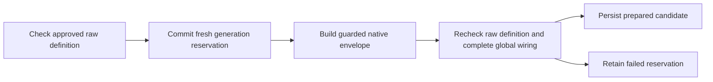

# Prepare a protected model definition

The internal factory prepares one key-free native model candidate. It first uses
the existing strict validator to read the approved raw `personal` OpenAI or
Anthropic definition. This is a schema, address and current-approval check; it
does not send a provider request or validate a submitted key.

`DjangoNativeDefinitionFactory` requires that validator, the complete expected
native configuration, and a fresh server-side wiring reader. It compares the
whole configuration, including fields unrelated to the generation header, and
stores only its digest. The expected configuration is trusted service input;
equality does not prove that its routes enforce policy. Native acceptance must
establish that separately.
`require_current` checks a fresh snapshot; it grants no lease across a later
native write. A publisher will need its own conflict and final-readback checks.

| Case | Required result |
| --- | --- |
| Prepare a supported current raw model | Persist separate raw fingerprint, envelope digest and wiring digest; return no key. |
| Raw model is unapproved, changed, already guarded or has provider authentication | Refuse before reserving a generation. |
| Entry, selected callback, private binding or other global configuration changes | Refuse preparation and current-candidate checks. |
| Preparation fails after reservation | Keep a failed record; keep any previous valid candidate unchanged. |
| Another attempt tries the same generation | Refuse, including failed or retired records. |
| Replace, retire, recreate or roll back a controlled definition | Allocate a fresh generation; old candidates never become prepared again. |
| Caller wraps a generation change in a transaction | Refuse before a reservation can escape and later roll back. |
| Restart with the same database | Read committed candidates and retained history. |
| Caller changes a returned envelope | Reject it without changing the stored candidate. |

Run `python -m pytest tests/integration/test_definition_generation_factory.py`.
The restart case also reads the committed SQLite records from a fresh process;
the migration case preserves existing model approval records.

The [internal publisher](definition-publication-cases.md) can consume a candidate;
no route, registrar, key store or provider dispatch uses this factory yet.
`prepared` means ready for a separate native acceptance trial, not authorized
traffic. Checking a candidate reads its still-raw source definition; publishing
the envelope changes the full native fingerprint/revision and needs explicit
final readback validation and new approval/key bindings. Those are not transferred.
Controlled removal must call `retire` before removing the model. Arbitrary
outside edits, restoring an older policy database, native replica acceptance,
TLS, fallback publication and release gateway selection remain separate work.
Failed/reserved/retired records are deliberately retained; there is no purge API.
