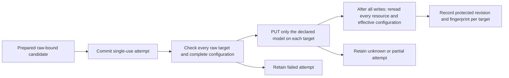

# Record one native publication attempt

`DjangoNativePublication` takes a prepared factory candidate, managed/existing
mode, every configured target and its complete trusted file and effective
configuration baselines, a primary
target, and an explicit operator-controlled model allowlist. Model approval and
client flags cannot grant control of an existing gateway resource.
The operator declares both baselines. The service refuses pre-existing API
topology drift even when the file still matches, and derives the expected final
configuration by replacing only the declared model in that trusted baseline.

Run `python -m pytest tests/integration/test_definition_publication.py`.
The same cases run in both modes, including two targets sharing one management
store. A later PUT can advance the shared revision; only the final fresh reads
are recorded as complete.

| Case | Required result |
| --- | --- |
| Complete protected value is read back from every target | Keep each protected revision/fingerprint separately from the approved raw fingerprint. |
| Approval says owned but operator did not declare control | No native write. |
| Any raw definition, file/effective baseline or prepared candidate is stale | Retain failure; no preflight write, including API policy drift with an unchanged file. |
| PUT fails or may have committed | Retain partial/unknown state; never retry or roll back automatically. |
| A final resource is missing, has an old revision, differs from the envelope, or changes other effective settings | Refuse completion. |
| Approval, candidate or wiring changes after the first PUT | Stop the remaining attempt. |
| Caller transaction could later roll back | Refuse before native contact. |
| Process/storage fails after native writes | Retain committed progress; incomplete confirmation never becomes complete. |
| A readback/error contains unexpected credential fields | Persist generic failure metadata only, never that body or exception text. |

The pinned native API has no revision/If-Match compare-and-swap. Checks are
snapshots, not leases or atomic multi-target publication. A generation gets only
one attempt, including failed preflight; recovery needs a new controlled plan.
Only the declared model resource changes; unrelated models/settings remain.

`readback_complete` means management desired-state observations. Native
`GET /api/config` reads the file and `GET /api/config/effective` materializes
stored resources; neither proves that every serving copy applied them.
The service changes no approval or key binding and returns no key. Existing
bindings stay on their old raw fingerprint. Serving-state acceptance, explicit
validation of the final protected envelope, final approval/key checks, recovery,
TLS and release gateway selection remain separate work. No route uses this
service to admit traffic.
