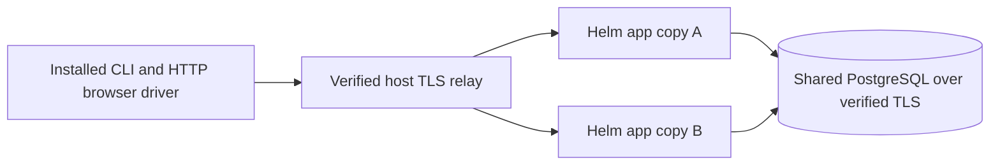

# Helm CLI sign-in across app copies

These optional cases install the actual chart in one disposable kind namespace.
Two app copies share PostgreSQL with verified TLS, separate migration/runtime
roles and one signing Secret. An installed CLI wheel reaches a verified host TLS
relay; two pod-specific port-forwards make the serving copy explicit.

| Case | Expected result |
| --- | --- |
| HELM-REPLICA-01 | Browser login on copy A works on B; refresh rotates the credential; logout on B withdraws access and refresh on both copies. |
| HELM-REPLICA-02 | Device authorization starts on A, approval/exchange finish on B, and the same cross-copy checks pass. |
| HELM-REPLICA-03 | With external migrations, the chart adds no migration hook. Missing or changed client registrations make both copies unready without modifying them. Explicit operator migration/registration restores readiness; altered metadata is refused. |

The fixture uses real HTTP sign-in, CSRF and consent forms. It does not prove a
rendered browser, ingress/load-balancer configuration, database HA or protected
model coding. The supplied gateway API is a deterministic preflight fixture;
no model call occurs. Namespace, PVC/PV and port-forwards are removed on failure.

Run `tests/integration/test_helm_cli_sign_in.py -m optional` with
`KEEPLANE_HELM_SIGN_IN_REQUIRED=1` and explicit `KEEPLANE_HELM_SIGN_IN_` values:
`SOURCE`, `IMAGE`, `IMAGE_ID`, `WHEEL`, `WHEEL_SHA256`, `KUBECONFIG`, `CONTEXT`
(`kind-keeplane-netpol`) and `HELM`. Use a fresh image built from the reviewed
Helm/readiness source with the optional PostgreSQL sign-in target, and an existing
wheel. The fixture downloads nothing. Set `KEEPLANE_TEST_REPORT_DIR` to a fresh
directory outside Git; the report records source/image pins and safe outcomes.

