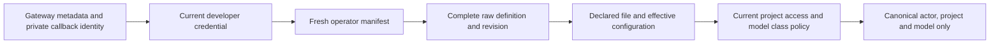

# Authorize an explicitly installed model

Run `python -m pytest tests/integration/test_installed_runtime.py`.
These are HTTP/database checks of the private server gate, with a synthetic
management reader. They do not install a native listener or prove serving state.

Both `POST /internal/runtime/installed/entry` and
`POST /internal/runtime/installed/selected` require the current Bearer credential
and private gateway callback key. Entry accepts only `project_id` and `model_id`.
Selected also requires a constant `definition_fingerprint` from its installed
native policy. The returned metadata contains no key, filename or fingerprint.

| Case | Expected result |
| --- | --- |
| Both stages match current enrollment, identity and project policy | Return canonical metadata; leave raw native resources unchanged. |
| Manifest is absent, disabled, malformed, oversized, writable by others or a symbolic link | Deny before gateway reads. |
| Approved model is absent from the exact installed list | Deny, including outside models, file models and virtual/wildcard aliases. |
| Resource, revision, approval, key choice or either complete configuration changes | Deny. |
| Operator enrolls a newer revision but the selected overlay still carries the old fingerprint | Entry may succeed; the old selected overlay denies. |
| Shared key disappears, changes content/name or becomes a symbolic link | Deny; do not return the key. |
| Project class changes or the developer signs out | Apply the new policy on the next request. |
| Client adds prompt, authority fields or a forged fingerprint header | Refuse unexpected metadata; ignore the header. |

This bounded gate does not accept personal provider keys or publish configuration.
The actual managed installation must prove applied guards before enabling its
operator declaration. No compare-and-swap or in-flight revocation is claimed.
