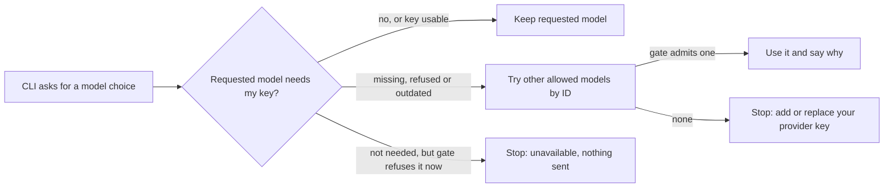

# Use another allowed model when my own key is missing

Spec 004 ST11 “No key yet” and “Replace or remove my key”; Spec 005 ST19
project classes (MC-07, MC-08, MC-18 to MC-21). Run
`python -m pytest tests/integration/test_model_choice.py tests/unit/test_cli_project_profile.py`.

| Case | Situation | Expected result |
| --- | --- | --- |
| MC-01 | The developer's own key for the requested model is added and current | The requested model is kept; no notice is shown. |
| MC-02 | No key was ever added | The first other allowed model by ID is chosen with reason `missing`. The gateway admits that model; the original model still returns “Add or replace your provider key”. |
| MC-03 | The key is removed, then added again | The next task moves to another model; after adding a key the next task uses the requested model again. |
| MC-04 | The key was refused by an explicit check, or saved for an earlier model definition | The task moves with reason `refused` or `outdated`, matching the key resolver, which would not use that key. |
| MC-05 | Only another developer has a key | That key does not count. |
| MC-06 | No other allowed model exists | `model_id` is `null`; the CLI stops before the runtime with “Add or replace your provider key: … no other allowed model is available for this project.” |
| MC-07 | The only other model is for another class, set up but not installed, listed only by the gateway, needs a missing own key, or lost its shared key file | It is never chosen. |
| MC-08 | Two other models are allowed | The one with the lower model ID is chosen; withdrawing its class approval moves the choice to the next. |
| MC-09 | The requested model needs no own key | It is kept unchanged. |
| MC-10 | Existing-gateway mode | Candidates pass that mode's shared-key check, which never admits a Personal model. |
| MC-11 | Responses | No key, key file name, fingerprint, session or directory appears. |
| MC-12 | Missing or extra query fields, an empty or unallowed model, invalid session, unknown project, policy outage | 400, 403, 401, 403 and 503 with no choice. |
| MC-13 | CLI receives a fallback | The runtime starts with the other model; stderr explains why and shows `keeplane keys set --model <model>`, with credentials omitted. |
| MC-14 | CLI receives a choice outside the allowed catalog or a malformed choice | The runtime never starts. |
| MC-15 | Older server without the route (404) | The CLI keeps the requested model; the gateway still refuses a missing key. A 403 or 503 stops before the runtime. |
| MC-16 | Spec 004 ST23: a model added outside Keeplane is removed from Keeplane | It stays in the gateway but is never chosen; the gateway entry check refuses it. Removing the last other model leaves `model_id` `null`. |
| MC-17 | The shared fallback filter is asked again with every model already tried | Each call returns the next permitted model by ID, then `null`. A requested model with a usable own key is itself a candidate; without one it is not. |
| MC-18 | Spec 005 ST19: the requested model is approved for the project's class but not installed, or its shared key file is gone, while a model for another class is up | `model_id` is `null` with reason `unavailable`; nothing moves to another model and the gateway refuses both models. |
| MC-19 | Every model approved for the class is down (own key missing, shared key gone) and only a model for another class is up | Each request gets no model; the other-class model is refused with 403. |
| MC-20 | A developer, a repository setting or a hand-made request names a model approved only for another class | The choice returns 403 and the gateway entry check refuses it; the project's own model still works. |
| MC-21 | The project's class is cleared | A model approved for any class is kept, chosen as a fallback and admitted by the gateway. |

The server cases use real Django accounts, policy, enrollment files and
owner-key registrations with synthetic provider admission, as in the
[managed Personal model access cases](installed-personal-runtime-cases.md).
The choice reads registration metadata only; it never reads a key file. The CLI
cases use a synthetic account server and a controlled runtime process.

