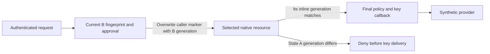

# Stop stale model definitions before key delivery

This controlled trial uses one authenticated actor and two native gateway copies.
Both serve the same model ID and provider endpoint, but A retains old model
parameters/revision while the current approval and server-held key bind to B.
The separate [actor-key check](native-actor-provider-key-cases.md) covers two actors.

Each model update gets a new random marker, called its publication generation.
The entry callback checks the current complete definition fingerprint, including
its native revision, and returns that generation. It overwrites
any caller-supplied generation. Each selected native model resource contains an
inline `Require` rule for its own generation; that rule runs before the final
key callback. A stale selected resource therefore stops before receiving a key.
The final callback rechecks current registry, approval and key binding.
This single-model fixture accepts only `private`; a modified client cannot use
the protected listener to reach an unrelated model preserved in native config.



Native model authorization also filters discovery. The inline rule permits
only the exact provider-free `GET /v1/models` read without a generation, so
the real Django policy can discover the current approved model. Inference
still requires its matching generation. This exception is part of the full
definition fingerprint, and keeps management and direct listeners private.

| Control | Expected result |
| --- | --- |
| Current B, with a forged old generation header | B answers using its bound key; the forged header is overwritten. |
| Modified client selects an unrelated customer model | Denied at entry with zero key callbacks or provider calls. |
| Stale A while approval/key target B | Denied before the final key callback and provider contact. |
| Outside edit to B without renewed approval | Its changed fingerprint denies before key delivery. |
| Publisher tries to reuse a generation | Rejected before changing native configuration or keys. |

An intentionally unsafe private control bypasses the last rule: stale A answers
using the key bound to current B. Its expected-denial failure stays outside Git.
A reused generation cannot attest which full definition was selected.
Generation identity must never be recycled on edits, deletion or name
reuse. This is a controlled publisher boundary, not native self-attestation of
arbitrary gateway definitions or a production admission implementation.

The fixture checks applied native configuration using provider-free private
reads, then sends each task once. Keys remain synthetic and server-held;
reports contain contact names, revisions and booleans only. Unrelated existing
configuration remains intact. Use the [native prerequisites](native-runtime-authorization-cases.md):

```sh
python -m pytest tests/integration/test_native_definition_binding.py -m live -q
```

The publisher, generation ledger and key map are disposable test code. No
production policy publication, durable generation lifecycle, distributed update
protocol, customer-gateway contract, TLS or release gateway selection is claimed.
An existing key validated against a raw definition cannot transfer automatically
to this changed policy envelope; its complete final readback needs validation.
