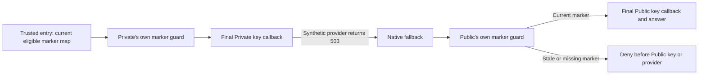

# Keep fallback bound to each model definition

A fallback needs a separate publication marker for each candidate. This
disposable check uses one authenticated actor, one Django authorizer and two
fixed models on two native gateway copies. The trusted
entry callback overwrites the caller's header with a JSON map of current markers,
at most 256 bytes. It includes only models currently eligible for the canonical
project, with matching complete definition/revision, approval and synthetic key
bindings. A missing or changed binding cannot borrow another model's marker.

The pinned gateway copies each model's inline policies into its failover
candidate. Each candidate's `Require` checks its own marker before the final key
callback. That callback checks the selected model's current binding again.
The map and developer/project/workload headers are removed before provider
contact; the provider receives only the synthetic server-selected credential.



| Control | Expected result |
| --- | --- |
| Modified client selects an unrelated model and forges the alias header | Entry rejects it with zero key callbacks or provider contact. |
| Current Private fails, current Public is allowed | Both final callbacks run; Public answers. |
| Same first candidate, stale Public on the other serving copy | Only Private gets a key or provider call; stale Public is denied. |
| Authorizer emits an empty, malformed or oversized map | Denied before any next key callback/provider, even with a forged correct client map. |
| Authorizer recovers | Current Public answers again. |
| Public approval is withdrawn, or its definition is edited outside Keeplane | Public is omitted from the trusted map and denied before its key callback/provider. |
| Publisher tries to reuse either model's generation | Refused before publication. |

After each copy's first Private 503, native test health policy evicts it for
600 seconds. Later map/withdrawal controls therefore select Public directly.
The outside-edit publication rebuilds the virtual backend, so that final control
allows one fresh Private 503 and still requires zero Public callbacks or calls.
The exact contact counts enforce this setup. A configured 500 ms retry backoff
lets the native health worker apply the initial eviction. Authorization denials
are not retried. The only generation-free exception remains exact,
provider-free `GET /v1/models`, so Django can read the model catalog.
The gateway derives the requested alias from the actual body for its private
entry check, overwriting the caller's alias header; only `fallback` is accepted.

Use the [native prerequisites](native-runtime-authorization-cases.md):

```sh
python -m pytest tests/integration/test_native_fallback_definition_binding.py -m live -q
```

This fixed map and test publisher are not a production header protocol, durable
generation lifecycle or personal-key admission implementation. One synthetic
provider key is bound to both definitions; per-model key selection is not tested
here. The gateway does
not attest arbitrary definitions: the [single-model control](native-definition-binding-cases.md)
retains the unsafe reused-generation failure. Real validation of the exact final
policy envelope is still required. Larger candidate sets, other routing forms,
TLS, production publication and release gateway selection remain open.
These tests keep the native callback configuration fixed. A model's fingerprint
does not detect edits to those global policies.
Reports contain status, model labels and booleans only, and stay outside Git.
