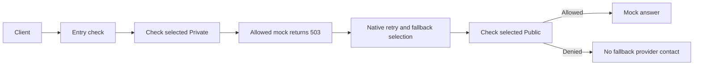

# Authorize each fallback model

This disposable native trial uses a fixed two-model alias. The approved Private
model deliberately returns 503. A native retry with an explicit 500 ms backoff
then selects Public. Keeplane
checks the actual selected model before either provider receives the task.
The alias and its first candidate are explicit test setup, not a product routing
rule or virtual-model approval contract.

| Fallback target | Expected result |
| --- | --- |
| Approved for the project's class, with a usable shared key | Public answers after both selected-model checks. |
| Approved only for a different class | No task reaches Public. |
| Approval withdrawn | No task reaches Public. |
| Its own shared-key file removed after native loading | No task reaches Public, even with native last-known configuration. |

Every case runs in managed and existing-gateway modes with real Django records,
synthetic keys and local mocks. Provider contact and key use are recorded as
model names and booleans only. Developer sessions and Keeplane context headers
never reach either provider. Unrelated native configuration stays intact.

Before sending the task, the fixture waits up to ten seconds for `/v1/models`
to list its active concrete models and fallback alias. This read does not contact
a provider or consume Private's deliberate 503. The task itself is sent once.
Safe status, selected-model decisions and provider-contact observations are saved
before assertions, so a failure keeps its diagnostics. The report marks a pass
only after every assertion succeeds; it contains no credentials or task content.

Native eviction runs asynchronously. A preserved check without backoff selected
Private twice and returned 503 even though every authorization check allowed it.
This fixture tests fallback with the configured backoff; immediate fallback is
not guaranteed or claimed. It keeps the same exact selected-model and provider
contact checks.

Guards attached only to `llm:model:<id>` do not protect the generated failover
backend. This pinned gateway exposes each candidate as a section of
`llm:virtual-model:fallback:0`. The fixture attaches a literal model-ID callback
to each section; the caller cannot supply that identity.



Use the [native fixture prerequisites](native-runtime-authorization-cases.md),
then run from the repository with its Python test environment:

```sh
python -m pytest tests/integration/test_native_runtime_fallback.py -m live -q
```

The fixture removes its containers, networks and temporary databases on failure.
Generated reports stay outside Git. This checks one bounded chat route and retry;
it does not install production policy or prove streaming, other retry conditions,
weighted/conditional/wildcard routing, cache paths, fallback across replicas,
TLS, Kubernetes or customer key-delivery APIs. The release gateway stays open.
