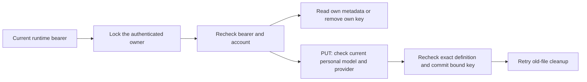

# Check runtime provider-key management

Run `python -m pytest tests/integration/test_runtime_provider_keys.py`.
These HTTP checks use actual Django accounts/sessions, the bound key store and
synthetic loopback responses. They use no paid provider or live preview.

| Case | Required result |
| --- | --- |
| Two owners add/replace/remove keys for the same model | Each sees and changes only their own registration; admin role gives no cross-owner access. |
| Cookie, expired or invalid bearer | 401; zero provider calls and no key writes. |
| Logout, password change, disable or removal after initial HTTP authentication | Fresh owner-lock recheck rejects the stale request before provider contact. |
| Injected JSON parser recursion failure with a body below 4 KiB | Generic 400 with zero provider/gateway contact and no key write. |
| Extra owner/file/fingerprint fields, duplicate JSON, invalid keys or large body | Generic refusal with zero provider contact. |
| Raw definition changes before replacement | No old binding is transferred or invalid replacement saved. |
| Model is withdrawn or key binding is old/unbound | GET still shows own metadata; DELETE remains usable without gateway contact. |
| Provider refuses or verification/storage fails | Previous key remains; response contains no secret or internal metadata. |
| Cleanup/status confirmation fails after commit | 503 can follow a committed replacement; GET safely reports stored registration. |
| Old-file deletion fails | Metadata reports pending cleanup; a later DELETE retries it. |
| Installation uses non-loopback plain HTTP | Runtime admission is refused. |

The owner lock covers the live bearer check, bounded provider validation and
key commit. Native logout takes the same lock; password/activity changes and
account removal already serialize on that owner. Storage owns its durable
transaction; the HTTP handler adds no enclosing write transaction.
These endpoints do not select keys for task dispatch.
